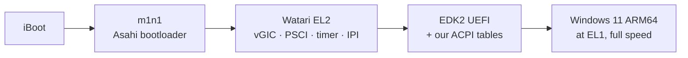

# Watari Boot

**渡 (watari): to cross over, to pass from one shore to the other.**

> **Watari Boot: Native Windows on Apple Silicon**: an open research project to dual-boot Windows 11 ARM64 on Apple Silicon Macs, starting from the M1.

> [!WARNING]
> **This does not work on a real Mac yet.** Watari Boot is an early-stage research project. Everything below runs in **QEMU** on a Mac; nothing here touches your Mac's disk or boot configuration. Do not expect a usable Windows install on Apple Silicon from this repository today.

## What we are trying to do

Boot **Windows 11 ARM64 directly on an Apple Silicon Mac**, chosen at power-on like any other OS, with **no macOS running underneath** and no virtual machine like Parallels or UTM. The cores should run Windows at full speed, and Windows should drive the real hardware.

It is hard for one main reason: Windows on Arm expects a standard Arm platform (a **GIC** interrupt controller, **PSCI**, ACPI), while Apple Silicon uses Apple's own interrupt controller (**AIC**), delivers its timer as **FIQ**, and documents nothing. Asahi Linux solved this for Linux by changing Linux. We cannot change Windows.

## How (Plan B: a minimal EL2 layer)

We first tried a **purely native** route: teaching Windows about the Apple hardware through its official extension points (HAL extensions, ACPI tables). Our experiments closed that route: Windows insists on a real GIC ([docs/FAILURES.md](docs/FAILURES.md), F-14), and the HAL-extension interface for custom interrupt controllers no longer exists (F-05).

So Watari Boot now builds a **minimal EL2 layer**, "Watari EL2", that sits below Windows and only does what Windows cannot do without:



- a **virtual GICv3**: the distributor/redistributor are emulated, the CPU interface uses the M1's hardware GIC virtualization (the same hardware Linux KVM uses on M1);
- **PSCI** to start the cores;
- the **timer FIQ** turned into a normal virtual interrupt;
- **IPIs** translated to Apple's mechanism.

Everything else stays native: cores, memory, and real peripherals (which still need Windows drivers). Design: [docs/design/watari-el2/](docs/design/watari-el2/) · decision: [docs/adr/draft-plan-b-el2-layer.md](docs/adr/draft-plan-b-el2-layer.md).

## Where we are

| Milestone | Result |
|---|---|
| Phase 0: research (11 studies on Windows ARM64, ACPI, M1 interrupts and timers, prior art) | ✅ done, in [re/](re/) |
| QEMU bench: our own EDK2 build, Windows 11 ARM64 unattended install, Apple HVF acceleration | ✅ works (we had to fix an EDK2/HVF GIC detection issue, F-08) |
| **V1**: Windows boots with ACPI tables generated by us (`tools/acpigen`) | ✅ works |
| **V2**: Windows without a GIC distributor in the tables | ❌ Windows requires it, so the pure native route is closed |
| **V3**: secondary cores via Microsoft's parking protocol, no PSCI | ⚠️ Windows uses it, then fails with `HAL_INITIALIZATION_FAILED` |
| **V6**: timer delivered as FIQ | ⚠️ inconclusive |
| Watari EL2: design | ✅ done |
| Watari EL2: **M0** (first spike: vGIC host tests, layer boots in QEMU) | ⏭️ next |

Current state and next steps: [docs/STATUS.md](docs/STATUS.md). Estimated time to Windows on a real M1 (lock screen, framebuffer, USB): months, not weeks.

## Failures are part of the project

We document every dead end with what we tried, what happened, why, and the lesson, so the next person does not repeat it: **[docs/FAILURES.md](docs/FAILURES.md)**.

## Try the QEMU bench

Requirements: an Apple Silicon Mac, Homebrew, plenty of disk space (we keep 75–115 GB of data on an external disk), and an official Windows 11 ARM64 ISO from Microsoft. Everything the project installs is listed in [docs/INSTALLED.md](docs/INSTALLED.md) and can be removed with `tools/uninstall-watari.sh`.

```sh
make -C tools/acpigen test          # host tests of the ACPI table generator
tools/build-edk2.sh                 # EDK2 ArmVirtQemu with our HVF fix
tools/run-qemu-windows.sh           # Windows 11 ARM64 in QEMU (window)
tools/build-edk2-watari.sh          # our EDK2 platform (WatariAcpiOverride, …)
```

Paths, options and caveats: [tools/](tools/) and the [plan](docs/PLAN.md).

## Repository map

| Path | What |
|---|---|
| [re/](re/) | research notes (Windows ARM64 HAL, interrupts, M1 FIQ/timer, prior art, Plan B feasibility) |
| [docs/](docs/) | plan, status, session diaries, ADRs, designs, failures |
| [edk2-apple/WatariQemuPkg/](edk2-apple/WatariQemuPkg/) | our EDK2 drivers (ACPI override, timer-as-FIQ experiment, parking protocol) |
| [tools/](tools/) | `acpigen` (ACPI table generator + tests), build and QEMU scripts, unattended install |
| [ralph/](ralph/) | prompts and logs of the autonomous agent loops |

## How this is built

Watari Boot is developed by a small team with AI agents doing much of the research and implementation: Claude Opus plans and verifies, Claude Sonnet agents execute, and long tasks run in autonomous "Ralph" loops (see [CLAUDE.md](CLAUDE.md) and [ralph/](ralph/)). Every technical claim in the docs is marked **verified** (with its source) or **hypothesis**. For transparency, the cost of this work is tracked below; each contributor updates their own share with `python3 -I tools/token-usage.py --autore <name>`.

## Tokens and costs
<!-- TOKEN-COUNTER:START -->
**Total tokens: 278,420,460 · Estimated cost: $120.33** (updated 2026-10-15; marco: 6 sessions, $120.33)

| Model | Input | Output | Cache written | Cache read | Estimated cost |
|---|---:|---:|---:|---:|---:|
| `claude-haiku-5-5` | 24 | 65 | 158,646 | 589,435 | $0.03 |
| `claude-opus-5-5` | 1,068 | 430,026 | 5,072,367 | 183,987,047 | $85.98 |
| `claude-sonnet-5-5` | 1,692 | 390,910 | 5,398,387 | 82,390,793 | $34.32 |

<sub>Estimate at Anthropic API prices, computed from local Claude Code transcripts with `tools/token-usage.py`. With a subscription (Pro/Max) the real cost is the subscription fee: this is the equivalent pay-as-you-go cost. Subagent output may be under-reported in the logs.</sub>
<!-- TOKEN-COUNTER:END -->

## Contributing

Issues and pull requests are welcome, especially from people who know the Windows ARM64 boot process, GICv3, or Apple Silicon. Read [docs/CONTRIBUTING.md](docs/CONTRIBUTING.md) first. Please do not submit Microsoft binaries or disassembled Microsoft code.

## Credits

This project would not exist without the work of others, above all **[Asahi Linux](https://asahilinux.org/)** (m1n1, the Linux drivers and the hardware documentation that make Apple Silicon understandable), **TianoCore EDK2**, **QEMU**, and the pioneering **[NT for Apple Silicon](https://github.com/NT-for-ASi)** project. Full list, with what each one taught us: **[CREDITS.md](CREDITS.md)**.

## Legal

- Licensed under the [MIT License](LICENSE); files with a different `SPDX-License-Identifier` (e.g. the EDK2 drivers, `BSD-2-Clause-Patent`) follow that license.
- Not affiliated with, endorsed by, or sponsored by Apple, Microsoft, Arm, or the Asahi Linux project. Apple, Apple Silicon and Mac are trademarks of Apple Inc.; Windows is a trademark of Microsoft Corporation; Arm is a trademark of Arm Limited.
- This repository contains **no Microsoft code or binaries**, and we do not disassemble Microsoft software. You need your own legitimate copy of Windows.

## Why this exists

Over the last year I watched AI agents rebuild apps, clone games, and recreate whole products from scratch: work that used to take teams and years, done in days. Then I looked at the Mac on my desk. Running Windows natively on Apple Silicon is the kind of problem everyone calls impossible: neither Apple nor Microsoft wants it, the hardware is undocumented, and it needs reverse engineering on the scale of Asahi Linux.

If AI really changes what a small team can build, this was the test I had to try. Maybe it fails. If it does, the failures are written down here, so the next person starts further ahead. Maybe it doesn't.

— **Marco** ([@ZonatedCord](https://github.com/ZonatedCord)), creator of Watari Boot
