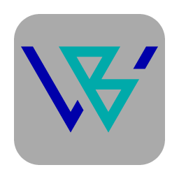
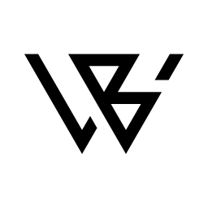

<!-- SPDX-License-Identifier: MIT -->
# Watari Boot logo

The W-B mark was drawn by hand by Marco. This folder holds its exact construction: every vertex sits on an equilateral-triangle lattice, and every measure follows from two numbers.

 

## Files

| File | What it is |
|---|---|
| `build.py` | The construction. It checks every rule below, then writes the SVGs and `geometry.json`. |
| `geometry.json` | Parameters, colours and every vertex, in lattice units and in canvas pixels. |
| `watari-boot-icon.svg` | Colour icon: grey plate with the mark. |
| `watari-boot-icon-mono.svg` | Black-and-white icon: white plate, black mark. |
| `watari-boot-mark.svg`, `watari-boot-mark-mono.svg` | The mark alone, on a transparent background. |
| `png/` | The two icons at 1024, 512, 256, 64, 32 and 16 px. |
| `watari-boot-logo.vectorcraft` | The VectorCraft working file, with the layers `Colori`, `Forma` and `Ricalco originale` (the hand drawing, traced). |

To regenerate everything after changing `T` or `a`:

```bash
python3 -I docs/brand/build.py --tables
```

The PNGs are rendered from the SVGs with `vectorcraft-cli convert <svg> <png> --scale <size/1024>`.

## The lattice

All edges run at 0°, 60° or 120°. The drawing therefore lives on a skew lattice with module `v`:

```
x = X0 + (i + j/2) · v
y = Y0 + j · (√3/2) · v
```

- An edge at **60°** keeps `i` constant.
- An edge at **120°** keeps `i + j` constant.
- A **horizontal** edge keeps `j` constant.

`j` counts lattice rows, from the top of the mark (0) to its baseline (50).

## Parameters

| Symbol | Value | Meaning |
|---|---|---|
| **T** | 6 | Stroke thickness, measured along a row. The same everywhere: diagonals, horizontal bars and gaps. |
| **a** | 13 | Small side: B counters, W short arm, accent length, plate corner radius. |

Everything else is derived:

| Measure | Formula | Value |
|---|---|---|
| Side of each B bowl | a + 3T | 31 |
| Offset of the lower bowl, left edge of the B | a + T | 19 |
| Mark height | 2a + 4T | 50 rows |
| Mark width | 2(a + T) + (a + 3T) | 69 modules |
| Plate side | 4(a + T) | 76 modules |
| Plate corner radius | a | 13 modules |

On the 1024 px canvas the plate is 864 px, so `v = 864 / 76 = 11.368 px` and a row is `9.845 px`. The mark and the plate are both centred on the canvas.

## Construction rules

1. **The B** is the union of two congruent equilateral triangles of side 31. The lower one is the upper one moved down 19 rows. Each has an equilateral counter of side 13, inset by T on all three sides.
2. **The W** is two V shapes. The first is drawn on its own: a long arm (band `0 ≤ i ≤ 6`) and a short arm (band `44 ≤ i + j ≤ 50`) that stops at `i = 13`, one stroke before the B. The second V is formed by the B itself: its left edge and the right side of the lower bowl.
3. **Shared lines.** The short arm of the first V lies on the same band as the right side of the B's upper bowl (`44 ≤ i + j ≤ 50`).
4. **The accent** continues the right side of the B's lower bowl (band `63 ≤ i + j ≤ 69`) above it. It is `a` long and ends `T` above the bowl.
5. **Gaps** between separate parts are always `T`: W arm to B, accent to bowl, and the bar between the two counters.
6. **Centre lines** [verified: `build.py` output]. The apex of the upper counter falls on the vertical centre of the canvas (x = 512). The top edge of the lower counter falls on its horizontal centre (y = 512).

### Changes from the hand drawing

The hand drawing already fitted the lattice to within a few pixels, except in two places:
- the line between the two bowls was 1.5 rows lower, so the lower counter was smaller than the upper one;
- the accent was about 1.5 rows longer.

Both now follow the rules above.

## Colours

The palette is taken from the VGA 16-colour palette, the colours of classic BIOS setup screens.

| Role | Hex | RGB | VGA index |
|---|---|---|---|
| Plate | `#AAAAAA` | 170, 170, 170 | 7, light grey |
| W and accent | `#0000AA` | 0, 0, 170 | 1, blue: the Windows side |
| B | `#00AAAA` | 0, 170, 170 | 3, cyan: blue + white (Apple) |
| Background (outside the plate, VectorCraft file only) | `#000000` | 0, 0, 0 | 0, black |
| Spare | `#55FFFF` | 85, 255, 255 | 11, light cyan |
| Spare | `#FFFFFF` | 255, 255, 255 | 15, white |

The mono version uses black `#000000` for the mark on a white `#FFFFFF` plate.

## Vertices

Generated by `build.py --tables`. Canvas coordinates are for the 1024 × 1024 canvas, with y pointing down.

| Shape | Vertex | Lattice (i, j) | Canvas px (x, y) |
|---|---|---|---|
| W | 1 | (0, 0) | (119.789, 265.866) |
| W | 2 | (6, 0) | (188.000, 265.866) |
| W | 3 | (6, 38) | (404.000, 639.989) |
| W | 4 | (13, 31) | (443.789, 571.072) |
| W | 5 | (13, 37) | (477.895, 630.144) |
| W | 6 | (0, 50) | (404.000, 758.134) |
| B | 1 | (19, 0) | (335.789, 265.866) |
| B | 2 | (50, 0) | (688.211, 265.866) |
| B | 3 | (31, 19) | (580.211, 452.928) |
| B | 4 | (50, 19) | (796.211, 452.928) |
| B | 5 | (19, 50) | (620.000, 758.134) |
| B counter 1 | 1 | (25, 6) | (438.105, 324.939) |
| B counter 1 | 2 | (38, 6) | (585.895, 324.939) |
| B counter 1 | 3 | (25, 19) | (512.000, 452.928) |
| B counter 2 | 1 | (25, 25) | (546.105, 512.000) |
| B counter 2 | 2 | (38, 25) | (693.895, 512.000) |
| B counter 2 | 3 | (25, 38) | (620.000, 639.989) |
| accent | 1 | (63, 0) | (836.000, 265.866) |
| accent | 2 | (69, 0) | (904.211, 265.866) |
| accent | 3 | (56, 13) | (830.316, 393.856) |
| accent | 4 | (50, 13) | (762.105, 393.856) |

Plate: x = y = 80, side 864, corner radius 147.789 px.
