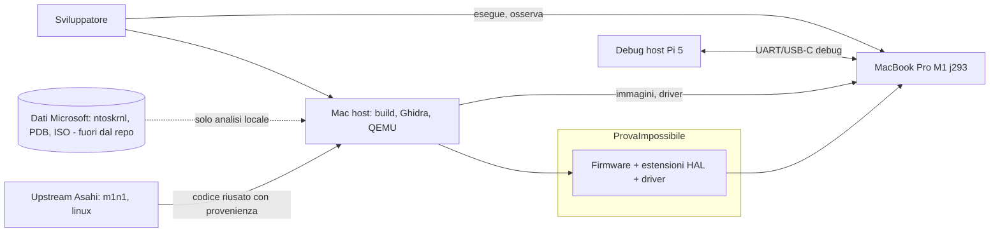
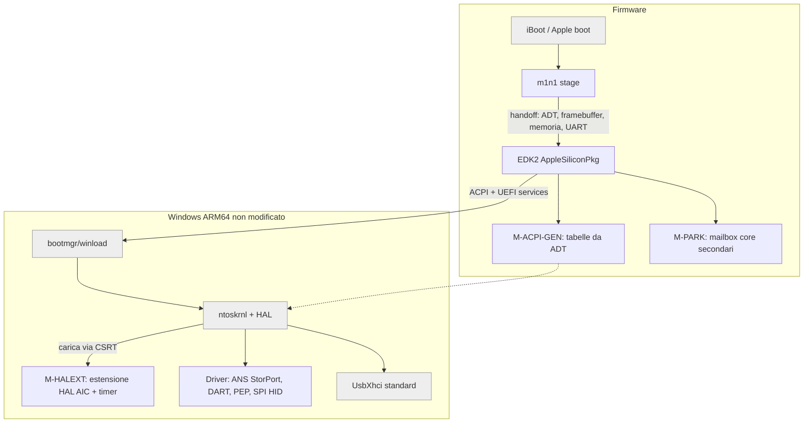
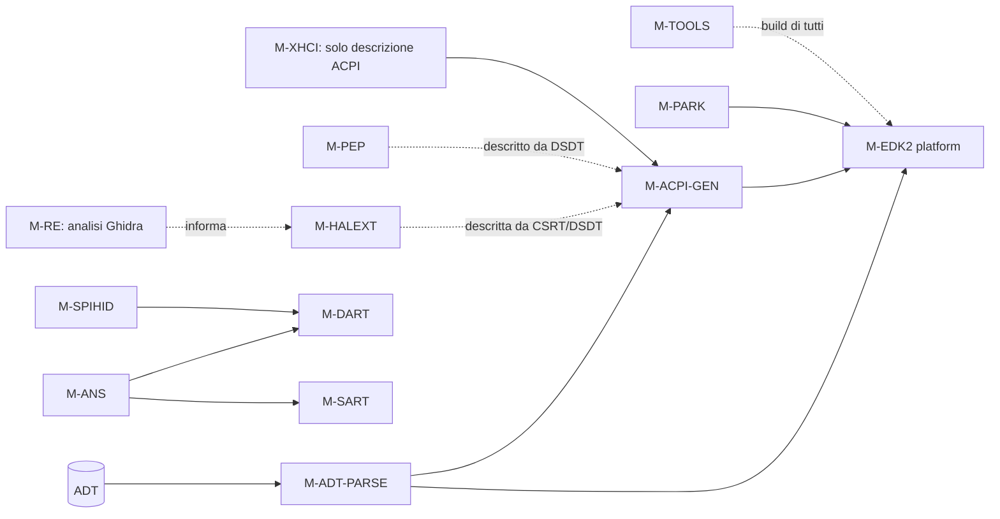
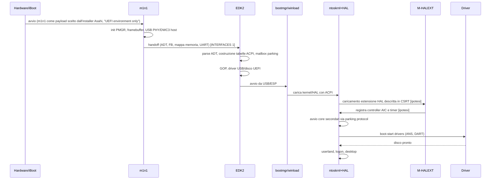
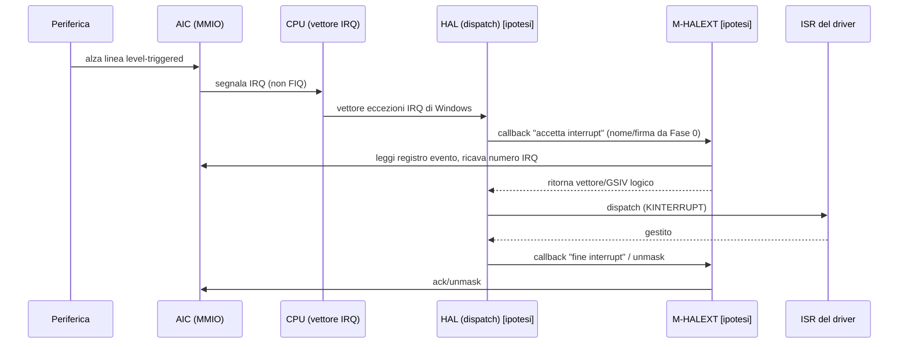

# ARCHITECTURE: ProvaImpossibile

- Progetto: ProvaImpossibile · Data: 2026-10-12 · Versione: 0.1 · Stato: draft
- Documenti collegati: [PRD](PRD.md) · [INTERFACES](INTERFACES.md) · [TEST_STRATEGY](TEST_STRATEGY.md) · [RISKS](RISKS.md)
- Marcatura: `[verificato: fonte]` / `[ipotesi]`. Tutto cio' che descrive il comportamento interno di Windows e' `[ipotesi]` fino alla conclusione della Fase 0.

## 1. Fatti di base usati
- [verificato: https://codebrowser.dev/linux/linux/arch/arm64/kernel/acpi_parking_protocol.c.html] Il parking protocol usa una mailbox per CPU con `cpu_id` (32 bit, atteso 0xFFFFFFFF finche' non rilasciata), `reserved` e `entry_point` (64 bit); l'OS scrive entry point, poi cpu_id, poi invia un IPI di risveglio.
- [verificato: sorgente `drivers/irqchip/irq-apple-aic.c` di Linux, es. https://gbmc.googlesource.com/linux/+/refs/heads/master/drivers/irqchip/irq-apple-aic.c] L'AIC ha 896 IRQ hardware level-triggered con mask e affinity per IRQ e due IPI per CPU; le FIQ sono usate per timer ARM, Fast IPI (e performance counter) verso client hard-wired.
- [verificato: https://learn.microsoft.com/en-us/windows-hardware/test/hlk/testref/de119483-e85e-4f19-ba05-202a7219b43f] Esiste il concetto di HAL Extension DLL, legata a un device ACPI tramite PNP ID (esempio ACPI\MSFT_1124) e al requisito HLK System.Fundamentals.HAL.IfCSRTPresent; l'estensione viene verificata come caricata e serviceable.
- [ipotesi] Il formato di CSRT per le HAL extension, l'interfaccia (`HalExtension` exports) e la possibilita' di registrare un controller non-GIC sono da confermare in Fase 0.
- [ipotesi, dal piano] Il M1 non ha EL3/PSCI; il SoC e' t8103, board j293; l'SSD e' ANS2 non su PCIe.

## 2. Vista C4

### 2.1 Context

### 2.2 Container (componenti di sistema)

### 2.3 Component (moduli e dipendenze)

Il grafo e' aciclico: le frecce tratteggiate sono dipendenze di descrizione/documentazione, non di link.

## 3. Moduli
| Modulo | Responsabilita' singola | Interfaccia pubblica | Dipende da |
|---|---|---|---|
| M-RE | Produrre conoscenza verificata su HAL/ntoskrnl (solo documenti) | Report in `re/` (INTERFACES, sez. IPOTESI) | nessuno |
| M-ADT-PARSE | Leggere l'ADT consegnato da m1n1 e produrre un modello dati di piattaforma | `AdtGet*` (INTERFACES 2) | nessuno |
| M-ACPI-GEN | Generare tabelle ACPI dal modello dati | `AcpiGenBuildAll()` | M-ADT-PARSE |
| M-PARK | Inizializzare le mailbox del parking protocol e il codice di parcheggio | Layout mailbox (INTERFACES 4) | M-ADT-PARSE |
| M-EDK2 | Piattaforma UEFI: memoria, GOP, console, avvio di bootmgr | UEFI + protocollo ACPI | M-ADT-PARSE, M-ACPI-GEN, M-PARK |
| M-HALEXT | Fornire a Windows l'AIC come controller di interrupt e il timer IRQ | Interfaccia estensione HAL (IPOTESI) | niente a link-time (carico dinamico) |
| M-ANS | Esporre l'SSD ANS2 come disco StorPort | Miniport StorPort | M-DART, M-SART |
| M-SART | Programmare le regioni SART dell'SSD | `SartMapRegion()` | nessuno |
| M-DART | Gestire IOMMU (bypass o mappature) | `DartMap()/DartBypass()` | nessuno |
| M-XHCI | Descrivere in ACPI il controller xHCI (nessun codice Windows nostro) | Nodo DSDT | M-ACPI-GEN |
| M-PEP | Gestione energetica e DVFS (registri PMGR) | PEP callbacks | nessuno |
| M-SPIHID | Tastiera/trackpad su SPI come HID | KMDF HID minidriver | M-DART |
| M-GPU | Futuro driver WDDM (non definito in dettaglio) | n/d | n/d |
| M-TOOLS | Build riproducibile, immagini, script QEMU | CLI in `tools/` | nessuno |

Nota Mantenibilita': i moduli che nel piano sono descritti in modo composto (ad es. "AIC + timer") restano due responsabilita' interne distinte (`aic_controller`, `irq_timer`) nello stesso binario perche' Windows carica una sola estensione HAL per device ACPI [ipotesi]; la separazione e' a livello di file e interfaccia interna.

## 4. Flusso di boot dall'accensione al desktop

Dettagli per fase: in Fase 3 si arriva fino al caricamento dei driver; Fase 4 abilita disco interno e USB; Fase 5 PEP e periferiche interne.

## 5. Flusso di un interrupt AIC -> estensione HAL -> ISR
Tutto l'interno di Windows e' `[ipotesi]`.

Punti aperti: [ipotesi] la lettura dell'evento puo' avvenire nel HAL e non nell'estensione; Fase 0 determina chi fa cosa. [verificato: irq-apple-aic.c] l'AIC espone registro evento e registri di mask/set/clear per IRQ e IPI.

## 6. Confini e contratti
- m1n1 -> EDK2: solo dati (INTERFACES 1). EDK2 non richiama m1n1 dopo l'handoff.
- EDK2 -> Windows: standard UEFI + ACPI; nessun protocollo privato oltre CSRT/DSDT.
- Windows -> estensioni/driver: solo interfacce WDK documentate. [ipotesi] Se Fase 0 mostra che serve un'interfaccia non documentata, la decisione va all'utente (ADR-0001, piano B).
- Modulo -> modello dati ADT: nessun modulo legge l'ADT direttamente salvo M-ADT-PARSE.

## 7. Punti di estensione espliciti
1. Nuovo SoC: aggiungere una tabella dati in M-ADT-PARSE/M-ACPI-GEN (nomi compatible ADT -> blocchi ACPI); nessuna modifica ai moduli esistenti. AIC2 aggiunge un back-end `aic_controller` dietro la stessa interfaccia interna (Fase 6).
2. Nuovo dispositivo: un nuovo nodo DSDT generato da una voce di registro `DeviceDescriptor` + nuovo driver con il suo HID ACPI.
3. Nuovo ruolo di core (P/E, nuove classi): solo dati PPTT/efficiency class.
4. Sorgente di interrupt alternativa (es. MSI/AIC di nuove generazioni): nuovo back-end in M-HALEXT.
5. Piano B hypervisor/shim: l'interfaccia M-EDK2 -> Windows resta invariata (ACPI con GIC virtuale); cambia solo M-ACPI-GEN. [ipotesi] da valutare se si attiva il piano B.

## 8. Tracciabilita'
FR-1 M-RE · FR-2 M-ACPI-GEN/M-EDK2 · FR-3 M-PARK · FR-4 M-EDK2 · FR-5/FR-6 M-HALEXT · FR-7 M-EDK2+M-HALEXT+M-XHCI · FR-8 M-ANS/M-SART/M-DART · FR-9 M-XHCI · FR-10 M-DART · FR-11 M-PEP/M-ACPI-GEN · FR-12 M-SPIHID · FR-13 punti di estensione (2) · FR-14 M-GPU · FR-15 M-ACPI-GEN/M-HALEXT · FR-16 procedura installer. NFR-2 M-TOOLS; NFR-3/4 sezioni 6-7.
