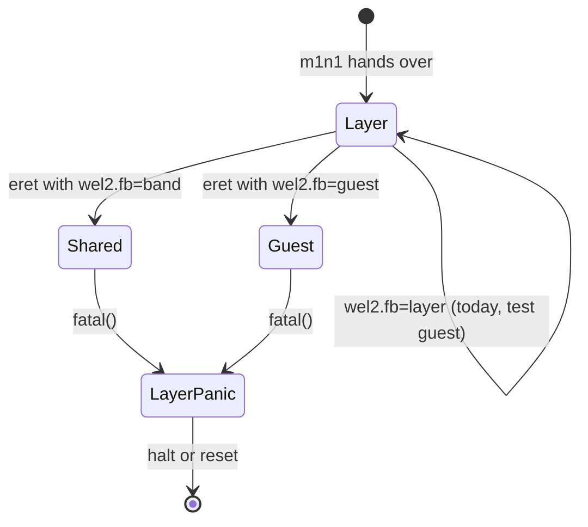

# DESIGN: EDK2 at EL1 on the real M1, on top of Watari EL2 (watari-edk2-m1)

- Project: Watari Boot, subsystem "watari-edk2-m1" (Ralph task T11) · Date: 2026-11-12 · Version: 0.1 · Status: draft
- Linked documents: [README](README.md) · [PLAN](PLAN.md) · [RISKS](RISKS.md) · [draft ADR](../../adr/draft-edk2-m1-platform.md) · parents: [watari-el2-m1boot DESIGN](../watari-el2-m1boot/DESIGN.md) (called "M1BOOT" below), [watari-el2 INTERFACES](../watari-el2/INTERFACES.md), [T7 wiring](../watari-el2-m1boot/T7-wiring.md)
- Target: 13" MacBook Pro M1 (j293, t8103), m1n1 v1.6.1, the layer of branch `ralph/m3a-night`, EDK2 `edk2-stable202608` as already present on the data disk.

## 0. Marking and sources

Every technical claim carries **[verified: source]** or **[hypothesis]**. "Verified" means read in that source on 2026-11-12 while writing this document, or measured on the machine on day 1. Nothing here was built or run by this task. No code was copied from any project; EDK2 (BSD-2-Clause-Patent) is reused as modules through the DSC, which its licence allows, and our own EDK2 code carries the same licence (CLAUDE.md, code conventions).

| Short name | Source |
|---|---|
| `E:path:lines` | the EDK2 tree at `$WATARI_DATA/src/edk2` (`edk2-stable202608` [verified: R:CLAUDE.md "Stack"], with the local patch `tools/edk2-hvf-gicv3.patch` applied). Upstream: https://github.com/tianocore/edk2/tree/edk2-stable202608/ + path. Licence BSD-2-Clause-Patent [verified: E:License.txt] |
| `MS-UEFI` | Microsoft Learn, "UEFI Requirements for Windows on SoC Platforms", https://learn.microsoft.com/en-us/windows-hardware/drivers/bringup/uefi-requirements-that-apply-to-all-windows-platforms |
| `MS-ACPI` | Microsoft Learn, "ACPI System Description Tables", https://learn.microsoft.com/en-us/windows-hardware/drivers/bringup/acpi-system-description-tables |
| `MS-NS` | Microsoft Learn, "Device Management Namespace Objects", https://learn.microsoft.com/en-us/windows-hardware/drivers/bringup/device-management-namespace-objects |
| `MS-DEV` | Microsoft Learn, "ACPI-defined Devices", https://learn.microsoft.com/en-us/windows-hardware/drivers/bringup/acpi-defined-devices |
| `MS-PE` | Microsoft Learn, "Windows PE (WinPE)", https://learn.microsoft.com/en-us/windows-hardware/manufacture/desktop/winpe-intro |
| `A:page` | Asahi Linux documentation, https://asahilinux.org/docs/ + page |
| `U:m1` | U-Boot documentation, "Apple M1", https://docs.u-boot-project.org/en/latest/board/apple/m1.html |
| `N:path` | NT-for-ASi/apple_silicon_platforms_mu, branch `main` as of 2026-11-12 (last push 2026-09-08), https://github.com/NT-for-ASi/apple_silicon_platforms_mu/blob/main/ + path. BSD-2-Clause [verified: `gh api repos/NT-for-ASi/apple_silicon_platforms_mu`] |
| `HW` | `re/m3a-ehw0-measurements.md` (measured on j293 on 2026-11-10) |
| `R:file` | a file of this repository |
| `M1BOOT n` | section n of `docs/design/watari-el2-m1boot/DESIGN.md` (whose own sources are m1n1 v1.6.1 and Linux v6.12) |

Arm ARM, GIC and UEFI/ACPI specification statements that were not re-read today are marked [hypothesis: from memory].

## 1. What is already proven, and what this design adds

- On the bench, `ArmVirtQemuKernel` (EDK2 loaded like an arm64 Linux kernel) boots at EL1 under the layer and reaches the Boot Manager; every GIC register access is a stage-2 fault served by the vGIC, the timer is PPI 27 injected by the layer, PSCI is an HVC [verified: R:el2/boot/README.md "M1-4"; R:docs/STATUS.md M1-4]. Windows then boots through it (M2) [verified: R:docs/STATUS.md M2].
- That path depends on QEMU in six places, none of which exists on the M1: the FDT QEMU generates (patched in place by `fdt_patch_for_guest`), the fixed addresses `EDK2_FDT_ADDR` and `EDK2_ENTRY`, the PL011 for EDK2's console, fw_cfg for ACPI/SMBIOS/boot order, the NOR flash for variables, and PCI/virtio for every device [verified: R:el2/boot/main.c `chain_to_edk2` and its TODO comment; E:ArmVirtPkg/ArmVirtQemuKernel.dsc].
- This design replaces each of the six, and adds the one thing the bench never had: a display owned by the layer that the guest must be able to draw on (R:el2/boot/README.md "Open design point (T11)").

## 2. Prior art: is there an EDK2 port for Apple Silicon?

| Project | What it is | Licence | Use for us |
|---|---|---|---|
| **Asahi Linux boot chain** | iBoot → m1n1 stage 1 → m1n1 stage 2 → **U-Boot** → GRUB. U-Boot "implements EFI services that hide the specifics of the platform"; it "cannot provide particularly useful EFI runtime services" and "the platform does not have an EFI variable store" [verified: A:platform/open-os-interop/]. U-Boot runs as an m1n1 payload and supports the S5L serial port, the SPI keyboard, the framebuffer, NVMe and the USB Type-C ports [verified: U:m1]. EDK2 is not mentioned on either page [verified: same pages] | U-Boot: GPL-2.0+ [hypothesis: U-Boot's well-known licence, not re-read today] | Not a base (ADR-0002 chose EDK2; Windows needs ACPI and runtime services that U-Boot does not give here). It is evidence that m1n1's FDT plus a simple-framebuffer is enough for a UEFI environment with a display. Its drivers are GPL: not to be copied |
| **NTASP `apple_silicon_platforms_mu`** | "Project Mu implementation for Apple silicon platforms (WIP)" [verified: `gh api`, repository description]. The tree has `Silicon/Apple/AppleSiliconPkg` with, among others, `PrePi`, `Drivers/SimpleFbDxe`, `Library/AppleUartSerialPortLib`, `Library/VirtualRealTimeClockLib`, `Drivers/AppleDartIoMmuDxe`, `Drivers/AppleUsbTypeCBringupDxe`, `Drivers/BootRamdiskHelperDxe`, `Drivers/SmbiosInfoDxe`, and per-SoC packages (`T810XFamilyPkg` with `Library/MemoryInitPeiLib` and ACPI tables) [verified: `gh api …/git/trees/HEAD?recursive=1`, file list] | BSD-2-Clause [verified: `gh api`] | **Reference only** (ADR-0007: independent path, nothing copied, their data used only after checking it against the DTS/ADT). Two facts taken from it: its GOP driver reports `PixelBlueGreenRedReserved8BitPerColor` unconditionally, with a comment that the simple framebuffer is 8-bit ARGB "for WoA devices" [verified: N:Silicon/Apple/AppleSiliconPkg/Drivers/SimpleFbDxe/SimpleFbDxe.c:223-229], i.e. it does not handle the 30-bit format; and it boots Windows from a RAM disk [verified: R:re/ntasp-analysis.md section 4, quoting its README] |
| **NTASP `m1n1_windows`** | m1n1 fork with a GIC emulator in its hypervisor [verified: R:re/ntasp-analysis.md section 2] | MIT (m1n1's) [verified: same] | The same architecture as Plan B, in another code base; already analysed, not reused |
| Other EDK2 ports for Apple Silicon | none found by a web search for "edk2 apple silicon / m1 uefi / Project Mu m1n1" on 2026-11-12 (the hits were Rockchip and Qualcomm ports) | — | [hypothesis: a search is not a proof of absence] |

Conclusion: there is no upstream EDK2 platform for the M1 to start from; `ArmVirtPkg` (which we already build and run) is the closest structure, because under the layer the M1 looks like a small virtual machine: a GICv3, a generic timer, PSCI, RAM, and a framebuffer.

## 3. How EDK2 is loaded

### 3.1 The chain

1. The host loader (`tools/m3a/boot_wel2.py`, M1BOOT 2.5) writes three things into RAM through the m1n1 proxy: the layer (its own 32 MB block), the **EDK2 firmware image** (its own 32 MB aligned block, image at the start of the block), the minimal DTB. It passes `wel2.guest=<address of the EDK2 image> wel2.abi=fdt wel2.fb=band` in the boot arguments, starts the secondaries, and calls `kboot_prepare_dt` + `kboot_boot` [verified as the existing design: M1BOOT 2.5; the two new arguments are this design's].
2. The layer boots as on day 2 (M1BOOT 2-7), builds the guest's stage 2 from the RAM ranges, then, instead of the test guest's info block, builds the **guest FDT** (section 4) and enters the image at EL1.
3. EDK2's PrePi starts as on the bench: the image header's first instruction records the load address, the relocatable PrePi fixes itself up, finds the memory in the FDT, copies the FDT into its own image, and continues to DXE [verified: E:ArmVirtPkg/ArmVirtQemuKernel.fdf (header `adr x1, .` / `b 0x8000`, text_offset 512 KB); E:ArmVirtPkg/PrePi/ModuleEntryPoint.S:10-20, 117-188].

### 3.2 Entry state (unchanged from the bench)

EL1h, MMU and caches off, DAIF masked, x0 = address of the guest FDT, x1-x3 = 0, the boot vCPU's redistributor awake [verified: R:el2/boot/main.c `chain_to_edk2`; R:docs/design/watari-el2/INTERFACES.md 3.1]. PrePi uses x0 as the FDT when it is non-zero and falls back to `PcdDeviceTreeInitialBaseAddress` otherwise [verified: E:ArmVirtPkg/PrePi/ModuleEntryPoint.S:12-18].

### 3.3 What `chain_to_edk2` must change for the M1

| Today (QEMU convention) | M1 (and the bench, behind `wel2.abi=fdt` + `wel2.gfdt=build`) |
|---|---|
| Entry = `EDK2_ENTRY` = carve-out end + `0x80000` [verified: R:el2/boot/boot.h:38-39] | Entry = `wel2.guest=<hex>` (the generalisation PLAN S14 of M1BOOT already asks for). The address must be inside a guest RAM range; 4 KB alignment is the minimum, **2 MB alignment is required** because the arm64 boot protocol asks for it and PrePi relocates itself assuming it **[hypothesis: not tested at smaller alignments]**; the `ARM\x64` magic at +0x38 is checked as today |
| x0 = the QEMU FDT, patched in place (`/memory` base moved, `/psci` method) and copied to `EDK2_FDT_ADDR` = RAM base, because PrePi's PL011 debug library reads the FDT at `PcdDeviceTreeInitialBaseAddress` before it knows x0 (F-21) [verified: R:el2/boot/main.c:522-573; R:docs/design/watari-el2/INTERFACES.md 3.2] | x0 = a **new FDT built by the layer** (section 4), placed in guest RAM at `entry + image_size` rounded up to 16 KB, inside the loader's 32 MB block. The F-21 constraint disappears: the M1 firmware has no FDT-based early console (section 7), so nothing reads the FDT before x0 is known |
| ABI implied (EDK2 is the only chained guest) | `wel2.abi=fdt` selects "x0 = guest FDT"; `wel2.abi=info` (default when `wel2.guest` is given) keeps the test guest's `struct wel2_guest_info` in x0. The two cannot be combined: PrePi's header overwrites x1 [verified: E:ArmVirtPkg/ArmVirtQemuKernel.fdf `code0: adr x1, .`], so no second pointer can travel in a register; the Watari-specific facts travel inside the FDT (`/chosen/watari,el2`) |
| The guest sees RAM from the carve-out end | The guest sees `g_guest_ram[]` (RAM ranges shrunk inward to 32 MB, without the layer's block and every reserved range) [verified: R:el2/boot/stage1.c:258-271; M1BOOT 4.3] |
| The framebuffer is a stage-2 hole | Mapped for the guest according to `wel2.fb` (section 8) |
| `vgic_vcpu_wake` for the boot vCPU | unchanged (EDK2's GICv3 driver never does the `GICR_WAKER` handshake, F-21) [verified: R:el2/boot/main.c comment in `chain_to_edk2`] |
| — | `HCR_EL2.TID3` on, so that `ID_AA64PFR0_EL1.GIC` reads 1 (section 6.1; T6g) |
| — | Cache maintenance: the FDT is written through EL2's cacheable map and read by a guest with caches off: `DC CVAC` over it, as the existing copy does [verified: R:el2/boot/main.c:564]. The EDK2 image was written by the host through m1n1's cached map: the loader cleans it (`p.dc_cvau`, `p.ic_ivau`) as for the other images [verified: M1BOOT 2.3] |

The image must lie in the **first** `/memory` node of the guest FDT: PrePi takes its system memory from the first range of the node `/memory` only, puts its stack and its 64 MB UEFI region at the top of that range, and declares only that range as system memory; the other ranges are added later by `HighMemDxe` [verified: E:ArmVirtPkg/PrePi/FdtParser.c:29-70; E:ArmVirtPkg/PrePi/ModuleEntryPoint.S:38-100; E:ArmVirtPkg/ArmVirtQemuKernel.dsc `PcdSystemMemoryUefiRegionSize|0x04000000`; E:OvmfPkg/Fdt/HighMemDxe/HighMemDxe.c:54-123]. On the bench the image is inside the first range too, which is the only configuration we know works [verified: R:el2/boot/README.md "M1-4"]; an image outside the first range is **[hypothesis: would be overwritten once HighMemDxe adds its range as free memory]**. The layer therefore emits the node of the range containing `wel2.guest` first, and refuses to chain when that range is smaller than 128 MB.

## 4. The guest FDT

### 4.1 Why a new tree instead of a patched one

INTERFACES 3.2 planned to copy m1n1's FDT "verbatim except the nodes listed". Three reasons to build a new one instead:

- m1n1's prepared FDT holds the serial number, MAC addresses and seeds [verified: M1BOOT 4.3]; a guest must never get them by default (M1BOOT R-19).
- EDK2's FDT client would see Apple nodes with `interrupt-parent = <&aic>` and AIC-style timer specifiers; the timer library decodes `interrupts` as GIC cells (`Type ? 16 : 0` + number) [verified: E:ArmVirtPkg/Library/ArmVirtTimerFdtClientLib/ArmVirtTimerFdtClientLib.c:58-99], so the node has to be rewritten anyway.
- PrePi copies the FDT into the 32 KB gap between the image header and the firmware volume [verified: E:ArmVirtPkg/ArmVirtQemuKernel.fdf (`0x00000000|0x00008000` then the FV at `0x8000`); E:ArmVirtPkg/PrePi/ModuleEntryPoint.S:171-185 "Copy the DTB to the slack space right after the 64 byte arm64/Linux style image header"]. A tree that must stay below 32 KB - 64 B is easy to guarantee for ten small nodes and impossible to guarantee for a tree we do not control.

The writer is new layer code (`el2/vgic/fdt_build.c`, flattened-tree writer: begin node, property, end node, strings block; no libfdt), host tested by parsing its output with the layer's own reader and with `dtc -I dtb` (already installed [verified: R:docs/INSTALLED.md line 15 as cited in M1BOOT 4.1]). The bench keeps `fdt_patch_for_guest` as its default; `wel2.gfdt=build` selects the builder there, which is how the M1 shape is tested without hardware (PLAN E6).

### 4.2 Content

| Node | Content | Consumer in EDK2 |
|---|---|---|
| `/` | `#address-cells = <2>`, `#size-cells = <2>`, `compatible = "watari,el2-guest"`. No `model`, no `serial-number` | PrePi reads the two cell counts [verified: E:ArmVirtPkg/PrePi/FdtParser.c:38-52] |
| `/memory@<base>`, one node per guest range, the image's range first | `device_type = "memory"`, `reg = <base size>` | first node: PrePi [verified: E:…/FdtParser.c:29-70; `FdtPathOffset("/memory")` finds the node with a unit address, as QEMU's `/memory@40000000` shows on the bench]; the others: `HighMemDxe` through `FindNextMemoryNodeReg`, which walks nodes with `device_type = "memory"` [verified: E:EmbeddedPkg/Drivers/FdtClientDxe/FdtClientDxe.c:265-280] |
| `/psci` | `compatible = "arm,psci-1.0", "arm,psci-0.2"`, `method = "hvc"` | `ArmVirtMonitorLib` picks HVC or SMC from this node [verified: E:ArmVirtPkg/Library/ArmVirtMonitorLib/ArmVirtMonitorLib.c:49-60] |
| `/intc@f00000000` | `compatible = "arm,gic-v3"`, `interrupt-controller`, `#interrupt-cells = <3>`, `reg = <GICD 0x10000>, <GICR ncores x 0x20000>` with the bases of `plat_m1` | `ArmVirtGicArchLib` reads the first two `reg` pairs, sets the PCDs and maps both windows itself [verified: E:ArmVirtPkg/Library/ArmVirtGicArchLib/ArmVirtGicArchLib.c, GICv3 case; bases: R:el2/boot/plat.h `PLAT_M1_GICD_BASE` `0xF00000000`, `PLAT_M1_GICR_BASE` `0xF10000000`] |
| `/timer` | `compatible = "arm,armv8-timer"`, `interrupt-parent = <&intc>`, `interrupts = <1 13 4>, <1 14 4>, <1 11 4>, <1 10 4>`, `always-on` | `ArmVirtTimerFdtClientLib`: INTIDs 29, 30, 27, 26 [verified: E:…/ArmVirtTimerFdtClientLib.c:75-84; the same numbers as the bench and the j293 GTDT: R:tools/acpigen/README.md] |
| `/cpus/cpu@<aff>` | `device_type = "cpu"`, `reg` = the affinity fields the guest sees, `enable-method = "psci"` | none in EDK2 (uni-core PrePi); present so that the tree is a valid description for any other FDT guest |
| `/chosen/framebuffer@<base>` (only when a framebuffer is handed over) | `compatible = "simple-framebuffer"`, `reg`, `width`, `height`, `stride`, `format` (`"x8r8g8b8"` or `"x2r10g10b10"`), geometry as the **guest** may use it (section 8.3) | `WatariSimpleFbDxe` (section 8.4). Same binding the layer reads from m1n1 [verified: R:el2/boot/README.md "Framebuffer output"] |
| `/chosen/watari,el2` | INTERFACES 3.3: `compatible = "watari,el2"`, `version`, `platform`, `hvc-vendor-base`, `gicd-base`, `gicr-base`, `gicr-stride`, `msi-frame-base`, plus `fb-mode` (`"band"`, `"guest"`, `"none"`) | informational; lets a driver refuse to run on an unexpected layer version |
| not present | no UART, no PCI host, no virtio-mmio, no fw_cfg, no flash, no RTC node, no AIC, nothing copied from m1n1's tree | — |

`/chosen/rng-seed` is left out for now (Q-E9).

## 5. Memory

- **Ranges.** Guest RAM = `g_guest_ram[]`. On the j293 the RAM starts at `0x800000000` and the normal RAM ends at `0x9df610000` [verified: HW "m1n1 boot log"]; after the inward 32 MB rounding and the removal of the layer's block and m1n1's reservations the guest gets a few ranges totalling somewhat under 7.5 GB **[hypothesis: the exact list is first seen at ladder rung L0 of day 2]**.
- **Address size.** PrePi builds the CPU HOB from `ArmGetPhysicalAddressBits()` [verified: E:ArmVirtPkg/PrePi/PrePi.c:81], which reads `ID_AA64MMFR0_EL1.PARange` = 36 bits on the M1 [verified: HW row 5]; the layer's stage 2 is 36 bits too [verified: R:el2/boot/plat.h `s2_ipa_bits`]. The vGIC windows (`0xF_0000_0000`, `0xF_1000_0000`) and the framebuffer (`0x9e2570000`) are below 64 GB [verified: HW; R:el2/boot/plat.h]. The layer's `TID3` emulation must pass `ID_AA64MMFR0_EL1` through unchanged [verified as designed: M1BOOT 5.4, "return the real register … with the GIC field forced to 1"].
- **Granule.** EDK2's AArch64 MMU code builds 4 KB-granule tables (`ArmMmuLib`) **[hypothesis: from memory; the file was only skimmed, E:UefiCpuPkg/Library/ArmMmuLib/AArch64/ArmMmuLibCore.c]**. The M1 supports the 4 KB granule at stage 1 [verified: HW row 5, TGran4 = 0]. A 4 KB stage 1 over the layer's 16 KB stage 2 is architecturally independent **[hypothesis: Arm ARM, the two stages have separate TCR/VTCR granule fields; this is also the bench configuration that boots Windows with `wel2.gran=16k`, R:docs/STATUS.md "M3a prep"]**.
- **The early memory map.** `QemuVirtMemInfoLib` maps the first RAM range, the firmware volume, and a fixed 128 MB peripheral window at QEMU's addresses [verified: E:ArmVirtPkg/Library/QemuVirtMemInfoLib/QemuVirtMemInfoLib.c, `VirtualMemoryTable[0..2]`]. The M1 has nothing at those addresses in the guest's stage 2, and nothing needs an early device mapping: the GIC library maps its own windows [verified: E:…/ArmVirtGicArchLib.c `MapMmioMemory`], the framebuffer driver maps its own (section 8.4), the console is a hypercall. Hence a platform library `WatariM1MemInfoLib` with two entries only (RAM, firmware volume). It is new code written against the `ArmVirtMemInfoLib` class interface.
- **Memory map handed to Windows.** Only guest RAM appears as conventional memory; the layer's block, m1n1, the spin table and the ADT are simply absent (they are not in any `/memory` node). The framebuffer is outside every range (above the RAM top [verified: R:el2/boot/README.md "Mapping"]) and is described only by GOP.

## 6. Interrupts, timer, PSCI

### 6.1 GIC

- Driver: `ArmPkg/Drivers/ArmGicDxe` with `ArmVirtGicArchLib`, exactly as `ArmVirt.dsc.inc` wires it [verified: E:ArmVirtPkg/ArmVirt.dsc.inc:427-430].
- **The ID check (answers M1BOOT Q-6).** `GicV3Supported()` uses GICv3 only when `ArmHasGicSystemRegisters()` is true, i.e. `ID_AA64PFR0_EL1.GIC` is non-zero; in `edk2-stable202608` `InterruptDxeInitialize()` falls back to GICv2 (MMIO, which does not exist here) only when neither GICv3 nor GICv5 system registers are present [verified: E:ArmPkg/Drivers/ArmGicDxe/ArmGicDxe.c:21-55 (`GicV3Supported`), 70-84 (`InterruptDxeInitialize`, the GICv5 branch at 77); E:MdePkg/Library/ArmLib/AArch64/AArch64Lib.c:27]. The M1 reads 0 [verified: HW row 5]. Two independent fixes, both kept:
  1. the layer presents the field as 1 through `HCR_EL2.TID3` (M1BOOT 5.4, task T6g): the proper fix, needed for Windows as well **[hypothesis: that Windows checks the field]**;
  2. the tree on the data disk carries `tools/edk2-hvf-gicv3.patch`, which also accepts a non-zero `PcdGicRedistributorsBase` as evidence of GICv3 [verified: R:tools/edk2-hvf-gicv3.patch; E:ArmPkg/Drivers/ArmGicDxe/ArmGicDxe.c:35-38]. The build scripts apply it idempotently [verified: R:tools/build-edk2-kernel.sh].
- The driver then reads and sets `ICC_SRE_EL1`, and uses the `ICC_*` registers that the bench already serves in `trap` mode [verified: E:ArmPkg/Drivers/ArmGicDxe/GicV3/AArch64/ArmGicV3.S:36-50; R:el2/boot/run-m1-4.sh `CPUIF=trap`]. `ICC_SRE_EL1` reading SRE = 1 at EL1 on the M1 is still a hypothesis of day 2 (M1BOOT 5.4).
- No ITS, no LPIs: the j293 MADT has a GIC MSI frame instead, and EDK2 uses no MSI at all without PCIe [verified: R:tools/acpigen/README.md "Model j293"].

### 6.2 Timer

`ArmPkg/Drivers/TimerDxe` with `ArmGenericTimerVirtCounterLib` and `ArmArchTimerLib`, the defaults of `ArmVirt.dsc.inc` [verified: E:ArmVirtPkg/ArmVirt.dsc.inc:118-119, 431-434]: EDK2 programs the **virtual** timer and takes INTID 27, which on the M1 is the FIQ the layer catches behind the `VM_TMR_FIQ_ENA_EL2` gate and injects as vPPI 27 (M1BOOT 5.2). `CNTFRQ_EL0` reads 24 MHz [verified: HW row 8]. EDK2 never touches the physical timer **[hypothesis: with the virtual counter library; not traced through every module]**.

### 6.3 PSCI

- Reset and power-off: `ArmPsciResetSystemLib` calls `ArmMonitorCall` [verified: E:ArmPkg/Library/ArmPsciResetSystemLib/ArmPsciResetSystemLib.c:57-113]; the conduit comes from `ArmVirtMonitorLib` and the `/psci` node (section 4.2), as in `ArmVirtQemuKernel.dsc` [verified: E:ArmVirtPkg/ArmVirtQemuKernel.dsc `ArmMonitorLib|ArmVirtPkg/Library/ArmVirtMonitorLib/ArmVirtMonitorLib.inf`]. The fixed-conduit alternative (`ArmPkg/Library/ArmMonitorLib` with `PcdMonitorConduitHvc = TRUE` [verified: E:ArmPkg/ArmPkg.dec:202-204; E:ArmVirtPkg/ArmVirt.dsc.inc:326]) would also work; the FDT-driven one is kept so that the bench and the M1 use one binary.
- In the layer `SYSTEM_RESET` is the watchdog reset and `SYSTEM_OFF` is a halt (M1BOOT 6). Microsoft requires `ResetSystem()` to support reset and shutdown [verified: MS-UEFI, "EFI runtime services requirements"]; the halt satisfies the call, not the intent (RISKS R-E12).
- EDK2 starts no secondary core (uni-core PrePi). Windows starts them with `CPU_ON` over the conduit the FADT names: HVC in the j293 model [verified: R:tools/acpigen/README.md, FADT `ARM_BOOT_ARCH = 3`]. Microsoft: platforms that support PSCI "must not use" the multiprocessor startup protocol [verified: MS-UEFI, "UEFI Arm multiprocessor startup requirements"]; no parking protocol on this path.

## 7. Console

| Option | For | Against | Verdict |
|---|---|---|---|
| a. A `SerialPortLib` for the S5L UART in EDK2 | independent of the layer | the UART would have to be mapped into the guest's stage 2 and shared with the layer's own log (two writers, no lock); useful only with the serial kit (M1BOOT 7); Windows gains nothing (no S5L driver, T10) | rejected for now |
| b. **A `SerialPortLib` over a vendor hypercall** | no device in the guest, stage 2 stays RAM-only; output from the first instruction of PrePi, before any FDT is parsed; the layer fans out to every sink it has (UART, log ring, framebuffer ticker); the same library works on the bench | one hypercall per write (acceptable: `DEBUG` output is line sized); the layer's sinks must tolerate a chatty guest | **chosen** |
| c. Framebuffer only (GOP text) | nothing to build | nothing visible before DXE has loaded the GOP driver; no `DEBUG` log at all | complement, not a replacement |

- **New hypercall `WEL2_CONSOLE_WRITE` (`0xC600_0004`)**, in the vendor range [verified: R:el2/include/wel2_hvc.h, ids 0-3 in use]: x1 = guest physical address of the bytes, x2 = length (at most `WEL2_LOG_MAX` = 160, the library splits). Unlike `WEL2_LOG`, which sanitises one line and prefixes it [verified: R:docs/design/watari-el2-m1boot/T7-wiring.md section 2 `log_line`], this is a raw byte stream: CR, LF and escape sequences pass to the UART and the log ring unchanged; the framebuffer ticker shows printable characters only. The range check and the cache-safe guest read are the ones `WEL2_LOG` already has.
- **Library `WatariHvcSerialPortLib`** (class `SerialPortLib`): `SerialPortWrite` issues the hypercall with the buffer address; EDK2 runs identity mapped before `ExitBootServices`, so the virtual address is the guest physical address **[hypothesis: UEFI Arm binding; true for every boot-time module of ArmVirt]**. `SerialPortRead`/`Poll` report "no data". If the hypercall answers NOT_SUPPORTED the library goes quiet.
- **`DebugLib`** = `MdePkg/Library/BaseDebugLibSerialPort` for every boot-time phase; for `DXE_RUNTIME_DRIVER` modules `BaseDebugLibNull`, because after `SetVirtualAddressMap` a buffer address is no longer a guest physical address **[hypothesis: the reason `ArmVirt.dsc.inc` has a dedicated runtime debug library, E:ArmVirtPkg/ArmVirt.dsc.inc:295]**.
- **UEFI console.** ConOut = `GraphicsConsoleDxe` on GOP, plus `SerialDxe` + `TerminalDxe` on the hypercall library, joined by `ConSplitterDxe` (all from `MdeModulePkg`, as ArmVirt uses them [verified: E:ArmVirtPkg/ArmVirt.dsc.inc:464-468]). **ConIn: none** on day 3: the laptop keyboard is behind SPI (U-Boot has a driver for it [verified: U:m1]; we do not), USB is T15. BDS must therefore never wait for a key. This is a day-3 limitation only: Microsoft requires the Simple Text Input protocol on systems with built-in or attached keyboards [verified: MS-UEFI, "Input at boot time"], and the M1 laptop has one, so "ConIn: none" is an **explicit M3b blocker** (RISKS R-E14).
- **Windows.** No DBG2 and no SPCR, as T10 decided [verified: R:tools/acpigen/README.md "Console: DBG2 / SPCR choice"]. Microsoft's page says "Microsoft requires a debug port on all systems" [verified: MS-ACPI, "Debug Port Table 2 (DBG2)"]: that is a requirement on shipped systems; whether Windows boots without DBG2 is **[hypothesis: yes; to be checked on the bench by removing QEMU's DBG2/SPCR, PLAN E13]**. Kernel debugging later = the layer's emulated PL011 (T10 option b).
- **Microsoft's "Debugging" platform-setup requirement.** Windows supports debugging via USB 3 host (xHCI), USB 2 host (EHCI), IEEE 1394, serial and USB function interfaces (and PCI Ethernet); "at least one of these must be powered, clocked and initialized by the firmware before OS handoff", with an exposed port [verified: MS-UEFI, "Debugging", read 2026-11-13]. The first platform has none of them (no DBG2, no UART mapped into the guest, no USB), so it does not meet this requirement as written; whether Windows boots anyway is **[hypothesis: yes, only the debugger needs it; tested on the bench by E13 and on hardware in M3b]** (RISKS R-E13). A later fix is the emulated PL011 of T10 option b or the SPI/USB work of T15.

## 8. Framebuffer hand-over and GOP

### 8.1 Facts

- m1n1 passes the panel as `/chosen/framebuffer@…`: j293 = 2560 x 1600, base `0x9e2570000`, 30 bits per pixel, format `x2r10g10b10` [verified: HW "m1n1 boot log"; M1BOOT 7]. The stride is read from the FDT; 4 x width = 10240 bytes is **[hypothesis until rung L0 of day 2]**.
- The layer maps it at EL2 as Normal non-cacheable, draws checkpoint squares in a band of 48 rows at the top and text below, and keeps it out of the guest's stage 2 [verified: R:el2/boot/README.md "Framebuffer output"; R:el2/include/wel2_fb.h `WEL2_FB_BAND 48`].
- Microsoft's requirements for GOP: horizontal and vertical resolution = the panel's native resolution; `PixelsPerScanLine` = `HorizontalResolution`; `PixelFormat` must be `PixelBlueGreenRedReserved8BitPerColor`; a physical frame buffer is required; once a boot application runs "the firmware boot manager and firmware must not use the frame buffer for any purpose" and it "must continue to be scanned out after boot services have exited" [verified: MS-UEFI, "Protocol requirements"].
- EDK2's blit library supports bit-mask formats, including masks wider than 8 bits: it derives a shift per channel from the highest set bit of each mask [verified: E:MdeModulePkg/Library/FrameBufferBltLib/FrameBufferBltLib.c:56-88, 136-153]. For a red mask `0x3FF00000` the 8-bit red value lands in the top 8 bits of the 10-bit field **[verified by reading the shift formula; not run]**.

### 8.2 Who owns the panel, and when



| `wel2.fb=` | The layer draws | The guest gets | Use |
|---|---|---|---|
| `layer` (today's behaviour, default for `wel2.abi=info`) | everything | nothing (stage-2 hole) | test guest, days 2 |
| **`band`** (default for `wel2.abi=fdt` **in bring-up only**; never the Windows configuration, which is `guest`) | only rows `[0, B)`: the checkpoint squares and a one-line ticker of the latest console text | rows `[B, height)` as a framebuffer of `height - B` rows | EDK2 bring-up, day 3: the layer's progress and the guest's picture are visible together |
| `guest` | nothing after the `eret` (log continues on the UART and in the log ring) | the whole panel, native resolution | Windows (Microsoft's native-resolution and "firmware must not use the frame buffer" rules) |

- **Band size.** `B` = the existing 48 rows, rounded up so that `B x stride` is a multiple of the 16 KB stage-2 page. With stride 10240, 8 rows are 5 pages, so 48 rows are exactly 30 pages [verified: arithmetic, 48 x 10240 = 491520 = 30 x 16384; stride itself hypothesis]. The band's pages stay unmapped for the guest, so a guest bug cannot wipe the checkpoints; the framebuffer base `0x9e2570000` is 16 KB aligned [verified: arithmetic on the measured base].
- **In `fatal()`** the layer always takes the panel back and prints its dump over whatever is there (it never unmapped its own EL2 view). Nothing else draws after a hand-over in `guest` mode.
- **The switch happens at the `eret`,** not at a guest request: no hypercall is needed, and a guest that never draws leaves the layer's last screen visible below the band.

### 8.3 What the layer must do

1. Stage 2: map `[fb_base + B x stride, fb_base + height x stride)` (or the whole buffer in `guest` mode) for the guest, read/write, never executable, memory type **Normal non-cacheable** so that the guest's own stage-1 choice (write-combining) is not turned into Device memory by the stage-2 combination **[hypothesis: Arm ARM stage-2 `MemAttr` combination rules, from memory; the EL2 mapping already uses Normal-NC for the reason given in R:el2/boot/README.md "Mapping"]**. Rounded outward to 16 KB pages; the j293 buffer is 2560 x 1600 x 4 = 16 384 000 bytes = exactly 1000 pages [verified: arithmetic; stride hypothesis].
2. Guest FDT: the `simple-framebuffer` node of section 4.2 with the guest's geometry (`reg` base = `fb_base + B x stride`, `height - B`), and `fb-mode` in `/chosen/watari,el2`.
3. Info block (test guest ABI): `struct wel2_guest_info` version 2 gains `fb_base`, `fb_width`, `fb_height`, `fb_stride`, `fb_format` and a flag `WEL2_GINFO_F_FB`; a new guest check G12 draws four colour bars. This lets day 2 (or the start of day 3) prove the stage-2 mapping and the channel order with 100 lines of guest code before EDK2 is involved. Version 1 guests are unaffected (the `size` field already exists [verified: R:el2/include/wel2_guest_info.h]).
4. Stop mirroring `putc_` to the text area after the hand-over (band mode: ticker only; guest mode: nothing), and repaint nothing below the band.

### 8.4 The GOP driver (`WatariSimpleFbDxe`)

New code, BSD-2-Clause-Patent, written from the UEFI specification's GOP chapter and the `simple-framebuffer` device-tree binding; `OvmfPkg/QemuRamfbDxe` (440 lines, also on `FrameBufferBltLib` [verified: E:OvmfPkg/QemuRamfbDxe/QemuRamfb.c:17, 279-280]) is the structural model inside EDK2. NTASP's and the Qualcomm ports' `SimpleFbDxe` are not copied.

- Finds the node through `FDT_CLIENT_PROTOCOL` (`FindCompatibleNodeReg("simple-framebuffer")`), reads `width`, `height`, `stride`, `format`; rejects anything it does not understand (no GOP rather than a wrong one).
- Adds the buffer to the GCD as memory-mapped I/O and sets write-combining attributes (the pattern `ArmVirtGicArchLib` uses for the GIC windows, with `EFI_MEMORY_WC` instead of `EFI_MEMORY_UC`).
- Publishes one mode: resolution from the node, `PixelsPerScanLine = stride / 4`, and
  - `x8r8g8b8` → `PixelBlueGreenRedReserved8BitPerColor`;
  - `x2r10g10b10` → **`PixelBitMask`** with red `0x3FF00000`, green `0x000FFC00`, blue `0x000003FF`, reserved `0xC0000000` (truthful), or, with `-D WATARI_FB_REPORT_BGR8=TRUE`, `PixelBlueGreenRedReserved8BitPerColor` (untruthful; for experiments only).
- `Blt` through `FrameBufferBltLib`; `SetMode` clears to black; `QueryMode` returns the one mode.

### 8.5 The 30-bit problem (the riskiest open question)

EDK2's own output is correct in the truthful mode (8.1). Windows is the unknown: Microsoft's requirement is 8-bit BGR, and what the Windows boot manager and kernel do with a `PixelBitMask` mode is **[hypothesis: unknown; it cannot be learned without running it, and no Microsoft binary may be analysed]**. Three stages, cheapest first:

1. **Truthful `PixelBitMask`.** If Windows' boot graphics honour the masks, done.
2. **Report 8-bit BGR on the 10-bit buffer.** Windows then writes B to bits 7:0, G to 15:8, R to 23:16, which the panel reads as blue[9:0] = G[1:0]:B, green[9:0] = R[3:0]:G[7:2], red[9:0] = R[7:4] in its low bits **[verified: arithmetic on the two layouts in R:el2/include/wel2_fb.h]**: wrong colours and low red, but shapes and text remain visible. NTASP's driver does exactly this unconditionally (section 2). Good enough to see a first boot.
3. **A shadow framebuffer in the layer:** the guest gets an 8-bit BGR buffer in RAM and the layer converts dirty pages into the panel buffer (stage-2 write protection to find dirty pages, a periodic EL2 tick to convert). Correct colours and a format Windows certainly accepts, at the price of new layer machinery (an EL2 timer the layer does not have today, a per-frame copy). Designed only if 1 and 2 are not acceptable; a decision for Marco, because it grows the "minimal" layer.

Changing the panel's scan-out format itself would mean driving Apple's display co-processor, which neither m1n1's hand-over nor this project does **[hypothesis: the format is set by iBoot; not researched here, T15 covers the display for Windows]**.

## 9. ACPI

### 9.1 Tables and how they are installed

| Table | Source | Note |
|---|---|---|
| MADT, GTDT, FADT, PPTT | `acpigen -m j293` (T10) [verified: R:tools/acpigen/README.md "Model j293"] | compiled into the driver as on the bench (`WatariAcpiOverride` links the acpigen library; the build script rebuilds the module after header changes, F-12 [verified: R:tools/build-edk2-watari.sh]) |
| **DSDT** | new, ASL, section 9.2 | compiled by the EDK2 build with `iasl` (Homebrew `acpica` 20260408, already installed [verified: R:docs/INSTALLED.md lines 6-11; `/opt/homebrew/bin/iasl` present]) |
| XSDT, RSDP | built by `MdeModulePkg/Universal/Acpi/AcpiTableDxe` when tables are installed | it also writes the DSDT address into the FADT's `X_DSDT` when both are installed [verified: E:MdeModulePkg/Universal/Acpi/AcpiTableDxe/AcpiTableProtocol.c:737-761], so the generator's `x_dsdt = 0` [verified: R:tools/acpigen/src/j293_model.c:60] is correct as input |
| BGRT | `MdeModulePkg/…/BootGraphicsResourceTableDxe` | listed by Microsoft among the tables the RSDT points to [verified: MS-ACPI, "Root System Description Table"]; optional for a first boot [hypothesis] |
| DBG2, SPCR | none | section 7 |
| CSRT | none | only "if non-standard CSRs are used" [verified: MS-ACPI, "Core System Resources Table"]; under the layer there are none |
| MCFG, IORT | none at first | no PCIe; added with the PCIe step of M3b |

Driver: `WatariM1AcpiDxe`, a simplified sibling of `WatariQemuPkg/WatariAcpiOverride`: there are no QEMU tables to replace, so it only calls `InstallAcpiTable` for each blob and installs `gEdkiiPlatformHasAcpiGuid` (the role `EmbeddedPkg/Library/PlatformHasAcpiLib` plays [verified: E:EmbeddedPkg/Library/PlatformHasAcpiLib/PlatformHasAcpiLib.inf:34]). No device tree is exposed to the OS.

### 9.2 The minimal DSDT

What Microsoft's public pages require:

- The RSDT/XSDT "contains pointers to" the FADT, MADT, optionally CSRT, DBG2, BGRT, FPDT, **the DSDT**, optionally SSDTs [verified: MS-ACPI, "Root System Description Table"]. The DSDT is where "peripheral devices and system hardware features on the platform are described" [verified: MS-ACPI, "Differentiated System Description Table (DSDT)"].
- `HARDWARE_REDUCED_ACPI` "must be set if the ACPI Fixed Hardware Programming Model isn't implemented" [verified: MS-ACPI, "Fixed ACPI Description Table (FADT)"]: so no fixed-hardware objects are needed in the namespace.
- For each device in the namespace: `_HID` is "the minimum requirement for identifying a device"; `_UID` is necessary when several instances share the same IDs; the resources "must also be reported by" `_CRS` [verified: MS-NS, "Hardware ID (_HID)", "Address (_ADR) and Unique ID (_UID)", "Device configuration objects"].
- The pages read list no device that every platform must have; lid, battery, time-and-alarm and thermal zones are described as optional features [verified: MS-DEV]. They do not mention processor devices at all [verified: MS-ACPI, MS-NS, MS-DEV read in full].

What we add from other evidence:

- Processor devices (`_HID "ACPI0007"`, `_UID` equal to the MADT GICC UID): the ACPI specification's way to declare processors, required by Linux on arm64 [verified: R:re/f0-acpi-windows-requirements.md line 36 and row 15]; QEMU's DSDT, with which Windows boots on our bench, has them **[hypothesis: that Windows needs them; that QEMU's DSDT contains them is from memory]**. They cost nothing and the PPTT/MADT UIDs already exist.

**DSDT v0 for the first Windows attempt:**

```
DefinitionBlock ("Dsdt.aml", "DSDT", 2, "WATARI", "J293    ", 1)
{
  Scope (\_SB)
  {
    Device (CPU0) { Name (_HID, "ACPI0007") Name (_UID, 0) }   // E core, MADT UID 0
    ...
    Device (CPU7) { Name (_HID, "ACPI0007") Name (_UID, 7) }   // P core, MADT UID 7
  }
}
```

UIDs 0-7 = the dense core index of the j293 MADT (E cores 0-3, P cores 4-7) [verified: R:tools/acpigen/README.md "Model j293"]. A build-time check compares the ASL's UID list with `acpigen`'s model (PLAN E9). Deliberately absent, each to be added with the milestone that needs it: a PCI host bridge (`PNP0A08`) with MCFG (PCIe), an xHCI device (`PNP0D10`/`PNP0D15` are the IDs Microsoft lists for XHCI-compliant controllers [verified: MS-NS, table of Compatible IDs]) for T15, a power button, `\_S5`, a debug-port device (the DBG2 table "must include a reference to the device node in the ACPI namespace" [verified: MS-ACPI]), thermal zones, battery.

Whether Windows boots with this DSDT can be tested on the bench before any hardware day: boot the QEMU Windows VM with QEMU's DSDT cut down to processors + the PCI host it needs for its NVMe disk (PLAN E13). That tells us whether the UART, GPIO, flash and fw_cfg devices of QEMU's DSDT matter.

### 9.3 Other things Windows needs from the firmware (recorded, not solved here)

| Requirement [verified: MS-UEFI] | First platform | Later |
|---|---|---|
| Configuration table entries for ACPI (RSDP) and **SMBIOS** (2.4 or higher, required structures) | `MdeModulePkg/Universal/SmbiosDxe` plus a small `WatariM1SmbiosDxe` with fixed strings (types 0, 1, 3, 4, 16, 17, 19, 32 [hypothesis: the set the SMBIOS spec requires]); never any identifier from m1n1's FDT | real memory size from the FDT |
| Variable services, including non-volatile and authenticated variables | RAM-backed: `PcdEmuVariableNvModeEnable = TRUE` [verified: E:MdeModulePkg/MdeModulePkg.dec:1917]; lost at reset | a variable store on the ESP or in NVMe (after storage) |
| `GetTime()`/`SetTime()` | `EmbeddedPkg/Library/VirtualRealTimeClockLib` (exists in the tree [verified: listing of E:EmbeddedPkg/Library]) | SMC/RTC through the layer or a driver |
| `ResetSystem()` reset and shutdown | PSCI (6.3) | real power-off |
| Secure Boot, TPM/TrEE, HSTI | not implemented; these are certification requirements [hypothesis: Windows boots without them, as on the bench where Secure Boot is off, E:ArmVirtPkg/ArmVirtQemuKernel.dsc `SECURE_BOOT_ENABLE = FALSE`] | — |
| `EFI_RNG_PROTOCOL` ("required by Windows on SoC platforms") | `RngDxe` as ArmVirt, whose default `BaseRngLib` uses the `RNDR` instruction [verified: E:MdePkg/Library/BaseRngLib/AArch64/ArmRng.asm:18-36]; whether the M1 has `RNDR` was not measured (Q-E9) | a seed from m1n1's `/chosen` forwarded by the layer |
| Block I/O for the boot device | none (9.4) | T14/T15 |

### 9.4 Storage: none at first

The first platform has no block device. Day 3 therefore ends in firmware, not in an OS. For the first Windows attempt (M3b) the plan of record is a **RAM disk**: `MdeModulePkg/Universal/Disk/RamDiskDxe` (already in ArmVirt's firmware volume [verified: E:ArmVirtPkg/ArmVirtQemuFvMain.fdf.inc; E:…/RamDiskDxe/RamDiskDxe.inf]) over an image the host loader puts in guest RAM and the layer names in `/chosen/watari,el2`. Windows PE can "run … entirely from memory"; for a RAM-disk boot "a contiguous portion of physical memory … which can hold the entire Windows PE (WIM) image must be available" [verified: MS-PE, "Hardware requirements"]. Whether the kernel needs any storage driver in that mode, how long a few hundred megabytes take over the m1n1 proxy, and the image itself (never in the repository, ADR-0005) are open (Q-E7). USB mass storage is T15.

## 10. The package

### 10.1 Layout

```
edk2-apple/WatariM1Pkg/
  WatariM1Pkg.dec                      GUIDs, PCDs (PcdWatariFbReportBgr8)
  WatariM1Pkg.dsc / WatariM1Pkg.fdf    the platform (own files, not a wrapper of ArmVirtQemu*)
  Library/WatariHvcSerialPortLib/      SerialPortLib over WEL2_CONSOLE_WRITE
  Library/WatariM1MemInfoLib/          ArmVirtMemInfoLib: RAM + FV only
  Library/WatariM1PlatformPeiLib/      PlatformPeiLib: FDT HOB, FV HOB, no PL011 HOB
  Library/WatariM1BootManagerLib/      PlatformBootManagerLib: consoles, no key wait, self-test fallback
  Drivers/WatariSimpleFbDxe/           GOP on the simple-framebuffer node
  Drivers/WatariM1AcpiDxe/             installs the acpigen tables + DSDT
  Drivers/WatariM1SmbiosDxe/           minimal SMBIOS
  AcpiTables/Dsdt.asl
  Application/WatariM1SelfTest/        UEFI app run when nothing is bootable
```

Our files: BSD-2-Clause-Patent (EDK2 drivers) with SPDX headers [verified as the rule: R:CLAUDE.md "Code conventions"]. Build: `tools/build-edk2-m1.sh`, modelled on `tools/build-edk2-watari.sh` (separate WORKSPACE on the data disk, `PACKAGES_PATH` = EDK2 + `edk2-apple`, the F-12 module clean); output `$WATARI_DATA/build-m1/WATARI_M1_EFI.fd`. No download: every module named here is in the tree on the disk.

### 10.2 Reuse map

| From | Reused as is | Not used |
|---|---|---|
| `ArmVirtPkg` | `PrePi/ArmVirtPrePiUniCoreRelocatable`, `ArmVirtRules.fdf.inc`, the image header of `ArmVirtQemuKernel.fdf` (rewritten in our FDF), `Library/ArmVirtGicArchLib`, `ArmVirtTimerFdtClientLib`, `ArmVirtMonitorLib`, `ArmVirtMemoryInitPeiLib`, `ArmVirtDxeHobLib`; `ArmVirt.dsc.inc` as the base include **[hypothesis: that including it and overriding is less work than a flat DSC; decided in PLAN E1 by trying]** | `QemuVirtMemInfoLib`, `PlatformPeiLib` (PL011/TPM discovery), `FdtPL011SerialPortLib`, `DebugLibFdtPL011Uart`, `ArmVirtPL031FdtClientLib`, the Kvmtool/CloudHv/Xen platforms |
| `ArmPkg` | `Drivers/ArmGicDxe`, `Drivers/TimerDxe`, `Drivers/CpuDxe`, `Library/ArmArchTimerLib`, `ArmGenericTimerVirtCounterLib`, `ArmPsciResetSystemLib`, `ArmHvcLib` | `ArmPkg/Universal/Smbios` (pulls SMCCC SoC-ID calls; revisit later) |
| `MdeModulePkg` | DXE core, PCD, variable driver in emulated mode, `AcpiTableDxe`, `BootGraphicsResourceTableDxe`, `SmbiosDxe`, console stack, `SerialDxe`, BDS + `UiApp`, `RamDiskDxe`, disk/partition/FAT stack, `FrameBufferBltLib`, `WatchdogTimer`, `ResetSystemRuntimeDxe`, `MonotonicCounterRuntimeDxe`, `CapsuleRuntimeDxe`, `Metronome` | PCI bus, NVMe, xHCI/USB (until T15), network |
| `EmbeddedPkg` | `FdtClientDxe`, `PrePiLib`/`PrePiHobLib`/`PrePiMemoryAllocationLib`, `RealTimeClockRuntimeDxe` + `VirtualRealTimeClockLib` | `NonCoherentIoMmuDxe` etc. (later, with DART questions) |
| `OvmfPkg` | `Fdt/HighMemDxe` | everything fw_cfg based (`AcpiPlatformDxe`, `SmbiosPlatformDxe`, `PlatformHasAcpiDtDxe`, `QemuKernelLoaderFsDxe`, boot-order libraries), virtio, `QemuRamfbDxe`, `VirtNorFlashDxe`, `Fdt/VirtioFdtDxe`, PCI host bridge |
| `FatPkg`, `ShellPkg` | FAT driver, UEFI Shell (for the RAM-disk step) | — |

### 10.3 The self-test application

With no boot device and no keyboard, day 3 needs the firmware to prove things by itself. `WatariM1SelfTest`, started by the boot manager library when no boot option exists: prints the memory map summary and the GOP mode; draws four full-height colour bars red, green, blue, white (the channel order of the 30-bit format becomes visible to the eye and the camera); counts ten one-second timer events (proves interrupt delivery to EDK2); prints `SELFTEST PASS`; calls `ResetSystem(EfiResetCold)`: the Mac restarts through the layer's watchdog path, the visible end of a successful run, as in day 2's ladder.

## 11. What stays unchanged

The layer's vGIC, trap modes, PSCI, FIQ timer path and platform seam (M1BOOT) are used as they are; this design adds to the layer only the FDT builder, the two framebuffer modes, one hypercall, and the ABI switch. `WatariQemuPkg` and the bench scripts keep working; the M1 package is separate.
