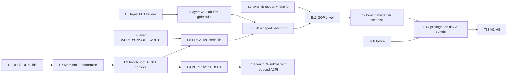

# PLAN: steps for T12 (package skeleton) and T13 (day-3 procedure) (watari-edk2-m1)

- Project: Watari Boot, subsystem "watari-edk2-m1" · Date: 2026-11-12 · Version: 0.1 · Status: draft
- Linked documents: [README](README.md) · [DESIGN](DESIGN.md) ("D n" below) · [RISKS](RISKS.md) · [draft ADR](../../adr/draft-edk2-m1-platform.md)

## Rules for every step

- No download, no installation. Everything named here is in the EDK2 tree on the data disk or in this repository [verified: DESIGN 10.2]. If the data disk is not mounted, the EDK2 steps are marked `[!]` (as T12 says) and the layer-side steps (E5-E8) still proceed.
- One small commit per step; every step has a test; `make -C el2 test`, `el2/boot/run-all.sh` 15/15 in both configurations and `make -C tools/acpigen test` stay green after each layer or acpigen change.
- Written from specifications and from EDK2's own interfaces. Nothing copied from NTASP, U-Boot, Linux, m1n1 or the Qualcomm EDK2 ports (ADR-0007, `docs/adr/draft-el2-license.md`). New EDK2 files: `SPDX-License-Identifier: BSD-2-Clause-Patent`; layer files: MIT.
- QEMU runs: TCG, never a Windows disk without `snapshot=on`, never two QEMUs on one disk (CLAUDE.md).
- Every result is reported with the output, including failures.

## Dependencies

E1-E4 need only EDK2 and the bench as it is today. E5-E9 are layer work and depend on T6c/T7 wiring being merged (the vendor hypercall dispatcher, `wel2.guest=`) [verified: R:docs/design/watari-el2-m1boot/T7-wiring.md sections 1-3]. Suggested split of T12 in `ralph/TASKS-m3a.md`: **T12a** = E1-E4, **T12b** = E5-E8 + E10, **T12c** = E9 + E11-E12, **T12d** = E13-E14.

## T12: steps

| Step | What | Files | Test / criterion |
|---|---|---|---|
| **E1** | Package skeleton that builds. `WatariM1Pkg.dec`, `.dsc`, `.fdf`. Start from `!include ArmVirtPkg/ArmVirt.dsc.inc` and the component list of `ArmVirtQemuKernel.dsc` with every fw_cfg/virtio/PCI/NOR/network/TPM/PL031 component removed (D 10.2); FDF with the arm64 `Image` header region and `FVMAIN_COMPACT` holding `ArmVirtPrePiUniCoreRelocatable`. If overriding `ArmVirt.dsc.inc` fights back, write a flat DSC instead and note it. `tools/build-edk2-m1.sh` modelled on `build-edk2-watari.sh` (separate WORKSPACE, HVF/GIC patch applied idempotently, F-12 module clean) | `edk2-apple/WatariM1Pkg/*`, `tools/build-edk2-m1.sh` | the build ends with `WATARI_M1_EFI.fd` in `$WATARI_DATA/build-m1/`; the build log has no fw_cfg, virtio, PCI or NOR module, and a **build-time check** fails the build if the module list contains `VirtNorFlashDxe`, `QemuFwCfg*` or PL011 modules; header magic `ARM\x64` at +0x38 and `image_size` = FD size (checked by the script with `xxd`) |
| **E2** | `WatariM1MemInfoLib` (RAM + FV, no peripheral window) and `WatariM1PlatformPeiLib` (FDT HOB and FV HOB only). Variables: `PcdEmuVariableNvModeEnable = TRUE`; RTC: `VirtualRealTimeClockLib`; reset: `ArmPsciResetSystemLib` + `ArmVirtMonitorLib` | `Library/WatariM1MemInfoLib/`, `Library/WatariM1PlatformPeiLib/`, DSC | builds; `grep` of the build map shows neither `QemuVirtMemInfoLib` nor `FdtPL011` in non-bench builds |
| **E3** | First bench boot **with the existing chain path, unchanged layer**: `-D WATARI_M1_BENCH_PL011=TRUE` swaps in ArmVirt's FDT PL011 serial/debug libraries (bench only), so the firmware talks on QEMU's UART while everything else is the M1 configuration. `el2/boot/run-m1-7.sh`: `run-m1-4.sh` with our FD at `0x40280000` | DSC switch, `el2/boot/run-m1-7.sh` | the layer's lines of M1-4 plus `Found GIC v3 Distributor @ 0x8000000`, timer interrupts injected, and BDS reached (`BdsDxe:` line or `Shell>`), in `hw` and `trap`; no `ASSERT`; documented limit: QEMU FDT, PL011 console, no GOP |
| **E4** | `WatariM1AcpiDxe` + `AcpiTables/Dsdt.asl` (D 9.1, 9.2). The driver takes its tables from a model chosen at build time (`j293` default; `qemu-virt` for the bench so that E3's run has a GIC at the right addresses). Build check: a script extracts the `_UID` list from `Dsdt.asl` and compares it with `acpigen madt -m j293` (8 UIDs, 0-7) | `Drivers/WatariM1AcpiDxe/`, `AcpiTables/`, `tools/acpigen/tests/` or a script under `tools/` | on the bench (UEFI Shell reached through E3's run with `-D` shell enabled): `acpiview -l` lists FACP, APIC, GTDT, PPTT, DSDT and `X_DSDT` is non-zero; `iasl -d` of the built AML round-trips to the same eight devices; `make -C tools/acpigen test` green |
| **E5** | Layer: flattened-device-tree **writer** (`fdt_build.c`): begin/end node, u32/u64/string/bytes properties, strings block with de-duplication, bounded buffer, total size reported; and `guest_fdt_build()` producing the tree of D 4.2 from a plain struct (ranges, GIC bases, core list, optional framebuffer, mode) | `el2/vgic/fdt_build.c`, `el2/include/wel2_fdt_build.h`, `el2/tests/test_fdt_build.c` | host tests: output parsed back by the layer's own reader (`fdt.c`) gives the same values; `dtc -I dtb -O dts` accepts it (run by the test when `dtc` is present); size below 32 KB - 64 B for 8 cores and 8 ranges; overflow of the buffer is an error, not a truncation; a j293-shaped input and a QEMU-shaped input; **no property named `serial-number`, `local-mac-address`, `kaslr-seed`, `rng-seed` can be produced** (asserted) |
| **E6** | Layer: `wel2.abi=fdt` and `wel2.gfdt=build`. Generalised chain: entry from `wel2.guest`, the guest FDT placed at `entry + image_size` (16 KB aligned), first `/memory` node = the range containing the entry, refusal when that range is below 128 MB, `DC CVAC`, `eret` with x0 = FDT. Bench default (`fdt_patch_for_guest`) untouched. On the bench, `wel2.split=<n>` makes `stage1` cut the QEMU RAM into n ranges with holes, so that EDK2 sees an M1-like multi-range map | `el2/boot/main.c`, `stage1.c`, `boot.h`, README | `run-all.sh` 15/15 both configurations (default path unchanged); a host test of the placement/ordering function that **asserts the first `/memory` range holds the image, the 64 MB UEFI region and the guest FDT** (PrePi moves its stack to the FD base when the FD lies within 64 MB of the top of the range); the `-m 6G` run must place the image above 4 GB explicitly (e.g. `wel2.guest` at `0x1_0000_0000` or higher); QEMU: covered by E10 |
| **E7** | Layer: `WEL2_CONSOLE_WRITE` (`0xC600_0004`) in the vendor dispatcher: range check, cache-safe guest read, raw bytes to the UART and the log ring, printable bytes to the framebuffer ticker; a per-call cap of 160 bytes; counted in `WEL2_STATS` | `el2/include/wel2_hvc.h`, `el2/vgic/hvc_vendor.c`, `el2/tests/test_hvc_vendor.c`, glue in `el2/boot` | host tests (length 0, 160, 161, a range outside guest RAM, bytes 0x00-0xFF pass through unchanged); the test guest gains one call and `run-m1guest.sh` shows its bytes |
| **E8** | EDK2: `WatariHvcSerialPortLib` (D 7), `BaseDebugLibSerialPort` for boot-time modules, `BaseDebugLibNull` for runtime drivers; `SerialDxe` + `TerminalDxe` on it. Default console of the package; E3's PL011 switch stays for comparison | `Library/WatariHvcSerialPortLib/`, DSC | bench under the layer: the same EDK2 log as E3 arrives through the hypercall (the script compares the `BdsDxe` end state); with the layer absent (plain QEMU virt, no EL2 layer) a vendor HVC id (`0xC600_0004`) is likely an UNDEF at EL1, not NOT_SUPPORTED **[hypothesis]**, so the first `SerialPortWrite` would take an exception. The library therefore runs a **guarded probe** once: `PSCI_VERSION` over HVC, then the vendor `WEL2_VERSION` call, and goes quiet unless both answer; if the probe itself cannot be made safe, the "layer absent" test is dropped [check: with the probe, the firmware boots silently on plain QEMU, seen by the GOP of E11 or QEMU's `info registers` idle state] |
| **E9** | Layer: framebuffer modes `wel2.fb=layer|band|guest` (D 8.2, 8.3): stage-2 mapping Normal-NC of the guest part, band rounding to whole stage-2 pages, ticker line, no text mirror after the hand-over, `fatal()` takes the panel back; info block v2 fields + flag; test guest check G12 (colour bars). **Bench stand-in:** `wel2.fakefb=<width>x<height>` reserves a block of guest RAM (removed from `/memory`), treats it as an `x2r10g10b10` framebuffer and advertises it; `wel2.fakefb8=…` the same as `x8r8g8b8` | `el2/boot/main.c`, `stage1.c`, `util.c`, `el2/vgic/maps.c`, `fb.c`, `el2/include/wel2_guest_info.h`, `el2/guest/`, tests | `test_pt.c`: the j293 guest map has the framebuffer pages minus the band, attributes Normal-NC, XN; `test_fb.c`: band rounding for strides 10240 and one non-multiple; `run-m1guest.sh` with `wel2.fakefb=…`: G12 PASS and a QEMU monitor `pmemsave` of the fake buffer shows the four bars at the expected pixel values in both formats and nothing written in the band rows |
| **E10** | The M1-shaped bench run: `run-m1-8.sh` = layer with `wel2.abi=fdt wel2.gfdt=build wel2.split=3` + our FD with the HVC console. This is "an FDT shaped like the M1" on `virt`: several `/memory` nodes, no UART/PCI/fw_cfg/virtio nodes, `psci` hvc, the timer and GIC nodes (GIC at QEMU's addresses: the physical GIC is there on the bench) | `el2/boot/run-m1-8.sh`, `run-all.sh` | EDK2 reaches BDS in `hw`, `trap`, `trap-notc`; its log shows every range added by `HighMemDxe`; one extra run with `-m 6G` and the image loaded above 4 GB (RISKS R-E4: PrePi with high RAM); `PcdSystemMemoryBase` = the range of the image; no `ASSERT`. Documented limits: GIC addresses and IPA size (40-bit on the bench) differ from the M1; no AIC, no FIQ timer |
| **E11** | EDK2: `WatariSimpleFbDxe` (D 8.4), `PcdWatariFbReportBgr8`; `GraphicsConsoleDxe` on it | `Drivers/WatariSimpleFbDxe/` | bench, `run-m1-8.sh` + `wel2.fakefb=1280x800 wel2.fb=band` and `wel2.fb=guest`: `pmemsave` of the buffer after BDS shows non-black pixels only at or below the band boundary in `band` mode; a known pixel of the boot logo or of the self-test bars has the expected 10-bit value (and the 8-bit value with `fakefb8`); with an unknown `format` string no GOP is installed and the firmware still boots |
| **E12** | `WatariM1BootManagerLib` (connect consoles, never wait for a key, boot timeout 0, fall back to the built-in self-test) and `Application/WatariM1SelfTest` (D 10.3); `WatariM1SmbiosDxe` (fixed strings) | `Library/WatariM1BootManagerLib/`, `Application/`, `Drivers/WatariM1SmbiosDxe/` | bench: the run ends by itself with `SELFTEST PASS`, ten timer ticks, then the layer's `PSCI SYSTEM_RESET` line and QEMU exiting (`-no-reboot`); `pmemsave` shows the four bars; `smbiosview` in the Shell variant shows the tables and no serial number |
| **E13** | Bench experiment for D 9.2 and D 7, **Windows VM, `snapshot=on`**: (a) QEMU's own tables with DBG2 and SPCR removed; (b) QEMU's DSDT replaced by "processors + PCI host only"; through `WatariQemuPkg/WatariAcpiOverride`, not the M1 package. Needs Marco's go-ahead for the VM run as usual | `tools/acpigen` (a `qemu-virt-min` DSDT in ASL), `WatariAcpiOverride`, a run script | Windows reaches the desktop, or the point where it stops is recorded with the screenshot (F-NN in `docs/FAILURES.md`); result written into DESIGN 9.2 replacing the hypotheses |
| **E14** | Day-3 bundle: extend `tools/m3a/build-m1-payload.sh` to add `WATARI_M1_EFI.fd` (and `-D WATARI_FB_REPORT_BGR8` variant), the loader option `--edk2 <file>` (third block, `wel2.guest`, `wel2.abi=fdt`, `wel2.fb`), sums; a host tool `gfdt_dump` (the E5 builder compiled for the host) that turns an m1n1-prepared FDT read back at rung L0 into the guest FDT the layer would build, printed with `dtc` | `tools/m3a/*` | the loader's call-order test passes with three blobs; `gfdt_dump` on the j293 fixture of T6b prints a tree with no Apple node and no identifying property |

### What the bench can and cannot show (the "documented limits" T12 asks for)

| Shown on `virt` | Not shown before hardware |
|---|---|
| the package builds and boots at EL1 under the layer; FDT-only discovery; several memory ranges; hypercall console; GOP on a simple-framebuffer in both pixel formats; ACPI and SMBIOS tables as published; reset through PSCI; all three trap configurations | 36-bit IPA and the real j293 ranges; GIC windows at `0xF_…`; the FIQ timer path under EDK2's tick; `ID_AA64PFR0_EL1.GIC` = 0 with `TID3` (the bench CPU reports 1; `wel2.tid3=1` exercises the trap but not the value); a 4 KB stage 1 on Apple cores; write-combined access to the real panel; what the panel shows; caches (TCG has none) |

## T13: the day-3 procedure (`docs/procedures/m3a-day3-hardware.md`)

Same form as day 1 and day 2: instructions for Claude on the host Mac at the top, zero footprint on the host, Marco's backup confirmed before anything, every step that was never run marked **[check]**.

| Step | Content |
|---|---|
| **H1** | Preconditions: day 2 passed rungs L0-L5 (layer, test guest, timers, secondaries, reset) [verified as the dependency: M1BOOT 9]; the bundle of E14 with its sums; the serial kit decision recorded (Q-11 of M1BOOT); macOS booted once since the last session |
| **H2** | Rung **D0, dry run**: loader with `--dry-run --edk2`: m1n1 prepares the FDT, the script reads it back, `gfdt_dump` prints the guest FDT on the host. Check by eye: the `/memory` nodes (first one contains the EDK2 block, at least 128 MB), GIC at `0xF00000000`/`0xF10000000`, framebuffer geometry (stride = 4 x width or not: note it), no identifying property. Nothing of ours has run. Abort here costs nothing |
| **H3** | Rung **D1, framebuffer hand-over without EDK2**: the test guest with check G12 and `wel2.fb=band`: four colour bars below the band, squares intact above. Photo. Settles the stage-2 mapping, the band arithmetic and the channel order (R-E2, R-E3) |
| **H4** | Rung **D2, EDK2 to PrePi**: `--edk2`, `wel2.fb=band`, one core. Expected, in order: the layer's checkpoints as on day 2; the "entering the guest" square; the ticker line showing EDK2's first line (`UEFI firmware (version …`) **[check: exact text from the E10 bench log]**. No ticker text within 10 s of the guest square = abort (RISKS R-E4/R-E5) |
| **H5** | Rung **D3, EDK2 to BDS**: same run continues: ticker shows DXE progress; then GOP: the graphics console appears below the band; then the self-test: colour bars, ten ticks, `SELFTEST PASS`, and the Mac restarts by itself. Record: time from hand-over to GOP, to PASS; the layer's trap statistics if the serial kit is connected |
| **H6** | Rung **D4**: the same with `wel2.cpuif=trap-notc` (or whichever configuration day 2 chose as the M1 default), and with all cores started by the host (EDK2 uses one; the others sit in m1n1's spin loop: proves they do not disturb it) |
| **H7** | Rung **D5**: `wel2.fb=guest`: full-panel GOP, no band; photo of the self-test at native resolution; optional: the `WATARI_FB_REPORT_BGR8` build, to photograph how an 8-bit picture looks on the 10-bit panel (input for D 8.5 stage 2) |
| **H8** | Abort and record. Abort criteria: no new checkpoint, ticker text or picture for 60 s; a red square; the layer's panic text. Action: hold the power button about 10 s, then a normal press boots macOS [verified as the day-1/day-2 method: M1BOOT 9]. To record in `re/m3a-day3-edk2.md`: the guest FDT summary (no identifiers), photos, timings, which rung failed and the last visible line; new failures as F-NN |

Expected output must be copied from the E10/E12 bench logs when the procedure is written, not from this plan.

## Task mapping

| Task | Steps | Done when |
|---|---|---|
| **T12a** | E1-E4 | `tools/build-edk2-m1.sh` builds; `run-m1-7.sh` reaches BDS in `hw` and `trap`; ACPI tables listed with a DSDT |
| **T12b** | E5-E8, E10 | `run-m1-8.sh` reaches BDS on the M1-shaped FDT with the hypercall console in all three trap configurations; host tests green |
| **T12c** | E9, E11, E12 | G12 and the EDK2 GOP draw on the fake framebuffer in both formats and both modes; the run ends with `SELFTEST PASS` and a PSCI reset |
| **T12d** | E13, E14 | the reduced-ACPI Windows result is recorded (pass or documented failure); the bundle builds with no network |
| **T13** | H1-H8 | the procedure is reviewed by an independent agent against this design and the T12 code and logs |
