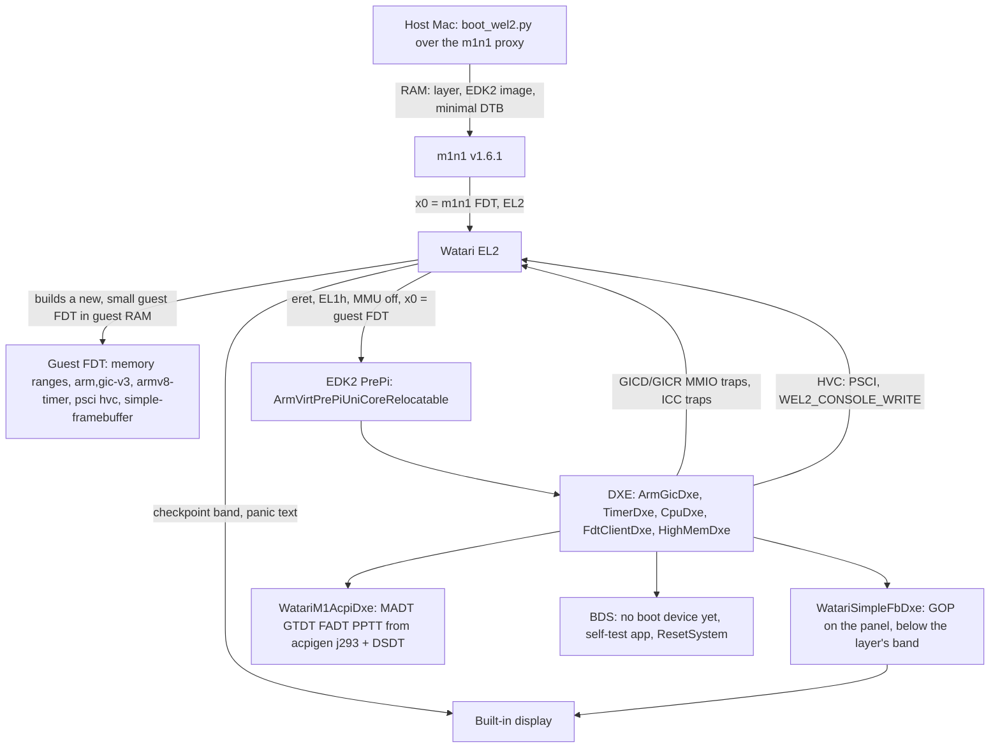

# watari-edk2-m1: EDK2 at EL1 on the real M1, on top of Watari EL2

- Project: Watari Boot · Ralph task T11 (`ralph/TASKS-m3a.md`) · Date: 2026-11-12 · Version: 0.1 · Status: **draft, not yet reviewed by an independent agent**
- Scope: what an EDK2 firmware needs to run at EL1 on Marco's 13" M1 MacBook Pro (j293, t8103) under the layer in `el2/`, how it is loaded (m1n1 → layer → EDK2), how it gets memory, interrupts, timer, PSCI, a console and the built-in display, which ACPI tables it publishes, and the step lists for T12 (package skeleton) and T13 (day-3 procedure).
- Out of scope: storage and USB drivers (T14, T15), PCIe, the Windows boot itself (M3b). They appear only where a decision taken here constrains them.

## Files

| File | Content |
|---|---|
| [DESIGN.md](DESIGN.md) | Sources; prior art (Asahi U-Boot, NTASP Project Mu); the load path and what `chain_to_edk2` must change; the guest FDT; memory; interrupts, timer, PSCI; console; the framebuffer hand-over and the GOP driver; ACPI and the minimal DSDT; the package layout and what is reused from EDK2 |
| [PLAN.md](PLAN.md) | Steps E1-E14 for T12 (with the QEMU smoke tests) and H1-H8 for T13 (day 3), with files and the test of each step |
| [RISKS.md](RISKS.md) | Risk table R-E1..R-E16 and open questions Q-E1..Q-E12 |
| [draft ADR](../../adr/draft-edk2-m1-platform.md) | The decisions that need Marco's approval |

As in `watari-el2-m1boot`: no PRD and no separate TEST_STRATEGY; the requirement is the scope above and the tests are part of each plan step.

## The design in one page

## Decisions (evidence in DESIGN, approval in the ADR)

| ID | Decision | DESIGN |
|---|---|---|
| E-1 | **Reuse the `ArmVirtQemuKernel` structure**: relocatable uni-core PrePi entered with the Linux arm64 boot protocol (x0 = FDT), FDT-driven DXE drivers. New package `edk2-apple/WatariM1Pkg/` with its own DSC/FDF; nothing of QEMU's fw_cfg, virtio, PCI, NOR flash, PL011 or PL031 is included | 3, 10 |
| E-2 | **The layer builds a new guest FDT** (a small writer in the layer, host tested) instead of patching m1n1's FDT in place. It holds only what the layer virtualises or hands over; no Apple node, no identifying property reaches the guest | 4 |
| E-3 | **Guest ABI selected by a boot argument**: `wel2.abi=fdt` (EDK2, x0 = guest FDT) next to the existing info-block ABI of the test guest; the image address stays `wel2.guest=<hex>`; the first `/memory` node is the range that contains the image | 3 |
| E-4 | **Memory:** one `/memory` node per guest RAM range, 36-bit IPA; EDK2's stage 1 uses the 4 KB granule over the layer's 16 KB stage 2; a platform `ArmVirtMemInfoLib` with no fixed peripheral window | 5 |
| E-5 | **Interrupts, timer, PSCI unchanged from the bench:** `ArmGicDxe` (GICv3) on the layer's vGIC at `0xF_0000_0000` / `0xF_1000_0000`, `TimerDxe` on the virtual timer (PPI 27), `ArmPsciResetSystemLib` over HVC. EDK2 **does** test `ID_AA64PFR0_EL1.GIC`: the layer's `TID3` emulation (T6g) is a prerequisite, the local EDK2 patch is the second line of defence | 6 |
| E-6 | **Console through the layer:** a new `SerialPortLib` that sends bytes with a vendor hypercall (`WEL2_CONSOLE_WRITE`), so EDK2 needs no UART driver and no UART mapping, and has output from its first instruction. No console input on day 3 | 7 |
| E-7 | **Framebuffer hand-over with two modes:** `wel2.fb=band` (default for bring-up: the layer keeps the top 48 rows for its checkpoints, the guest gets the rest) and `wel2.fb=guest` (the whole panel, for Windows). Stage-2 mapping Normal non-cacheable, geometry in the guest FDT as a standard `simple-framebuffer` node and in the info block; the layer takes the panel back only in `fatal()` | 8 |
| E-8 | **GOP driver written by us** (`WatariSimpleFbDxe`) on `FrameBufferBltLib`; the 30-bit panel format is reported truthfully as `PixelBitMask`, with a build switch to report 8-bit BGR for the Windows experiments | 8 |
| E-9 | **ACPI:** the T10 tables from `acpigen -m j293` plus a **DSDT in ASL with eight processor devices and nothing else**, installed through `EFI_ACPI_TABLE_PROTOCOL`; no DBG2/SPCR (T10's decision stands) | 9 |
| E-10 | **No storage, no PCIe, no USB, no keyboard in the first platform.** Variables are RAM-backed, the clock is a virtual RTC. The first Windows attempt (M3b) is planned as a RAM-disk boot, the storage question stays in T14/T15 | 9.4, 10 |

## Four findings the task text did not expect

1. **The panel is not an 8-bit framebuffer.** m1n1 reports 2560 x 1600 at 30 bits per pixel (`x2r10g10b10`) [verified: re/m3a-ehw0-measurements.md "m1n1 boot log"; DESIGN-m1boot 7]. Microsoft's firmware requirements say the GOP pixel format must be 8-bit BGR [verified: MS-UEFI]. EDK2 itself copes (its blit library handles bit masks); what Windows does with it is the riskiest open question of this design (RISKS R-E1).
2. **EDK2's GIC driver checks the CPU's GIC ID field** and falls back to GICv2 MMIO when it reads 0, as it does on the M1. This answers Q-6 of the T4 design. The tree on the data disk already carries a local patch for it (written for HVF), and the layer's ID-register emulation removes the cause.
3. **`iasl` is already installed** (Homebrew `acpica`, an EDK2 build dependency), so the DSDT can be plain ASL compiled by the EDK2 build; no AML emitter is needed in `acpigen`.
4. **A public EDK2-family port for Apple Silicon exists**: NTASP's Project Mu tree (BSD-2-Clause). Asahi itself ships U-Boot, not EDK2. Per ADR-0007 the NTASP tree is a reference only; nothing is copied (DESIGN 2).

## Status of the evidence

Read on 2026-11-12: the EDK2 tree on the data disk (`edk2-stable202608`), Microsoft's public bring-up pages, the Asahi and U-Boot documentation, the NTASP repository listing and one of its files. Nothing was built or run for this task (the rules forbid running QEMU here). Everything about the behaviour on the real M1 is **[hypothesis]** and depends on day 2 (`watari-el2-m1boot`) succeeding first.
