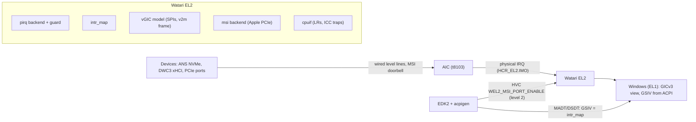
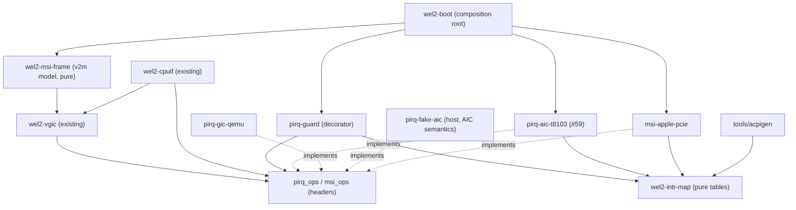
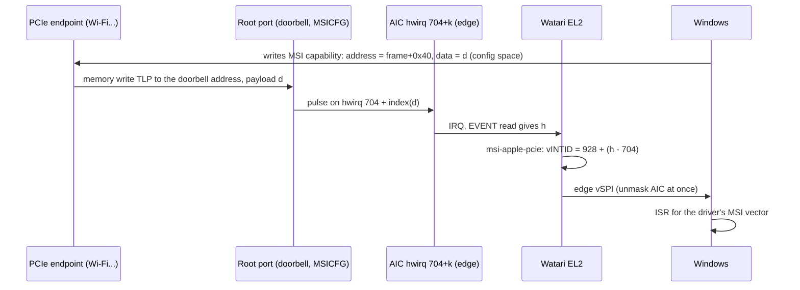

# ARCHITECTURE: Device interrupt routing on the M1 (watari-el2-devirq)

- Project: Watari Boot, subsystem "watari-el2-devirq" (#62) · Date: 2026-10-21 · Version: 0.1 · Status: draft
- Linked documents: [PRD](PRD.md) · [RISKS](RISKS.md) · [TEST_STRATEGY](TEST_STRATEGY.md) · [DESIGN-STATUS](DESIGN-STATUS.md) · [draft ADR](../../adr/draft-m1-device-interrupts.md) · parent: [watari-el2 ARCHITECTURE](../watari-el2/ARCHITECTURE.md), [INTERFACES](../watari-el2/INTERFACES.md)
- Marking and short source names as in the PRD (`PCIE`, `BIND`, `DTS`, `V2M`, `QDOC`, `MSDOC`, `F0`, `FAL`). Hardware numbers come from mainline Linux `master`; the Asahi downstream tree and the machine's ADT may differ, so every number below that ends up in code is **generated from the FDT/ADT of the machine**, not typed (FR-D10).

## 1. Established facts

| # | Fact | Source |
|---|---|---|
| 1 | t8103 AIC: `apple,t8103-aic` at `0x23b100000`, size 0x8000; every wired device interrupt in the DTS is `AIC_IRQ n`, `LEVEL_HIGH`, except the PCIe MSI pool | [verified: DTS] |
| 2 | ANS NVMe (`apple,t8103-nvme-ans2`, `0x27bcc0000` + ANS window `0x277400000`): **one** interrupt, AIC 590, level. Its mailbox `0x277408000` has four more (583-586: send-empty/not-empty, recv-empty/not-empty). SART has no interrupt. It is not a PCIe device | [verified: DTS] |
| 3 | USB: `dwc3_0` AIC 777, `dwc3_1` AIC 857, one level interrupt each; their DARTs share 781 / 861; the ATC PHYs have no interrupt | [verified: DTS] |
| 4 | PCIe: `pcie0` has one interrupt per root port (695, 698, 701, level) plus `msi-controller` with `msi-ranges = <&aic AIC_IRQ 704 IRQ_TYPE_EDGE_RISING 32>`: **32 MSIs shared by all ports, AIC hwirq 704..735, edge** | [verified: DTS, BIND] |
| 5 | MSI mechanism: the driver programs one **doorbell address** into each port (`PORT_MSIADDR`, 32-bit only on t8103, any address in the bottom 4 GiB, macOS uses `0xfffff000`), enables MSI with `PORT_MSICFG` (`L2MSINUM` = log2 of 32) and writes `PORT_MSIBASE = 0`. The MSI message is `address = doorbell`, **`data = vector index` 0..31**. The address "has to be excluded from the IOVA range and the DART driver has to know about it". t602x chips instead have a per-vector `MSIMAP` table and a 64-bit address | [verified: PCIE] |
| 6 | Port INTx: INTA-D are bits 0-3 of the per-port `PORT_INTSTAT` (level), demultiplexed behind the **single port interrupt**; link up/down, `MSI_ERR`, `MSI_BAD_DATA` are other bits of the same status/mask registers | [verified: PCIE] |
| 7 | GICv2m frame: `MSI_TYPER` at 0x008 (base SPI [25:16], count [9:0], SPIs valid 32-1019), `MSI_SETSPI_NS` at 0x040 (the doorbell, written with the SPI INTID), `MSI_IIDR` at 0xFCC. Compose message is `address = frame + 0x40`, `data = absolute INTID` (vendor quirks subtract an offset: X-Gene, NS2) | [verified: V2M] |
| 8 | MADT GIC MSI Frame (type 0x0D, 24 bytes): id, physical base, flags (bit 0 = use the SPI count/base of the MADT instead of `MSI_TYPER`), SPI count, SPI base | [verified: EDK2 `MadtParser.c` layout; F-11 comparison table: QEMU's frame had flags 1] |
| 9 | Windows boots on GICv3 + GICv2m frame **without ITS** (QEMU/HVF): the lock screen is reached; without the frame in the MADT Windows hangs after `ntoskrnl` | [verified: F-11, ablation] |
| 10 | Windows with `its=off` on QEMU TCG hangs in an NVMe INTx storm with or without our layer (F-23, #65). QEMU's current docs say "when ITS is not available on a GICv3 platform, a GICv2m is provided by default" and the local QEMU 11.1.2 has `-M virt,msi=auto\|gicv2m\|its\|off`; whether the F-23 run had a v2m frame in its MADT was **not checked** | [verified: QDOC, `qemu-system-aarch64 -M virt,help` on the bench; F-23] |
| 11 | ACPI-enumerated xHCI exists on SoC platforms: `_HID` vendor, compatible ID `PNP0D10`, `_CRS` | [verified: MSDOC] |
| 12 | The existing Watari EL2 design already reserves vINTID 928-959 for a t8103 MSI frame, maps SPI = 32 + AIC index (max 896 sources), uses level semantics "masked from ack to EOI", `pirq_ops.intid_of`, `set_trigger`, `sw_trigger` | [verified: INTERFACES 4, 4.1, 8.1; ARCHITECTURE 6.1] |
| 13 | Current QEMU layer: SPIs are assumed level at the physical GIC; `GICD_ICFGR` is not forwarded; vGIC effects are only `UNMASK_SPI`, `MASK_SPI`, `SET_TARGET`; LPI pass-through has a 64-entry per-vCPU queue | [verified: el2/boot/README.md M1-3 "Not done"; `el2/include/wel2_vgic.h`; F-23; #64] |

## 2. Question 1: what the guest sees

### 2.1 Options
| Option | Guest-visible | Pros | Cons | Cost |
|---|---|---|---|---|
| **A. vSPI only** (wired) | GICv3 with SPIs, vestigial MSI frame | Matches ANS (1 irq), DWC3 (1 irq), DARTs, SPI/I2C: all platform devices on the M1; already implemented end to end on the bench (PL031 test, M1-3); nothing new in the vGIC | PCIe devices limited to INTx (shared per-port line); the Windows NVMe INTx storm of #65 shows INTx can be fragile **[hypothesis: cause unknown]** | none |
| **B. Emulated ITS** (vLPI) | `GICD_TYPER.LPIS=1`, ITS in MADT, LPI tables in guest RAM | The path Windows demonstrably takes on QEMU (F-23) | Large: command queue, device/collection/ITT tables, `MAPD/MAPC/MAPTI/MOVI/INV...`, LPI property and pending tables, redistributor LPI registers fully in software (no physical LPI on the M1). KVM's ITS alone is 2853 lines **[verified: re/planB-feasibility.md]**. Needs a (DeviceID, EventID) <-> (port, vector) layer on top of Apple's shared 32-vector pool. Fidelity risk of the F-14 kind (silent hang on a wrong register). #64 findings apply (section 2.3) | 2-3 weeks of design+code **[hypothesis]**, permanent maintenance |
| **C. Emulated GICv2m frame** | MADT GIC MSI Frame, SPI 928-959, `MSI_SETSPI_NS` doorbell | Tiny (a read-mostly 4 KB page); SPIs only, so the existing vGIC, LR flow and AIC mask/unmask logic are reused; the MADT structure already exists in acpigen and is proven to be accepted by Windows (F-11); maps naturally onto Apple's "doorbell + index" scheme | Data semantic mismatch (section 5): v2m wants `data = INTID`, Apple wants `data = index`; 32 vectors in total; whether Windows allocates MSI from the frame is **[hypothesis]** until #65 is answered | ~150 lines + one hardware experiment |
| D. GICv3 MBIS (`GICD_SETSPI_NSR`) | `GICD_TYPER.MBIS=1` | Same idea inside the distributor | Windows use unknown **[hypothesis]**; same data mismatch; less precedent than v2m | not evaluated further |

### 2.2 Recommendation
**A for M3a/M3b, C for the first PCIe/MSI device (M4), B only as a contingency.** The first Windows targets on the M1 (ANS NVMe, DWC3 xHCI, framebuffer) are platform devices, so they never need MSI: the whole M3b critical path is option A, which already works. The vestigial v2m frame stays in the MADT (it is what made Windows boot in F-11; removing it would be an unnecessary regression risk). Option C turns the vestigial frame into a real MSI route once a PCIe device with MSI needs it and once hardware experiment E-HW1 has shown how the Apple port treats the MSI data. Contingency trigger for B: Windows refuses both INTx and v2m for a PCIe driver we cannot replace (answered by the bench steps of section 9, M2.x-1). Reasons are recorded in the draft ADR.

### 2.3 Why B is expensive even without the 64-entry queue
If B were chosen on the M1, the ITS and the LPI tables would be **entirely software** (no physical LPI). The #64 findings change meaning: `GICR_CTLR.EnableLPIs` could be freely cleared in the model (the "cannot be cleared once set" divergence is a physical-redistributor artifact of the pass-through), and the 64-entry queue would be replaced by a pending **bitmap** bounded by the 32 hardware MSI vectors plus the software-programmed event count (no drops). The cost that remains is the ITS command interpreter and table walking, which is the bulk of KVM's 2853 lines.

### 2.4 Which Windows inbox drivers accept which model
Microsoft public documentation only; no Microsoft binary was analysed.

| Claim | Status |
|---|---|
| An xHCI controller on a SoC can be ACPI-enumerated with compatible ID `PNP0D10` and `_CRS` resources, handled by Windows' standard USB stack | [verified: MSDOC] |
| The inbox xHCI driver accepts a **line-based** (wired, level) interrupt for such a controller | [hypothesis]; precedent claimed in PLAN ("as on Qualcomm") is unverified here. Test: Windows XHCI under QEMU with `msi=off` is not possible (QEMU's xHCI is PCIe), so the first real test is M3b |
| Windows boots on GICv3 with a GIC MSI Frame and no ITS | [verified: F-11] |
| Windows allocates PCI MSI/MSI-X from the GIC MSI Frame | [hypothesis]: F-11 only shows the frame's presence changes the boot; usage is checked by bench step M2.x-1 |
| Windows allocates PCI MSI/MSI-X from the ITS | [verified: F-23] (NVMe path works with `its=on`) |
| Windows' inbox NVMe driver works with INTx only | [verified negative on QEMU: F-23, cause unknown, #65] |
| A custom StorPort miniport (ANS) receives a line-based interrupt from an ACPI `_CRS` interrupt resource | [hypothesis]: depends on how an ACPI-enumerated storage device is bound to StorPort, an open point of #48 |
| Basic Display needs no interrupt | [hypothesis] (framebuffer from the UEFI GOP, as in PLAN) |

## 3. Components

### 3.1 Context


### 3.2 Components and dependencies (acyclic)

No backend is included by `vgic` or `wel2-msi-frame`; `tools/check-deps.sh` (planned in the parent design) is extended to forbid `intr_map` from including anything but `types`.

### 3.3 Module list
| Module | Single responsibility | Public interface | Depends on |
|---|---|---|---|
| `wel2-intr-map` | Translate hwirq <-> vINTID <-> GSIV and say which hwirqs the guest may see | `intr_map.h` (section 7.1) | types |
| `wel2-msi-frame` | Model the 4 KB GICv2m frame registers and turn a CPU write of `MSI_SETSPI_NS` into a pending SPI | `msi_frame_read/write()` | vgic |
| `pirq-aic-t8103` | Read, mask, unmask and route AIC IRQs of the t8103 (AICv1) | `pirq_ops` (existing, INTERFACES 8.1) | types, intr_map |
| `pirq-guard` | Count events per hwirq and mask a source that is not allow-listed or storms | wraps a `pirq_ops` and returns a `pirq_ops` | intr_map |
| `pirq-gic-qemu` | Same contract on the QEMU physical GIC, now also forwarding trigger type | `pirq_ops` | types |
| `pirq-fake-aic` | Behave like the AIC in host tests (auto-mask on ack, edge latch, `SW_SET`) | `pirq_ops` + test control API | types |
| `msi-apple-pcie` | Program the Apple PCIe ports for MSI/INTx and report the MSI hwirq pool | `msi_ops` (section 7.2) | types, intr_map |
| `wel2-boot` (existing) | Compose the above; handle the vendor HVC `WEL2_MSI_PORT_ENABLE` | unchanged | all |

"Single and" check: each description above has one verb phrase; `pirq-guard` is separate from `pirq-aic-t8103` precisely so the storm limiter is testable on the fake and reusable on QEMU and AICv2.

## 4. Question 2: AIC events become virtual interrupts

### 4.1 Mapping
| hwirq (AIC) | vINTID / GSIV | Note |
|---|---|---|
| 0 - 703 | 32 + hwirq (32 - 735) | wired, level; exposed only if allow-listed |
| 704 - 735 | **not exposed as wired**; MSI pool, see 5 | edge; arrives as vINTID 928 + (hwirq - 704) |
| 736 - 895 | 32 + hwirq (768 - 927) | wired, level |
| >= 896 | unsupported in v1 | `intr_map` build/boot error if an allow-listed device uses it; option to raise `ITLinesNumber` to 31 (max SPI 1019) if a real machine needs it |
| 928 - 959 (vINTID) | MSI frame SPIs | only through `msi-apple-pcie` |

The allow-list is generated at boot from the FDT (nodes that acpigen exposes to Windows) and mirrored in the DSDT; everything else is masked at init (FR-D2). Interrupts the AIC cannot mask or that must stay with the layer (timer FIQ, fast IPI, PMU) are not AIC IRQs and are untouched (see 4.5).

### 4.2 Life cycle and who unmasks (level, trap mode and hw mode)
```mermaid
sequenceDiagram
  participant D as Device line (level)
  participant A as AIC
  participant G as pirq-guard + aic backend
  participant V as vGIC model
  participant W as Windows (EL1)
  D->>A: asserts hwirq h
  A->>G: physical IRQ at EL2 (h masked by the read)
  G->>G: poll(): EVENT read, allow-list check, rate counter
  G->>V: vgic_set_irq_level(vINTID, 1)
  V->>W: LR pending, vIRQ
  W->>V: ICC_IAR1 (trap, or hardware in hw mode)
  W->>W: ISR clears the device cause
  W->>V: ICC_EOIR1 (+ ICC_DIR if EOImode 1): deactivate
  V->>G: effect UNMASK_SPI(vINTID) at deactivate if still enabled
  G->>A: MASK_CLR h
  Note over A,D: line still high: new event; line low: nothing
```
Rules (the contract, tested on the host with `pirq-fake-aic`):

| Situation | Level source | Edge source (ICFGR edge, MSI) |
|---|---|---|
| Event read | masked by hardware **[verified: Linux AIC flow in `re/f0-qemu-aic-models.md` section 5, "the delivered IRQ stays masked until MASK_CLR"]** | same |
| Injection | line = 1 in the model, stays masked | pending set, **unmask immediately** |
| Guest deactivate (EOIR with EOImode 0; DIR with EOImode 1) | unmask if enabled | none |
| Guest disables the SPI while pending/active | mask; on re-enable unmask only if no LR holds it | mask / unmask |
| No vCPU can take it (target OFF) | stay masked, remember; unmask at the next vCPU wake or re-target (F-21 lesson: the mask must never outlive the ability to unmask) | latched in the AIC [hypothesis] |
| Source not allow-listed, or more than N events/s | `pirq-guard`: log once, keep masked, count | same |

Unmask at *deactivate*, not at priority drop: with EOImode 1 the guest may drop priority long before the ISR finishes. In the current QEMU code the unmask happens at harvest of the list register (the EOI maintenance interrupt in hw mode, the EOIR trap in trap mode), which equals deactivate for EOImode 0; the EOImode 1 case must be checked in the trap path (host test, TEST_STRATEGY 2).

### 4.3 What must be added to the vGIC (small)
1. A new effect `VGIC_EFFECT_SET_TRIGGER(intid, edge)` emitted on `GICD_ICFGR` writes (today ICFGR is not forwarded, README M1-3 "Not done").
2. Re-target hook: `vgic_vcpu_reset` (PSCI `CPU_OFF`) emits `SET_TARGET` for every SPI routed to that vCPU (today only the vCPU private state is reset).
3. Everything else (enable/disable, pending, active, priority) is already modelled; AIC has **no priorities**, so priority is only the vGIC's ordering between pending vINTIDs.

### 4.4 Affinity
`GICD_IROUTER[n]` (Aff3.Aff2.Aff1.Aff0 or `IRM`) -> vCPU index (flat virtual MPIDR, parent design 6.3) -> `plat.pcpu_of_vcpu` -> AIC CPU index -> `TARGET_CPU[h]` bit mask with a single bit. `IRM=1` picks vCPU 0 if enabled, else the first enabled one (parent INTERFACES 5). AIC index of the P cores (E0-E3 = 0-3, P0-P3 = 4-7) is **[hypothesis]** until #55 (WHOAMI vs MPIDR on hardware). Because the target is derived from `IROUTER`, the physical IRQ normally lands on the core that owns the vCPU; if it does not (race with an `IROUTER` write), the existing cross-core kick path forwards it.

### 4.5 Consistency with timer and IPI (existing design)
- Timer: guest EL1 timers are FIQ sources recognised in `pirq.poll` by `CNTx_CTL_EL02` + `VM_TMR_FIQ_ENA_EL2` (parent ARCHITECTURE 6.2); they become PPI 27/30, a different path from AIC IRQs. No overlap: the AIC `EVENT` read happens only in the IRQ branch (the Mu bug D7 "read the AIC event in the FIQ branch" must not be repeated).
- IPI: fast IPIs are system registers (`IPI_RR_*`), never AIC events on t8103 **[verified: F0 section 4.1]**. An AIC `EVENT` of type 4 (legacy IPI) must be logged as unexpected by the guard.
- Maintenance interrupt (hw mode): fake FIQ read via `ICH_MISR_EL2`, again not an AIC IRQ.
- Order inside one `poll`: FIQ sources first, then `EVENT` loop until 0, as in the parent contract ("every returned event is already acknowledged and masked at the source").
- Result: **no inconsistency found with the timer/IPI design**; the inconsistencies found elsewhere are listed in section 10.

## 5. Question 3: Apple PCIe MSI

### 5.1 Hardware path (t8103)

The write never reaches CPU-visible memory, so **the guest-visible frame does not see device MSIs**; the frame only has to (a) exist at the address Windows programs into the device and (b) answer `TYPER`/`IIDR` reads. This is the opposite of the QEMU bench (where the real v2m device receives the DMA write at the same address) and is why the frame is passed through on QEMU but modelled on the M1.

### 5.2 The data mismatch and the three hypotheses
Windows will write `data = INTID` (928..959) because that is what a GICv2m frame means [V2M: absolute INTID]. The Apple port wants an **index** 0..31 [PCIE: `data = hwirq` of a 32-bit pool; `MSI_BAD_DATA` status bit exists]. What the port does with other values is not documented.

| Hypothesis | If true | Software needed | Test |
|---|---|---|---|
| H-A: `MSIBASE` (the register the Linux driver writes as 0; a second field at shift 16 is defined but unused) is the data base, i.e. the port computes `index = data - base` | set `PORT_MSIBASE = 928` | none in the data path | E-HW1 |
| H-B: the port only looks at the low `L2MSINUM` = 5 bits of data | 928 = 0x3A0 is a multiple of 32, so the index equals the low 5 bits for every vINTID in 928..959 | none, just keep the SPI base 32-aligned (already 928) | E-HW1 |
| H-C: the port needs `0 <= data < 32` and flags anything else | layer rewrites the data field of the **MSI capability** (not MSI-X) of each device: trap the ECAM page of the device in stage 2, on a write to `Message Data` store `INTID - 928` and remember the original for readback | `msi-apple-pcie` config-space shim (~200 lines) **[hypothesis]**; MSI-X (table in a BAR) cannot be handled this way without trapping the BAR page | E-HW1 |

The frame address must satisfy: below 4 GiB (t8103 `PORT_MSIADDR` is 32-bit, no high register), not RAM, not inside any IOVA range the DARTs will map for the guest (PCIE comment), identical as IPA and PA (stage 2 is identity and the port matches the physical doorbell). Proposed: frame page at `0xFFFFF000` (the macOS convention) with `MSI_SETSPI_NS` at `0xFFFFF040`, inside a 16 KB trapped stage-2 page (`0xFFFFC000-0xFFFFFFFF`, 16 KB granule, #58) whose other 12 KB are RAZ/WI. This **replaces** `0xF_2000_0000` in parent INTERFACES section 4, which cannot be a doorbell on t8103 (it is above 4 GiB). Whether anything occupies `0xFFFFF000` physically must be checked in the machine's ADT **[hypothesis: free]**. The layer programs `PORT_MSIADDR` with `frame + 0x40` (the address Windows will put in the device); whether the port matches that exact address or the whole page is not documented and is part of E-HW1 (Linux programs `0xfffff000` and composes messages to the same address, so the unknown only matters for the `+0x40` offset).

t602x (M1 Pro/Max/M2 family) has `MSIMAP` (per-vector programmable target) and a 64-bit address **[verified: PCIE]**: there the mismatch disappears by programming `MSIMAP[k].TARGET`, the same `msi_ops` interface hides it (extension point).

### 5.3 Mapping to the chosen model
`msi-apple-pcie` exposes the pool as `base_hwirq = 704`, `size = 32`. `intr_map` turns an event from the pool into vINTID `928 + (h - 704)`, configured edge. `GICD_ISENABLER` of an MSI SPI unmasks the AIC hwirq (same effect hook), so a disabled MSI stays masked at the AIC. Level 2 adds the HVC `WEL2_MSI_PORT_ENABLE(port)` so the layer, not EDK2, owns every `PORT_*` offset; EDK2 only trains the link and then calls the HVC (layer is the single owner of the register knowledge, NFR-D1).

### 5.4 Port interrupts and INTx
One shared AIC line per port (695/698/701 on the 13" M1 MBP). The layer sets `PORT_INTMSK` so that only INTA-D can assert it and clears pending status of the other bits once; ACPI `_PRT` maps INTA-D of every device behind that port to the port's GSIV (32 + hwirq), level, shared. This is the fallback if MSI is not available, and it is subject to the same unknown as #65 (Windows INTx behaviour).

## 6. Question 4: per-device plan

| Device (j293) | Interrupt | Guest model | ACPI resource | First milestone | Notes |
|---|---|---|---|---|---|
| ANS NVMe (`nvme@27bcc0000`) | AIC 590, level | vSPI 622, level | `Interrupt(ResourceConsumer, Level, ActiveHigh, Exclusive)` in the ANS device `_CRS` | M3b | The four mailbox interrupts 583-586 stay **masked and unexposed**: the driver polls the RTKit mailbox first (#48). One interrupt means all completions on one core; acceptable for boot. Not an NVMe-class PCIe device, so Windows' inbox NVMe driver is not an option, a StorPort miniport is needed (#48) |
| USB keyboard (external, via Type-C) | `dwc3_0` AIC 777, level | vSPI 809 | xHCI `_HID` vendor, `_CID PNP0D10`, memory `0x382280000` (xHCI window, size 0xcd00), interrupt as above [verified: DTS, MSDOC] | M3b | Needs firmware to bring up ATC PHY and host mode (PLAN row "USB/Thunderbolt"). The DART IRQ 781 (shared by the two DWC3 DARTs) stays masked: the DART is in bypass/identity and an unexpected fault must be a logged guard trip, not an interrupt storm. Internal keyboard is SPI/MTP (M4) |
| Framebuffer | none | none | GOP, Basic Display | M3b | |
| Wi-Fi (PCIe port0, `reset-gpio` 152) | MSI via the pool (level 2) or INTx 695 | v2m SPI 928+k, or SPI 727 | PCIe host bridge `PNP0A08` + MCFG; `_PRT` for INTx | M4+ | No Windows driver exists for Apple's Broadcom parts; this is the reason level 2 is not on the M3b path |
| PCIe ports themselves | link up/down, `MSI_ERR` | masked, unexposed | none | with the PCIe design | |
| Watchdog (AIC 338), SMC mailbox (400-403), GPU mailbox (575-578), SPI (614-617), ADMAC (626), SIO DART (635) | various level | **unexposed** by default | none | M4 per device | default-deny is the safe state; each new device adds one allow-list row |

GSIV arithmetic example: AIC 590 -> vINTID/GSIV 622; AIC 777 -> 809; AIC 695 -> 727 **[verified arithmetic from DTS numbers; numbers of other machines differ and are generated]**.

## 7. Interfaces in the small

### 7.1 `wel2_intr_map.h` (pure, shared with acpigen)
```c
#define INTR_INVALID 0xFFFFFFFFu

typedef struct intr_map {
    uint32_t wired_max;        /* exclusive upper bound of exposed hwirq, 896 on t8103 */
    uint32_t msi_hwirq_base;   /* 704, or INTR_INVALID when the SoC has no AIC MSI pool */
    uint32_t msi_count;        /* 32 */
    uint32_t msi_vintid_base;  /* 928 */
} intr_map_t;

/* hwirq -> vINTID for a wired source; INTR_INVALID if reserved (MSI pool) or out of range. */
uint32_t intr_wired_vintid(const intr_map_t *m, uint32_t hwirq);
/* hwirq in the MSI pool -> vINTID; INTR_INVALID otherwise. */
uint32_t intr_msi_vintid(const intr_map_t *m, uint32_t hwirq);
/* inverse; *is_msi tells which pool the vINTID belongs to. Total functions, no side effects. */
uint32_t intr_hwirq_of_vintid(const intr_map_t *m, uint32_t vintid, bool *is_msi);
/* GSIV for ACPI: equals the vINTID (GIC GSIV = INTID). */
uint32_t intr_gsiv(const intr_map_t *m, uint32_t hwirq);
```
Preconditions: none (pure arithmetic). Postconditions: `intr_hwirq_of_vintid(intr_wired_vintid(h)) == h` for every exposed `h`; no vINTID has two hwirqs; vINTIDs 32..927 minus the hole 736..767 hold wired sources, 928..959 only MSI. Errors: `INTR_INVALID`. Example: `intr_wired_vintid(&t8103, 590) == 622`; `intr_wired_vintid(&t8103, 704) == INTR_INVALID`; `intr_msi_vintid(&t8103, 704) == 928`.

### 7.2 `msi_ops` (new, one small struct)
```c
typedef struct msi_ops {
    const char *name;
    /* Program one root port: doorbell, vector count, INTx-only port mask. Idempotent. */
    wel2_err_t (*port_enable)(uint32_t port, uint64_t doorbell_pa);
    /* Hardware MSI pool as AIC/GIC hwirq numbers. */
    void       (*pool)(uint32_t *base_hwirq, uint32_t *count);
    /* Level-2 fallback H-C only: translate the Message Data a guest writes. NULL when not needed. */
    wel2_err_t (*data_fixup)(uint32_t port, uint32_t guest_data, uint32_t *hw_data);
} msi_ops_t;
```
Errors: `WEL2_E_NOENT` (port absent in the FDT), `WEL2_E_STATE` (link not up), `WEL2_E_RANGE` (doorbell above 4 GiB on t8103). Backends: `msi-apple-pcie`, `msi-none` (QEMU passthrough, `port_enable` returns `WEL2_E_NOSUP`).

### 7.3 Changes to existing interfaces
- `pirq_ops`: add nothing; the existing `set_trigger`, `intid_of`, `sw_trigger` suffice. Document that `intid_of` is a thin wrapper over `intr_*` and that `poll` of a masked/ unexposed source returns it flagged `PEV_UNKNOWN` (already in the contract) so the guard can count it.
- `vgic_effect`: add `VGIC_EFFECT_SET_TRIGGER`. Re-target on vCPU reset (4.3).
- Vendor HVC table: `0xC6000010 WEL2_MSI_PORT_ENABLE(port) -> 0 | -err` (Vendor Specific Hypervisor range, parent INTERFACES 9).
- `/chosen/watari,el2` already carries `msi-frame-base`; value becomes `0xFFFFF000` on t8103.

### 7.4 Design patterns
| Module | Pattern | Why | Rejected | Cost |
|---|---|---|---|---|
| backends | Strategy (`*_ops`) | same vGIC on QEMU, M1, host | `#ifdef` per platform | one indirection |
| `pirq-guard` | Decorator over `pirq_ops` | storm/allow-list logic written and tested once, for every backend | logic inside the AIC backend (untestable without hardware) | one more call per event |
| `intr_map` | Pure table + total functions | shared by layer, host tests, acpigen: one truth for GSIV | numbers typed in acpigen and the layer separately (drift) | none |
| `wel2-msi-frame` | Register-file model with explicit effects (like the vGIC) | host-testable | direct vGIC pokes from the stage-2 handler | small |
| Fallback H-C | Shim behind `msi_ops.data_fixup`, NULL by default | the common case pays nothing | always trapping ECAM | only if E-HW1 says H-C |

## 8. Extension points
1. New SoC or AIC revision: new `intr_map_t` row + `pirq` backend (AICv2, #47); `msi_ops` with `MSIMAP` (t602x) behind the same interface.
2. New allowed device: one allow-list row (generated from the FDT) + acpigen entry; no code in vGIC or trap.
3. Another MSI model (ITS) later: a new module beside `wel2-msi-frame`, selected by `plat_ops.has_its_emulation`; `vgic` already has the LPI plumbing from the bench (`wel2.lpi`), re-used in software form.
4. Another guard policy: replace the decorator.
5. Test-only hooks: `sw_trigger`, `pirq-fake-aic` control API.

## 9. Bench prototyping and milestones (fits `docs/PLAN.md`)
Milestone names follow PLAN: M2.x (bench), M3a (M1 hardware with EDK2), M3b (Windows on the M1), M4.

| Step | Milestone | What | Needs | Exit criterion |
|---|---|---|---|---|
| M2.x-1 | M2.x (#65, #62) | **MSI controller matrix on the existing bench.** Dump the MADT of the F-23 `its=off` run (`pmemsave` + `RSD PTR` search, as F-11) to see whether it had a v2m frame. Then run `run-m2.sh` with `-M virt,...,msi=gicv2m` (QEMU 11.1.2 already has the option) in three variants: plain QEMU (control), layer with the frame passed through, layer in trap mode. Add the knob `MSI=gicv2m\|its\|off` to `run-m2.sh` | forwarding of edge SPIs and `ICFGR` (step 2); no download, no install | Lock screen reached with v2m and no ITS, or a documented failure with MADT evidence; counters show MSI SPI arrivals and no NVMe INTx. Result recorded as F-NN and in #65 |
| M2.x-2 | M2.x | **Edge SPIs and the AIC contract in the layer.** `VGIC_EFFECT_SET_TRIGGER`, edge handling (unmask at injection), `pirq` indirection around the current `gic_phys` SPI code, re-target on `CPU_OFF`, EOImode 1 check, `pirq-guard`. Host tests first (TEST_STRATEGY 2) | none | `make -C el2 test` green with the new suites; `run-m1-3.sh` still passes (PL031 level) plus a new edge test using a second RTC-like source or SGI-style self-injection |
| M2.x-3 | M2.x | `wel2-intr-map` + acpigen use it for GSIVs; `wel2-msi-frame` model (host) | none | acpigen test compares generated GSIVs for the j293 FDT interrupts of section 6 |
| M2.x-4 (optional) | M2.x / M3a | **#42 QEMU AIC machine** with a doorbell device that mimics the Apple port (address match, `idx = data - 928`, pulse hwirq 704+idx): end-to-end test of `pirq-aic` semantics, `SW_SET`, `TARGET_CPU`, timer-to-FIQ and the MSI path with real Windows | building QEMU from source: **needs Marco's backup confirmation and go-ahead**; 8-9 days for the AIC machine (re/f0-qemu-aic-models.md) plus about 2 for the doorbell **[hypothesis]** | Windows reaches the lock screen on a GIC-less QEMU machine |
| M3a-1 | M3a (#59, #55, #40) | `pirq-aic-t8103`: event decode, auto-mask, unmask, `TARGET_CPU`, `SW_SET`; **E-HW0** facts: `AIC_INFO` IRQ count, WHOAMI vs MPIDR, edge latch behaviour, spurious zero events | debug host (#40), Time Machine backup confirmed | self-test M-3 in PRD on all cores, both cpuif modes |
| M3a-2 | M3a | **E-HW1: MSI data semantics** (decides H-A/H-B/H-C): with the m1n1 proxy, bring up one PCIe port, program `PORT_MSIADDR/MSICFG/MSIBASE`, make an endpoint write `data = 928+k` and `k`, observe which AIC hwirq pulses and the `INTSTAT` error bits | PCIe link-up from m1n1 (Wi-Fi port), backup | recorded in `re/` and in the ADR; selects the fallback. Not on the M3b critical path |
| M3b-1 | M3b (#48) | ANS completion interrupt (AIC 590) and DWC3 (777) as level vSPIs through ACPI; DART/mailbox IRQs masked | drivers (#48), PHY bring-up | M-4 in PRD |
| M4-1 | M4 | Level 2: `msi-apple-pcie`, HVC `WEL2_MSI_PORT_ENABLE`, real frame; first PCIe device with MSI | PCIe host bridge design, a driver | MSI vector delivered to a Windows driver |
| M4-2 | M4 (#47) | AICv2 `intr_map` + backend, t602x `MSIMAP` | hardware | per #47 |

Suggested GitHub issues (not created here): "pirq indirection + edge SPIs + re-target on CPU_OFF" (M2.x-2), "intr_map shared header and acpigen GSIV generation" (M2.x-3), "MSI controller matrix on the bench" (M2.x-1, may be folded into #65), "E-HW1 PCIe MSI data semantics" (M3a-2).

## 10. Consistency findings against the existing watari-el2 documents
| # | Where | Finding | Proposed fix |
|---|---|---|---|
| C1 | INTERFACES 4 (MSI frame row) | Frame at `0xF_2000_0000` cannot be a doorbell on t8103: `PORT_MSIADDR` is 32-bit [verified: PCIE] | Use `0xFFFFF000` (this document, 5.2) |
| C2 | INTERFACES 4 | Register named `SETSPI_NSR`; the v2m register is `MSI_SETSPI_NS` at frame + 0x40, while `GICD_SETSPI_NSR` is the GICv3 MBIS register inside the distributor (also at 0x40 of the GICD) [verified: V2M, INTERFACES 5] | Rename in the table |
| C3 | ARCHITECTURE 6.1 note "edge: unmasked immediately" | Not implemented: README M1-3 "SPIs are assumed level"; `GICD_ICFGR` not forwarded | Add `SET_TRIGGER` (4.3) |
| C4 | INTERFACES 4.1 "SPI = 32 + AIC index" | Collides with the MSI pool hwirq 704-735 (they would become vINTID 736-767) | Hole in `intr_map` (4.1) |
| C5 | PSCI `CPU_OFF` (M1-3) | Resets the vCPU but SPIs routed to it keep their `TARGET_CPU` | Re-target (4.3, FR-D5) |
| C6 | INTERFACES 8.1 | `intid_of` has no inverse and no "exposed" predicate | `intr_map` (7.1) |
| C7 | F-23 / `its=on` bench | LPI pass-through must not leak into t8103 | FR-D14, `plat_ops` capability |
| C8 | PRD (parent) FR-13 "vestigial MSI Frame" | Still right for level 1; level 2 makes it real | FR-D7, FR-D11 |
No inconsistency with the timer/IPI paths (4.5).

## 11. Traceability
| Requirement | Modules |
|---|---|
| FR-D1, D10 | `wel2-intr-map`, acpigen |
| FR-D2, D3, D4, D5 | `pirq-*`, `wel2-vgic` (effects), `wel2-cpuif` |
| FR-D6, D9 | `pirq-guard`, `pirq-fake-aic` |
| FR-D7, D11 | `wel2-msi-frame`, `wel2-vgic` |
| FR-D8, D12, D13 | `msi-apple-pcie`, `wel2-boot` |
| FR-D14 | `wel2-boot`, `plat-*` |
| NFR-D1..D7 | section 3 (module split), section 8, TEST_STRATEGY |

## 12. The four cross-cutting requirements
- Maintainability: one owner per register family (AIC in `pirq-aic-t8103`, PCIe port in `msi-apple-pcie`); errors as `wel2_err_t`; names follow parent INTERFACES 10 (`wel2_`, `*_ops`, `<family>-<platform>`).
- Reproducibility: numbers generated from the FDT; host tests with fixed seed; bench variants scripted with pinned QEMU 11.1.2 and EDK2 `edk2-stable202608`; no step depends on a machine-specific path (the data disk path follows `WATARI_DATA`).
- Modularity: `intr_map` and `msi-frame` are pure; backends behind two small interfaces; dependency graph in 3.2 is acyclic.
- Extensibility: section 8; a new SoC or device does not modify existing modules except the composition root and the generated tables.
