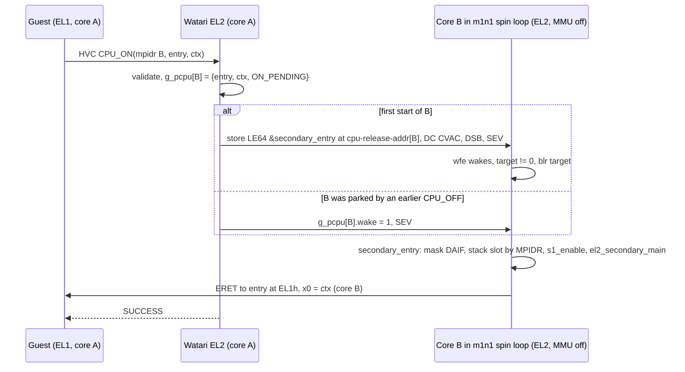

# DESIGN: first boot of Watari EL2 on the real M1 through m1n1 (watari-el2-m1boot)

- Project: Watari Boot, subsystem "watari-el2-m1boot" (Ralph task T4) · Date: 2026-11-10 · Version: 0.2 (revised 2026-11-11 after the independent review of 0.1) · Status: draft
- Linked documents: [README](README.md) · [PLAN](PLAN.md) · [RISKS](RISKS.md) · [draft ADR](../../adr/draft-m1-first-boot.md) · parents: [watari-el2 ARCHITECTURE](../watari-el2/ARCHITECTURE.md), [INTERFACES](../watari-el2/INTERFACES.md), [watari-el2-devirq](../watari-el2-devirq/ARCHITECTURE.md)
- Target: 13" MacBook Pro M1 (j293, t8103), m1n1 v1.6.1 as installed on 2026-11-10 ("Tethered boot"), host Mac with the m1n1 proxyclient.

## 0. Marking and sources

Every technical claim carries **[verified: source]** or **[hypothesis]**. "Verified" means: read in that source on 2026-11-10 while writing this document, or measured on the machine. Nothing here was run on hardware by this task. No code was copied: m1n1 and Linux were read as descriptions of hardware and firmware behaviour, and the layer's code is to be written from this text and from the specifications.

| Short name | Source |
|---|---|
| `M:file:lines` | AsahiLinux/m1n1, tag `v1.6.1` (commit `06a4601a351ebfd1abb6abba9a44c34e40d94776`), https://github.com/AsahiLinux/m1n1/blob/v1.6.1/ + file. MIT (the `proxyclient` scripts cited are MIT by their SPDX line) |
| `L:file:lines` | torvalds/linux, tag `v6.12`, https://github.com/torvalds/linux/blob/v6.12/ + file. Read as hardware facts only (GPL-2.0; the DT sources are `GPL-2.0+ OR MIT`) |
| `D:file` | AsahiLinux/docs, branch `main` as of 2026-11-10, https://github.com/AsahiLinux/docs/blob/main/docs/ + file |
| `HW` | `re/m3a-ehw0-measurements.md` (measured on j293 on 2026-11-10, m1n1 v1.6.1) |
| `R:file` | a file of this repository |
| `F0` | `re/f0-m1-fiq-irq.md`, `re/f0-timer-irq-hw.md` (earlier notes, same Linux/m1n1 sources) |
| Arm ARM / GIC / PSCI | section numbers as already checked in `re/el2-m0-register-check.md`, `el2/boot/README.md` and `docs/design/watari-el2/INTERFACES.md`; a section number quoted here without that backing is marked [hypothesis: section number from memory] |

Caveat on versions: the m1n1 on the Mac is v1.6.1; the proxyclient used on day 1 was the `main` zip of 2026-11-10 (HW header). The line numbers below are from the v1.6.1 tag. The proxy ABI between the two worked on day 1 for reads, `smp_start_secondaries` and calls; it is **[hypothesis]** for the `kboot_*` operations used here until day 2 (RISKS R-9).

## 1. Corrections to the task's premises (read first)

1. **"The M1 has no GICv3 hardware, so the CPU interface must be fully emulated" is half right.** The M1 has no GIC distributor, redistributor or ITS, and no working *physical* CPU interface: interrupts come from the AIC (IRQ) and from system-register sources (FIQ) [verified: L:drivers/irqchip/irq-apple-aic.c:532-600; F0]. But it **does implement the GICv3 virtual CPU interface**: `ICH_VTR_EL2` reads `0x90580007` (8 list registers, PRIbits 5, SEIS 1), `ICH_LR0_EL2` / `ICH_VMCR_EL2` / `ICH_HCR_EL2` are writable, and an armed list register delivered a virtual IRQ to EL1 [verified: HW rows 3 and "vGIC list-register delivery"]. Linux KVM runs GICv3 guests on this CPU with exactly this interface [verified: L:drivers/irqchip/irq-apple-aic.c:887-890 and 1067-1082 (`vgic_info`, type `GIC_V3`), L:arch/arm64/kvm/vgic/vgic-v3.c:616-636]. So the layer keeps using `ICH_*` on the M1; what must be emulated in software is everything else (GICD, GICR, physical interrupt sources). Section 5 has the full analysis, including what would happen if the interface were absent.
2. **"The second Mac sees the layer's UART over the day-1 USB link" is wrong.** The day-1 link is m1n1's USB gadget (`/dev/cu.usbmodem…1`). m1n1 shuts that gadget down before it jumps to the next stage [verified: M:src/main.c:196-204, `usb_iodev_shutdown()`]. The hardware UART is on the debug pins of the DFU port and needs USB-PD vendor commands (`macvdmtool` on an Apple Silicon host, with a SuperSpeed cable, `sudo`, a build) [verified: D:hw/soc/serial-debug.md]. Section 7 therefore makes the **framebuffer** the output that needs nothing extra.
3. **The layer image is not position independent today** (`linker.ld` links at `0x40080000`, `-fno-pic`, and `stage1.c`/`linker.ld` assume "the first 2 MB of RAM") [verified: R:el2/boot/linker.ld, R:el2/boot/Makefile]. On the M1 the RAM starts at `0x800000000` [verified: HW "m1n1 boot log"] and the load address is chosen by the loader at run time (section 2.3). This is the largest code change of the first boot (PLAN T6a).
4. `ID_AA64PFR0_EL1` on the M1 is `0x1101000010110111` [verified: HW row 5]: the **GIC field [27:24] is 0** and the EL3 field [15:12] is 0. Consequences: a guest that checks the GIC field before using `ICC_*` sees "no system-register GIC" (section 5.4), and there is no EL3, so the layer must never execute `smc` on the M1 (section 6).

## 2. Hand-over from m1n1 v1.6.x

### 2.1 The three mechanisms

| | Mechanism | What it does | Verdict |
|---|---|---|---|
| A | `proxyclient/tools/chainload.py` | Loads a Mach-O (or `--raw`) image **over m1n1's own base** (`new_base = u.base`), builds an Apple boot-args structure, passes **x0 = boot-args pointer** (not an FDT), rewrites the RVBAR of the cores that are not running, then `p.reload()` or `p.call()` [verified: M:proxyclient/tools/chainload.py:24-36, 95-104, 108-132, 160-170] | Meant for chainloading another m1n1 or XNU. Rejected: the layer would have to parse the ADT and Apple boot args and start the secondaries itself (RVBAR, PMGR) |
| B | Payload appended to m1n1 (`cat m1n1.bin Image.gz dtb > m1n1-payload.bin`) | m1n1 scans what follows its image: a kernel is recognised by `ARM\x64` at offset `0x38`, an FDT by `d00dfeed`; "Kernel images … must be compressed or last payload"; then it runs the same Linux boot path as C [verified: M:README.md:65-83, M:src/payload.c:22-31, 134-155, 312-350] | The **standalone** form for later (no host Mac). Not for day 2: it needs an m1n1 binary to append to (a build or a download) and a write to the stub volume or ESP, i.e. a persistent change |
| C | Proxy "Linux" path: `proxyclient/tools/linux.py` → `kboot_prepare_dt()` + `kboot_boot()` | The host writes image and DTB into m1n1's heap over USB, m1n1 fills the DTB from the ADT and jumps to the image with x0 = FDT [verified: M:proxyclient/tools/linux.py:44-163, M:src/kboot.c:2862-2885] | **Chosen for the first boot.** Everything lives in RAM; a power cycle removes it |

Paths B and C end in the same function (`kboot_boot`) and the same jump, so an image that boots through C boots through B unchanged, provided it carries the arm64 `Image` header (section 2.4).

### 2.2 State at the layer's entry point (path C, same for B)

| Item | State | Evidence |
|---|---|---|
| Call | `next_stage.entry(args[0..4])`, a plain function call from m1n1's `m1n1_main`; x30 points back into m1n1 (returning panics m1n1) | [verified: M:src/main.c:190-212] |
| x0 | address of the **FDT prepared by m1n1** (a heap copy of the DTB the host supplied, grown by 96 KB and edited); x1 = x2 = x3 = x4 = 0 | [verified: M:src/kboot.c:2876-2881 and `kboot_prepare_dt`] |
| Exception level | EL2. m1n1 runs at EL2 on the M1 with `HCR_EL2` = `0x0000032488000038` (E2H = 1, **TGE = 1**); E2H is stuck at 1 | [verified: HW row 4 and "E2H stuck-bit test"] |
| MMU and caches | **off**: `mmu_shutdown()` clears `SCTLR.{M,C,I}` and then cleans+invalidates the data cache by set/way, on the boot core only | [verified: M:src/memory.c:636-643, M:src/main.c:204] |
| PSTATE | `DAIF = 7 << 6`: A, I, F masked, **D not masked** | [verified: M:src/exception.c:180-183] |
| `VBAR`, stack | still m1n1's; the layer sets its own before anything can trap (it already does) | [verified: R:el2/boot/start.S `reset`] |
| Devices m1n1 stopped | NVMe, its USB gadget, external display, its framebuffer console | [verified: M:src/main.c:196-203] |
| Devices m1n1 started in `kboot_boot` | MCC cache, static tunables, clocks, USB (PHY/DWC3 bring-up for the OS), PCIe ports, DAPF | [verified: M:src/kboot.c:2864-2871]. These are volatile hardware initialisations that every Asahi Linux boot performs; the layer does not rely on them |
| FIQ sources | cleared once by m1n1 at start-up (`CNTP/CNTV_CTL` and the `_EL02` pair written 7, PMCR0 IMODE/IACT cleared, `IPI_SR` acked, uncore PMC off); **not** re-cleared at hand-over | [verified: M:src/exception.c:126-150]. The layer repeats the clean-up on every core (section 5.2) |
| Watchdog | disabled by m1n1 at start-up | [verified: M:src/wdt.c:13-48, M:src/main.c:161; HW boot log] |
| Boot core | cpu0, an Icestorm E core, `MPIDR_EL1 = 0x80000000`, AIC `WHOAMI` 0 | [verified: HW row 2]. `start.S` `reset` continues only when Aff2:Aff0 is 0: satisfied |
| Other cores | **only those the host started** with `p.smp_start_secondaries()` before `kboot_prepare_dt`; each sits at EL2, MMU off, in m1n1's spin loop (section 3). Cores that are not alive are removed from the FDT | [verified: M:proxyclient/tools/linux.py:113, M:src/kboot.c:573-580] |

Two consequences for `start.S`: mask D as well (`msr daifset, #0xf`) at `reset` and at `secondary_entry` (the secondaries arrive with m1n1's `DAIF = 0xc0` [verified: HW "AIC software-trigger" paragraph]); and nothing may depend on `HCR_EL2.TGE` being 0 before `enter_el1` writes the layer's own `HCR_EL2` (today's code satisfies this: `s1_enable` only changes bit 34) [verified: R:el2/boot/start.S].

### 2.3 Where the image is loaded; alignment and size

- With path C the **host script** picks the address: `linux.py` uses `u.memalign(2 MB, size)` in m1n1's heap and asserts 64 KB alignment [verified: M:proxyclient/tools/linux.py:69-75]. With path B m1n1 copies the kernel to a `KERNEL_ALIGN` = 2 MB aligned heap block of `image_size` bytes (header field) [verified: M:src/payload.c:22-23, 134-155]. In both cases the address is a property of the m1n1 build and of what was allocated before: **not a constant**.
- m1n1 ignores the header's `text_offset` (the entry is the first byte of the image) [verified: M:src/payload.c:134-155, M:src/kboot.c:2876]; QEMU's `-kernel` honours it [verified: R:el2/boot/linker.ld header comment and the bench runs, which find the image at RAM base + `0x80000`]. The header keeps `text_offset = 0x80000` for QEMU.
- **Design decision D-1:** the layer becomes a position-independent image (`-fpie`, linked `-pie` at 0, `R_AARCH64_RELATIVE` entries applied by `start.S` before the first C call; the technique is the standard ELF one, m1n1 does the same for itself [verified: M:src/start.S:84-90, as a fact that it works under this loader]). The same binary then runs at `0x40080000` in QEMU, which exercises the relocation code on the bench.
- **Build details of D-1** (PLAN S6). No `ldr xN, =symbol` literal may remain in `start.S`: each becomes `adrp` + `add`, because a literal-pool word would be read before it is relocated. Compile with `-fpie -fvisibility=hidden`, so that no GOT/PLT indirection and no symbol pre-emption is generated. Link with `-pie --no-dynamic-linker -z norelro`, keep `.rela.dyn` inside the loaded image, and do **not** use packed relative relocations (RELR, `-z pack-relative-relocs`): the only form to apply is then an `Elf64_Rela` entry of type `R_AARCH64_RELATIVE` (1027), `*(base + r_offset) = base + r_addend` **[hypothesis: type number and linker option spellings from memory of the AArch64 ELF ABI and the lld manual; the build check of S6 (`llvm-readelf -r`) confirms them]**. After relocating, the boot core invalidates the data cache by VA (`DC IVAC`) over the **whole image**, not only `.bss` and the stacks: the relocation stores went to memory with the caches off, while lines of the same addresses may still be cached from the proxy's writes **[hypothesis: same reasoning as the existing `.bss` maintenance; not observable in QEMU]**.
- **Design decision D-2 (carve-out):** on the M1 the loader allocates one **32 MB block, 32 MB aligned**, and loads the image at its start. 32 MB is the level-2 block of the 16 KB granule [verified: R:el2/boot/README.md "16 KB granule"], so the layer's region is exactly one stage-2 block left unmapped and one EL2 stage-1 table of pages. Image, `.bss`, EL2 stacks, page-table pools and the log ring must fit in it; `linker.ld` asserts that. The header's `image_size` must cover everything up to the end of the stacks (today it stops at `__image_end`, before the stacks [verified: R:el2/boot/linker.ld]); path B allocates from that field.
- Cache state of what the host wrote: the host writes through m1n1's cached mapping, so the script must clean the data cache and invalidate the instruction cache over each image (`p.dc_cvau`, `p.ic_ivau`) before `kboot_boot`, as `linux.py` does [verified: M:proxyclient/tools/linux.py:153-154]. The layer still treats its `.bss`/stacks as stale and invalidates them (existing code) [verified: R:el2/boot/start.S].

### 2.4 `Image` header

Needed by path B only: `ARM\x64` at offset `0x38`, `image_size` at offset 16 [verified: M:src/payload.c:28, 134-155]. Path C checks nothing. The header already exists in `start.S`; only `image_size` changes (section 2.3). Linux's `booting.rst` rule that `image_size` bytes from the image start are free for the kernel is what m1n1 implements **[hypothesis: booting.rst not re-read today; the m1n1 allocation is verified]**.

### 2.5 The loader script (ours)

`tools/m3a/boot_wel2.py`, modelled on the sequence of `linux.py` but **without `from m1n1.setup import *`**, which writes the PMU [verified: R:docs/procedures/m3a-day1-hardware.md section 4 step 5]:

1. Build `UartInterface` / `M1N1Proxy` / `ProxyUtils` as `tools/m3a/ehw0.py` does [verified: R:tools/m3a/ehw0.py].
2. Allocate first: the DTB buffer `u.malloc(len)`, the layer block `u.memalign(32 MB, 32 MB)`, the guest block `u.memalign(32 MB, 32 MB)`; write the three; `p.dc_cvau` + `p.ic_ivau` on both images.
3. Only now build the boot arguments (they contain the guest's address, `wel2.guest=<hex>`) and set them: `p.kboot_set_chosen("bootargs", "<wel2 arguments>")` [verified: M:proxyclient/tools/linux.py:53-55].
4. `p.smp_start_secondaries()` (skipped in the single-core rungs, section 9).
5. `p.kboot_prepare_dt(dtb_addr)`; a non-zero return aborts the run **before anything of ours executes** [verified: M:proxyclient/tools/linux.py:127-129]. With `--dry-run` (rung L0, section 9) the script stops after this call and reads the prepared FDT back with `iface.readmem`. Its address is in m1n1's console line `FDT prepared at …` [verified: M:src/kboot.c, last `printf` of `kboot_prepare_dt`], which the proxy interface relays to the host **[check: that the line can be captured by the script]**. The blob is saved **inside the host folder only** (it contains the serial number, section 4.3) and the layer's own FDT queries are run on it by `fdt_m1_dump`, a host build of `el2/boot/fdt.c` compiled with the `cc` of the Command Line Tools the host already has [verified present: R:docs/sessions/2026-11-10-ciani-01.md line 6]. What the layer will see on hardware is thus checked before it runs.
6. `u.msr(DAIF, 0xc0)` as `linux.py` does, then `p.kboot_boot(layer_addr)` [verified: M:proxyclient/tools/linux.py:158-163]. m1n1 leaves its proxy loop inside this request and shuts its USB device down, so the reply may never arrive: the script treats a timeout or a serial error **after the request was sent** as the expected outcome, prints "handed over" and exits 0 **[hypothesis: whether the reply is flushed before the shutdown; `linux.py` does not check it either]**.

`linux.py` also calls `p.cpufreq_init()` [verified: M:proxyclient/tools/linux.py:112]; the first boot leaves it out (fewer writes; the cores stay at their boot frequency) **[hypothesis: the layer and the test guest do not need the higher frequency]**.

## 3. Secondary cores

### 3.1 How Apple SoCs start a core (hardware)

No PSCI and no EL3 exist on the M1 [verified: HW row 5, EL3 field 0]. A core is started by: writing its reset vector to RVBAR at `cpu-impl-reg + 0` (ADT `/cpus/cpuN`), setting bit `4*cluster + core` in PMGR `cpu_start + 0x4` (a system-wide "core alive" bit, without which AIC interrupts do not reach the core), then setting bit `core` in `cpu_start + 0x8 + 4*cluster`; `cpu_start` is PMGR `reg[0] + 0x54000` on the M1 [verified: D:hw/cpu/smp.md; M:src/smp.c:16-28, 114-180]. The core starts at RVBAR at the highest EL; chicken bits must then be applied [verified: D:hw/cpu/smp.md]. m1n1 writes RVBAR with its own vector base and, where the register allows, that also sets the lock bit [verified: M:src/smp.c:23-28, 127-155, 377-386].

### 3.2 What m1n1 does and what it hands over

- `smp_start_secondaries()` performs 3.1 for every ADT cpu, with m1n1's own entry as RVBAR; each core runs m1n1's reset path (chicken bits included: deep sleep disabled, WFI mode "up" [verified: M:src/chickens.c:241-250]) and ends in `smp_secondary_entry()`: it publishes `mpidr` and `flag = 1` in its `struct spin_table { mpidr, flag, target, args[4], retval }` and loops until `target` is non-zero, then calls `target(args[0..3])` [verified: M:src/smp.c:30-36, 60-106].
- `kboot_boot()` switches the loop to **WFE mode** (`smp_set_wfe_mode(true)`): each waiting core executes `wfe` and re-reads `target` [verified: M:src/kboot.c:2873, M:src/smp.c:80-96, 490-500].
- `kboot_prepare_dt()` → `dt_set_cpus()`: for each `cpu@…` node whose `reg` is not the boot core it checks that the core is alive (else the node is removed), checks `reg` against the MPIDR the core reported, and writes **`cpu-release-addr` = address of that core's `spin_table.target`** in place (the property must already exist, 8 bytes); the args are zeroed. It also reserves each secondary's m1n1 stack in the FDT memory reservation block [verified: M:src/kboot.c:541-610, M:src/smp.c:518-530].
- The Linux DT for the t8103 declares `enable-method = "spin-table"` and `cpu-release-addr = <0 0>` "to be filled by loader" [verified: L:arch/arm64/boot/dts/apple/t8103.dtsi:60-62].
- State of a secondary when it calls the release address: EL2, **MMU and caches off** (m1n1 only turns a secondary's MMU on through a separate `mmu_init_secondary` proxy call, which `linux.py` does not make) [verified: M:src/memory.c:588-634, M:proxyclient/tools/linux.py], on its m1n1 stack, x0..x3 = 0, called with a branch-and-link (it must never return).

### 3.3 Guest PSCI `CPU_ON` / `CPU_OFF` on top of it (design)



- **First start:** the writer runs with its MMU and caches on, the reader has them off, so the store must be cleaned to memory before the event: `DC CVAC` on the line, `DSB`, then `SEV`. Linux's spin-table code does the same (write, clean+invalidate, `sev()`) [verified: L:arch/arm64/kernel/smp_spin_table.c:85-100]. The value is a little-endian 64-bit physical address of `secondary_entry` (the relocated run-time address).
- The secondary's contract with the existing `secondary_entry` is the one QEMU's firmware already gives: EL2, MMU off, any stack, x0 unused [verified: R:el2/boot/start.S]. The stack slot comes from `wel2_core_index(MPIDR)` (T1, done).
- **`CPU_OFF`:** a core that left m1n1's loop cannot go back into it, and a real power-down would restart the core at RVBAR, which holds m1n1's vectors **[hypothesis: follows from D:hw/cpu/smp.md ("Core starts up at RVBAR") and M:src/smp.c:152-155; not observed]**. So on the M1 `CPU_OFF` **parks the core inside the layer**: vGIC/pirq teardown as today, both guest timer gates closed, state `OFF`, then a loop at EL2 with interrupts masked: `wfe`, re-read `g_pcpu[me].wake`. A later `CPU_ON` sets the wake flag (the parked core has its MMU on: an ordinary store, no cache maintenance) and executes `SEV`. **No IPI is used:** the event wakes a `wfe` wait, and a FIQ sent to a core that keeps F masked would only stay pending and have to be cleared afterwards. The woken core re-runs the per-core init, **including writing 0 to `CNTV_CTL_EL02` and `CNTP_CTL_EL02` before the timer gates open** (the core's previous guest context may have left a timer enabled, section 5.2), and `eret`s to the new entry. No power is saved; that belongs to a later power-management milestone.
- The core list no longer comes from walking GIC redistributors (`gic_phys_discover`): on the M1 it is the FDT `/cpus` list (MPIDR from `reg`, release address from `cpu-release-addr`), in node order = `cpu-id` order = AIC `WHOAMI` order, E cores 0-3 then P cores 4-7 [verified: HW row 2]. This makes the vGIC vCPU index, the PSCI index and the stack index agree, which closes open doubt (3) of T1 in `ralph/PROGRESS-m3a.md` **[hypothesis: the node order of the DTB we supply is under our control, section 4]**.
- The m1n1 image, the spin table (in m1n1's `.bss`), the secondaries' m1n1 stacks and the prepared FDT stay in use after hand-over. m1n1 lists them in the FDT **memory reservation block** [verified: M:src/kboot.c `kboot_prepare_dt` (`fdt_add_mem_rsv` for the FDT buffer and `_base.._end`) and 573-590]. The layer must keep every reserved range out of the guest's RAM (section 4.3).

## 4. Device tree

### 4.1 Options

| | Option | For | Against |
|---|---|---|---|
| a | The layer reads the **ADT** itself | no DTB needed | a second parser (ADT format), Apple boot-args handling, SMP start by hand; path A only |
| b | Upstream **`t8103-j293.dtb`** from the Linux tree, filled by m1n1 | the input m1n1 is tested with; dual licence `GPL-2.0+ OR MIT` [verified: L:arch/arm64/boot/dts/apple/t8103.dtsi:1] | needs a kernel tree and a build, or a download: a manual hardware-day step; ~200 nodes of which the layer reads five |
| c | **Our own minimal DTS** for the j293, compiled with `dtc`, filled by m1n1 | built in the loop with no download (`dtc` 1.8.1 is already installed as a QEMU dependency [verified: R:docs/INSTALLED.md line 15; `/opt/homebrew/bin/dtc` present]); MIT; contains only what the layer reads; m1n1 touches less hardware state for nodes that are absent | m1n1's DT fix-ups were written for the upstream DTB: acceptance of a minimal one is **[hypothesis]** until day 2 (it fails safe, see below) |

**Decision D-3:** c is the primary input, b is the documented fallback, a is rejected. Reasoning on c's risk: `kboot_prepare_dt()` runs about thirty fix-ups; those that fail hard on a missing node are `/chosen`, `/cpus` with `cpu@…` nodes (`reg`, an existing 8-byte `cpu-release-addr`), a node compatible with `apple,aic`, and `/memory`; the others look a node or alias up and skip it when absent (examples read: `dt_set_fb`, `dt_set_sep`, `dt_set_pmp`, `dt_setup_sio`, `dt_reserve_asc_firmware`, the display set-up, which only acts when the root is compatible with a known SoC) [verified: M:src/kboot.c:180-195, 256-270, 444-449, 541-620, 1751-1768, 1935-2000, 2031-2040, 2074-2082, 2189-2200]. Not every fix-up was read line by line, hence [hypothesis]. A failure makes `kboot_prepare_dt` return non-zero and the loader stops before the jump: nothing of ours has run, the proxy is still alive, and the fallback DTB can be tried in the same session.

### 4.2 The minimal DTS (`tools/m3a/dts/watari-j293-min.dts`)

Written from the Devicetree specification, the public bindings and our measurements; values are hardware facts.

| Node | Content | Why / source |
|---|---|---|
| `/` | `compatible = "apple,j293", "watari,m1-min"`; `#address-cells = <2>`, `#size-cells = <2>` | path B accepts an FDT only if the root is compatible with the board string m1n1 derives from the ADT [verified: M:src/payload.c:112-119; the exact string `apple,j293` is **[hypothesis]**]. Leaving `apple,t8103` out makes the display fix-up skip [verified: M:src/kboot.c:1990-1995] |
| `/chosen` | empty; child `framebuffer` with `compatible = "simple-framebuffer"`, `status = "disabled"` | m1n1 adds `bootargs`, firmware versions, seeds; it fills `/chosen/framebuffer` (`reg`, `width`, `height`, `stride`, `format`), renames it `framebuffer@<base>` and deletes `status` [verified: M:src/kboot.c:180-240, 256-315] |
| `/memory@800000000` | `device_type = "memory"`, placeholder `reg` | m1n1 overwrites `reg` with the usable span `[phys_base, phys_base + mem_size)` plus extra regions [verified: M:src/kboot.c:350-452] |
| `/reserved-memory` | `#address-cells`, `#size-cells`, `ranges` | m1n1 adds its ADT/log regions there; absent, those helpers fail [verified: M:src/kboot.c:1426-1433, 2718-2740] |
| `/cpus` | `#address-cells = <2>`, `#size-cells = <0>`; `cpu@0..3` (`apple,icestorm`, `reg = <0 0>`..`<0 3>`), `cpu@10100..10103` (`apple,firestorm`, `reg = <0 0x10100>`..); each `device_type = "cpu"`, `enable-method = "spin-table"`, `cpu-release-addr = <0 0>` | `reg` must equal `MPIDR & 0xFFFFFF` or m1n1 bails [verified: M:src/kboot.c:566-595]; MPIDRs [verified: HW row 2]; node order = cpu-id order |
| `/soc/interrupt-controller@23b100000` | `compatible = "apple,t8103-aic", "apple,aic"`; `reg = <0x2 0x3b100000 0x0 0xc000>`; `interrupt-controller`; `#interrupt-cells = <3>` | AIC base and size [verified: HW row 1; the ADT's second range `0x23b108000`+`0x1000` lies inside the first]. Upstream says size `0x8000` [verified: L:…/t8103.dtsi:527-531]; the measured ADT value wins. No `affinities` child: m1n1 tolerates that [verified: M:src/kboot.c:622-624] |
| `/soc/serial@235200000` | `compatible = "apple,s5l-uart"`; `reg = <0x2 0x35200000 0x0 0x4000>`; interrupt `<AIC_IRQ 605 LEVEL_HIGH>` | [verified: HW row 13; L:…/t8103.dtsi:444-449 (size there is `0x1000`)] |
| `/soc/watchdog@23d2b0000` | `compatible = "apple,t8103-wdt", "apple,wdt"`; `reg = <0x2 0x3d2b0000 0x0 0x4000>` | [verified: L:…/t8103.dtsi:636-642; HW boot log "watchdogs at 0x23d2b0000"] |
| `/timer` | `compatible = "arm,armv8-timer"`; `interrupt-parent = <&aic>`; `interrupts = <AIC_FIQ 2 4>, <AIC_FIQ 3 4>, <AIC_FIQ 0 4>, <AIC_FIQ 1 4>` (guest phys, guest virt, hv phys, hv virt) | [verified: L:…/t8103.dtsi:300-308; L:include/dt-bindings/interrupt-controller/apple-aic.h (`AIC_IRQ` 0, `AIC_FIQ` 1, `AIC_TMR_HV_PHYS` 0, `HV_VIRT` 1, `GUEST_PHYS` 2, `GUEST_VIRT` 3)]. Documentation only: the layer does not parse it |

### 4.3 What the layer reads from the FDT it receives

| Read | Used for |
|---|---|
| any node compatible with `apple,aic` | **platform switch**: present → M1 back ends (AIC `pirq`, FIQ timer, fast IPI, spin-table, s5l UART, no physical GIC); absent → today's QEMU path. `reg` → AIC base/size for the EL2 map |
| `/chosen/bootargs` | `wel2.*` arguments (existing), plus `wel2.guest=<hex>` and `wel2.step=<n>` (section 8, 9) |
| `/memory` `reg`, **all** pairs | RAM for the EL2 stage 1 and the guest stage 2 (today only the first pair is read [verified: R:el2/boot/fdt.h `fdt_get_memory`]) |
| memory reservation block; `/reserved-memory` children | ranges kept out of the guest (m1n1, spin table, m1n1 stacks, the FDT, ADT) |
| `/cpus/cpu@*`: `reg`, `cpu-release-addr` | core list, vCPU index, PSCI |
| first node compatible with `apple,s5l-uart`: `reg` | log UART |
| `/chosen/framebuffer@*`: `reg`, `width`, `height`, `stride`, `format` | framebuffer checkpoints and console |
| node compatible with `apple,wdt`: `reg` | `SYSTEM_RESET` |

The layer **never prints or forwards** the identifying properties m1n1 adds to the FDT: the root `serial-number`, the `/smbios` nodes, MAC addresses, the `/chosen` seeds [verified that m1n1 adds them: M:src/kboot.c:108-170, 454-470, 474-525, 778-790]. Log lines and screen text end up in photos and in the repository; FDT dumps taken on the host stay in the host folder and are never committed.

What the layer gives the **guest**: for the test payload a small information block (section 8), not an FDT. The FDT/ACPI for EDK2 and Windows on the M1 is T10/T11, outside this design.

For the first boot the guest's RAM is kept coarse: every `/memory` range is shrunk inward to 32 MB boundaries and every reserved range (and the layer's block) removes the whole 32 MB blocks it touches. This costs the guest some RAM and no level-3 tables, so the existing 24-table stage-2 pool is enough **[hypothesis: to be confirmed by the host test that builds the j293 map, PLAN T6c]**.

## 5. Interrupts on the M1: FIQ timer, AIC IRQ, and the virtual CPU interface

### 5.1 What arrives where

| Physical source | Signal | Where it is taken | Mask the layer uses |
|---|---|---|---|
| Guest timers `CNTV` / `CNTP` (the `_EL02` views from EL2) | **FIQ**, gated by `VM_TMR_FIQ_ENA_EL2` (`s3_5_c15_c1_3`, bit 0 = V, bit 1 = P) | EL2, because `HCR_EL2.FMO = 1` | the gate bits [verified: L:drivers/irqchip/irq-apple-aic.c:183-185, 485-505, 566-576] |
| EL2's own timers (`CNTP/CNTV_CTL_EL0` as seen at EL2 with E2H = 1, i.e. `CNTHP`/`CNTHV`) | FIQ | EL2 | never enabled by the layer; written `IMASK` at init [verified: L:…irq-apple-aic.c:558-564; M:src/exception.c:134-139] |
| Fast IPI | FIQ. The layer sends with **`IPI_RR_GLOBAL_EL1` only** (`s3_5_c15_c0_1`): target core = `MPIDR.Aff0` in bits [7:0], target cluster = **`MPIDR.Aff1`** in bits [23:16] (0 for the E cores, 1 for the P cores), type [29:28] = 0 (immediate). Pending in `IPI_SR_EL1` (`s3_5_c15_c1_1`) bit 0, write 1 to clear. The same-cluster form `IPI_RR_LOCAL_EL1` is an optimisation the layer does not need | EL2 | none; it is the layer's own cross-core kick [verified: L:drivers/irqchip/irq-apple-aic.c:167-180, 203-204 (cluster = MPIDR affinity level 1), 765-787; M:src/smp.c:436-447 uses the global form for every target] |
| vGIC maintenance interrupt | FIQ, **not maskable**: asserted while `ICH_HCR_EL2.En` and `ICH_MISR_EL2 != 0` | EL2 | remove the cause (harvest the list registers); last resort `En = 0` [verified: L:…irq-apple-aic.c:411-420, 887-890 (`no_maint_irq_mask`)] |
| Core PMU, uncore PMC | FIQ when `PMCR0.IMODE` = FIQ and `IACT` (`s3_1_c15_c0_0`), or `UPMCR0.IMODE` = FIQ and `UPMSR.IACT` | EL2 | `IMODE = OFF`, `IACT` cleared at init on every core [verified: L:…irq-apple-aic.c:191-200, 580-597, 847-853; F0] |
| Devices | **IRQ** through the AIC: `EVENT` read returns and masks the source | EL2, because `HCR_EL2.IMO = 1` | AIC `MASK_SET/CLR` (`pirq_aic`, host-tested, #59) [verified: HW "AIC software-trigger"; R:el2/include/wel2_aic.h] |
| SError | SError | EL2 (`AMO = 1`) | fatal with a dump; the M1's locally generated SEI (SEIS = 1) is the reason for trap mode (5.4) |

`HCR_EL2` on the M1 is what the layer already builds: `RW | IMO | FMO | AMO | VM | E2H` (+ `TSC` for a firmware guest, + `TID3`, section 5.4, + `API | APK`, next paragraph) [verified: R:el2/boot/main.c `el2_main`]. With `IMO`/`FMO` set, physical IRQ and FIQ are taken to EL2 whatever the guest's `PSTATE.{I,F}` are, and the guest's `ICC_*` accesses address the virtual interface [verified: R:el2/boot/README.md "M1-2", GIC spec 4.6.4 as cited there]. The guest's `WFI` is not trapped and wakes on a physical FIQ/IRQ; it keeps register state because m1n1 disabled deep sleep and set the WFI mode on every core it started [verified: M:src/chickens.c:241-250].

**Pointer authentication (decision).** With `HCR_EL2.API` (bit 41) and `APK` (bit 40) clear, a guest's pointer-authentication instructions and key-register accesses trap to EL2 **[hypothesis: Arm ARM, HCR_EL2 field descriptions, not re-read]**. The M1 implements PAuth, and m1n1 itself runs with both bits set: `HCR_EL2 = 0x0000032488000038` has bits 40 and 41 [verified: HW row 4, decoded]. The layer builds `HCR_EL2` from scratch and sets neither today [verified: R:el2/boot/main.c `el2_main`]. Decision: **set `API | APK`** whenever `ID_AA64ISAR1_EL1` or `ID_AA64ISAR2_EL1` reports an address or generic authentication algorithm, on every platform. The alternative, hiding PAuth from the guest through the `TID3` ID-register emulation, is rejected: Windows would lose a security feature for nothing, and software may execute the hint-space forms without checking the ID register. No key switching is needed: there is one guest, and the layer is built without pointer authentication, so the keys belong to the guest alone. QEMU `-cpu max` has PAuth, so the bench exercises this (guest check G3).

### 5.2 The FIQ handler (new; vector index 10, "lower EL, AArch64, FIQ")

Today index 10 falls into `fatal()` [verified: R:el2/boot/main.c `el2_exception`]. On the M1 it calls `apple_fiq(me)`, which looks at every possible cause, because no register names the cause [verified: F0; L:…irq-apple-aic.c:532-600 has the same structure]:

1. `VM_TMR_FIQ_ENA_EL2.V` set and `CNTV_CTL_EL02` has `ENABLE & ISTATUS & !IMASK` → clear the V gate (the guest's `CNTV_CTL` stays untouched), mark the per-core "vtimer masked" flag. Same for P with `CNTP_CTL_EL02`.
2. `IPI_SR_EL1.PENDING` → write 1 to clear. It is a kick: nothing else to do, the flush below delivers.
3. `ICH_HCR_EL2.En` and `ICH_MISR_EL2 != 0` → maintenance: count, let the flush harvest. If `ICH_MISR_EL2` is still non-zero after the flush, clear the enable bits that cause it (`UIE`, the EOI maintenance of the offending LR) and count the event; never loop.
4. `PMCR0.IACT`, or uncore `IMODE` = FIQ with `UPMSR.IACT` → unexpected: switch the source off, count.
5. EL2's own `CNTHP`/`CNTHV` firing → unexpected: write `IMASK`, count.
6. Nothing found → count as spurious. More than a small budget of consecutive spurious FIQs on a core is fatal with a register dump (no silent storm, F-14).

Then `cpuif_flush()` + `cpuif_kick_others()` as on every exit. The level of the virtual timer line is still computed from `CNTV_CTL_EL02` in the flush (`vtimer_line()`, already E2H-aware [verified: R:el2/boot/cpuif.c:300-314]); when the guest has silenced its timer, the flush sets the gate bit again. This is the `timer_src_ops` contract of INTERFACES 8.3 with `mask_source` = clear gate bit, and the sequence of ARCHITECTURE 6.2 [verified: R:docs/design/watari-el2/ARCHITECTURE.md 6.2]. PPI 27 = virtual timer, PPI 30 = EL1 physical timer, as the vGIC model and the ACPI tables already use [verified: R:docs/design/watari-el2/INTERFACES.md 4.1].

Per-core init `apple_fiq_init_cpu()` (boot core, every secondary, and every re-entry from the park loop of section 3.3; always before the `eret`), in this order: `PMCR0.IMODE = OFF` and `IACT` clear; uncore PMC off; `IPI_SR_EL1 = 1`; `CNTHP`/`CNTHV` control = `IMASK`; **`CNTV_CTL_EL02 = 0` and `CNTP_CTL_EL02 = 0`**; only then `VM_TMR_FIQ_ENA_EL2 = V | P`. The guest timer controls are reset because m1n1 left them at 7 (enabled, masked, status) [verified: M:src/exception.c:134-139] and because a core coming back from `CPU_OFF` carries whatever its last guest context programmed; opening the gate on a timer that is enabled, unmasked and expired would inject a timer interrupt the new guest context never asked for **[hypothesis: PSCI's entry-state rules do not mention the timers; a disabled timer is our choice of clean state]**. The quiescing steps are the list that Linux's per-CPU AIC init and m1n1's `exception_initialize` clear [verified: L:drivers/irqchip/irq-apple-aic.c:826-853; M:src/exception.c:126-150]. The last step is deliberately the opposite of Linux's: at that point Linux **clears** both gate bits and `ICH_HCR_EL2.En`, because it has no guest yet [verified: L:drivers/irqchip/irq-apple-aic.c:837-843]; the layer opens the gates and enables the virtual interface because its guest runs next.

```mermaid
sequenceDiagram
  participant G as Guest EL1
  participant T as CNTV (hardware)
  participant E as Watari EL2
  participant V as vGIC model + ICH list registers
  G->>T: programs CNTV_CVAL/CTL (no trap)
  T->>E: FIQ (gate V open, timer firing)
  E->>E: apple_fiq: close gate V
  E->>V: line PPI 27 = high, cpuif_flush: LR pending, vINTID 27
  E-->>G: ERET, virtual IRQ taken through VBAR_EL1
  G->>E: ICC_IAR1_EL1 (trap mode: EC 0x18) → 27
  G->>T: reprograms or stops the timer
  G->>E: ICC_EOIR1_EL1 (trap)
  E->>E: flush: line follows CNTV_CTL_EL02; low → open gate V again
```

### 5.3 The IRQ path

Vector index 9 on the M1 calls the AIC drain instead of `gic_phys_ack()`: loop `pirq_aic_poll()` until `AIC_EV_NONE`, hand each hardware event to `pirq_arrive()` (the logic already exists for the hybrid QEMU machine in `pirq_qemu_aic_irq` [verified: R:el2/boot/cpuif.c end of `cpuif_irq`, R:el2/boot/pirq_qemu.c `pirq_qemu_aic_irq`]). For the first boot no device source is exposed to the test guest; the only expected AIC activity is none. A software-triggered test source (as on day 2, IRQ 891) is an optional rung.

### 5.4 The virtual CPU interface: analysis of the key risk

**What the architecture says.** `ID_AA64PFR0_EL1.GIC = 0` means the system-register interface to the GIC CPU interface is not implemented; on such a CPU the `ICC_*` and `ICH_*` encodings are UNDEFINED **[hypothesis: Arm ARM, description of ID_AA64PFR0_EL1.GIC and of accesses to unimplemented System registers; section number not re-read today]**. An UNDEFINED instruction executed at EL1 is taken **to EL1** (EC 0x00) when `HCR_EL2.TGE = 0`; EL2 gets no chance to emulate it **[hypothesis: Arm ARM exception routing rules, same caveat]**. The traps that turn guest `ICC_*` accesses into EL2 exceptions are `ICH_HCR_EL2.TC` (the registers common to both groups: `ICC_SGI0R/SGI1R/ASGI1R/CTLR/DIR/PMR/RPR`), `TALL0`, `TALL1` (Group 0 / Group 1 registers) and `TDIR`; they exist only as part of the virtual CPU interface [verified: R:docs/design/watari-el2/INTERFACES.md 7.2 and R:el2/boot/README.md "TRAP_EMULATE (#52)", checked there against the GIC specification].

So **without a virtual CPU interface in hardware, an unmodified GICv3 guest could not be served at all**: `HCR_EL2.VI`/`VF` (bits 7 and 6) would still let EL2 pend a virtual IRQ/FIQ, but the guest's acknowledge (`ICC_IAR1_EL1`) would be UNDEFINED at EL1 and could not be trapped. A fully software CPU interface is therefore not a fallback for Windows. It would be one only for a paravirtualised guest.

**What the M1 actually does.** The ID field says 0 [verified: HW row 5], yet:

| Fact | Evidence |
|---|---|
| `ICH_VTR_EL2`, `ICH_VMCR_EL2`, `ICH_LR0_EL2`, `ICH_HCR_EL2`, `ICH_MISR_EL2`, `ICH_ELRSR_EL2`, `ICC_SRE_EL2` (= `0xf`) are readable/writable at EL2 | [verified: HW row 3 and "vGIC list-register delivery"] |
| A pending list register raises the virtual IRQ line of EL1 | [verified: HW, third attempt: `EL1 Exception: 0x15` = IRQ at current EL with SP_ELx, possible only for a virtual IRQ under `IMO = 1`] |
| Linux KVM registers a GICv3 vGIC on Apple cores, with no maintenance-interrupt mask and no hardware deactivation | [verified: L:drivers/irqchip/irq-apple-aic.c:887-890, 1067-1082] |
| On M1 cores KVM turns on the Group 0 and Group 1 traps and, **because `ICH_VTR_EL2.TDS` = 1, the `ICC_DIR` trap instead of the common trap**: `group0_trap`, `group1_trap`, `dir_trap`. In `ICH_HCR_EL2` terms that is `TALL0 \| TALL1 \| TDIR`, **without `TC`**. The reason is the M1's broken SEIS; the Icestorm/Firestorm MIDRs are in the list | [verified: L:arch/arm64/kvm/vgic/vgic-v3.c:616-636, 705-715 (`dir_trap` if TDS, else `common_trap`); TDS = 1: HW row 3] |
| KVM overrides the guest's view of the ID field to "implemented" when a GICv3 vGIC is in use | [verified: L:arch/arm64/kvm/sys_regs.c:1720-1723] |

**Conclusion.** Trapping is necessary on the M1: with SEIS = 1 and no traps, a guest write can raise a locally generated SError that the layer cannot attribute [verified: R:docs/FAILURES.md F-19 as referenced by HW row 3]. The `hw` mode stays a QEMU-only configuration. In every trap configuration the guest's trapped accesses are emulated by `vcif`/`cpuif_sysreg_trap`, while the **signalling** of the virtual IRQ is still done by the hardware from the list registers and `ICH_VMCR_EL2` [verified: R:el2/boot/README.md "TRAP_EMULATE"]. Two trap configurations, selected by boot argument:

| `wel2.cpuif=` | `ICH_HCR_EL2` | Evidence on this CPU | Role |
|---|---|---|---|
| `trap` (today's `TRAP_EMULATE`) | `En \| TALL0 \| TALL1 \| TC \| TDIR` | `TALL0`, `TALL1`, `TDIR`: used by KVM on M1 cores. **`TC`: none.** KVM does not set it here, so that `TC` traps `ICC_PMR_EL1` / `ICC_CTLR_EL1` / `ICC_RPR_EL1` correctly on the M1 is a pure **[hypothesis]** | default: the configuration Windows was booted with on the bench [verified: R:docs/STATUS.md M2] |
| `trap-notc` (new) | `En \| TALL0 \| TALL1 \| TDIR` | exactly KVM's configuration on the M1 [verified: row above] | fallback, and the one with a hardware precedent |

In `trap-notc` the guest's `ICC_PMR_EL1`, `ICC_CTLR_EL1` and `ICC_RPR_EL1` are served by the hardware virtual interface. The layer then takes the priority mask from `ICH_VMCR_EL2.VPMR` and the EOI mode from `ICH_VMCR_EL2.VEOIM` every time it loads the hardware state into the model (it already loads `ICH_VMCR_EL2` on each trap [verified: R:el2/boot/README.md "TRAP_EMULATE"]), and the running priority the hardware reports follows the active-priority registers the layer writes back **[hypothesis: no model state other than PMR, EOImode and the running priority depends on the three untrapped registers; the `vcif` host tests of PLAN S12b check it]**. `ICC_SGI*R_EL1` writes trap in both configurations, through `IMO`/`FMO`, as in the bench's `hw` mode [verified: R:el2/boot/README.md "M1-2"]. `trap-notc` runs in QEMU like the other modes (`CPUIF=trap-notc`). Day 2 runs the guest in both configurations (rung L3), so the `TC` question is answered whichever way it falls; if `TC` misbehaves, `trap-notc` becomes the M1 default.

Not yet proven **on this machine by us** (all [hypothesis], all exercised by the T7 payload, section 8):
- **`TALL1` group:** a guest `ICC_IAR1_EL1` / `ICC_EOIR1_EL1` / `ICC_IGRPEN1_EL1` / `ICC_BPR1_EL1` / `ICC_HPPIR1_EL1` access traps with EC 0x18 and the ISS the layer decodes (KVM precedent on this CPU; guest check G5a);
- **`TC` group:** `ICC_PMR_EL1` / `ICC_CTLR_EL1` / `ICC_RPR_EL1` trap the same way (no precedent on this CPU; guest check G5b, which tells "trapped" from "served by the hardware" with the layer's per-register trap counters);
- `ICC_SGI1R_EL1` writes trap in both configurations;
- `ICC_SRE_EL1` read at EL1 returns SRE = 1 without trapping (`ICC_SRE_EL2.Enable` = 1 was measured);
- the EOI maintenance and underflow conditions appear in `ICH_MISR_EL2` and arrive as the FIQ of 5.1;
- why m1n1's EL1 call on cpu7 hung with IRQs masked (HW: "not explained"). A locally generated SError from the armed list register is one candidate **[hypothesis]**.

**The physical side.** Nothing of `el2/boot/gic_phys.c` may run on the M1: it reads and writes a GICD/GICR at QEMU's addresses and uses the physical `ICC_IAR1_EL1`/`ICC_EOIR1_EL1`, which have no interrupt source behind them on the M1 [verified: R:el2/boot/gic_phys.c, R:el2/boot/boot.h]. Its four jobs move behind the platform interface: core discovery → FDT; timer PPI masking → gate bits; cross-core kick (physical SGI 15) → fast IPI; SPI control → `pirq_aic`. List registers stay `HW = 0` with EOI maintenance, as today; `HW = 1` cannot work without a physical GIC (KVM: `no_hw_deactivation`) [verified: L:…irq-apple-aic.c:890; R:el2/boot/README.md "M1-2"].

**The guest's ID register.** A guest that reads `ID_AA64PFR0_EL1` sees GIC = 0 on the M1 unless the layer intervenes. Whether EDK2's GIC library and Windows consult that field before using `ICC_*` is **[hypothesis]** (EDK2's `ArmGicArchLib` did in the versions we know; not re-read today, the file has moved upstream). KVM's override is evidence that guests care. Design: set `HCR_EL2.TID3` on the M1 and emulate the ID group: return the real register, read at EL2, for every encoding the CPU implements, with the GIC field of `ID_AA64PFR0_EL1` forced to 1; unallocated encodings in the group read as zero **[hypothesis: Arm ARM "ID register group 3" definition for TID3; the README lists TID3 as "not yet"]**. The test guest checks the field. It is not needed for the test payload itself, so it sits late in the plan (T6g) but before EDK2.

**If a trap misbehaves on hardware.** The `TC` group: switch to `trap-notc` (above); nothing else changes. `TALL0` / `TALL1` / `TDIR`: no further configuration keeps an unmodified guest safe from the SEIS problem, so that finding would go back to Marco as a blocker for Plan B on this CPU generation. The KVM precedent makes it unlikely **[hypothesis]**.

## 6. PSCI for the guest when the hardware has none

- **Conduit:** HVC, as designed (INTERFACES 9); an `SMC` from the guest is trapped by `HCR_EL2.TSC` and served the same way (needed for Windows, whose FADT says SMC in the bench set-up [verified: R:docs/STATUS.md M2]). **The layer itself must never execute `smc` on the M1**: there is no EL3 (ID field 0 [verified: HW row 5]), so the instruction is UNDEFINED at EL2 **[hypothesis: Arm ARM, SMC with EL3 not implemented]**. Today `psci.c` forwards `CPU_ON`, `CPU_OFF`, `SYSTEM_OFF`, `SYSTEM_RESET` with `smc #0` to QEMU's firmware [verified: R:el2/boot/psci.c]. These four calls move behind the platform interface (`plat_ops` of INTERFACES 8.4, never implemented so far).
- **`CPU_ON` / `CPU_OFF` / `AFFINITY_INFO`:** section 3.3. The state machine and the argument checks stay as they are.
- **`SYSTEM_RESET`:** the watchdog. m1n1's own reboot writes, relative to the WDT base (`0x23d2b0000` on the j293): `+0x14` (alarm) = `0x100000`, `+0x10` (count) = 0, `+0x1c` (control) = 4 (reset enable); at 24 MHz that is about 44 ms [verified: M:src/wdt.c:8-10, 50-61; HW boot log; clock: L:…/t8103.dtsi:322-327, 636-642]. The register block at these offsets is the watchdog that does a normal reset, not the one that resets into recovery [verified: R:re/f0-m1-fiq-irq.md 3.2]. After the reset the Mac boots its default startup volume, which is macOS [verified that macOS is still the default: R:docs/STATUS.md "M3a day 1"] **[hypothesis: that a watchdog reset is followed by a normal start on this machine; not observed]**. Before writing, the layer masks interrupts on the calling core; other cores keep running until the reset.
- **`SYSTEM_OFF`:** no simple register turns a MacBook off; Linux does it through the SMC co-processor over an RTKit mailbox **[hypothesis: not read for this task]**. First boot: `SYSTEM_OFF` = **halt**: print the final statistics and `SYSTEM_OFF: halted, hold the power button to switch off`, paint the final checkpoint, park every core. The test guest ends with `SYSTEM_RESET` by default so that a successful run ends with a visible reboot.
- `CPU_SUSPEND` stays `NOT_SUPPORTED`; `PSCI_FEATURES`, `PSCI_VERSION`, `MIGRATE_INFO_TYPE` unchanged.

## 7. Where the layer's output goes

Three sinks, all fed by the same `putc_` path:

| Sink | Reaches the person how | Extra needs | Role |
|---|---|---|---|
| **Framebuffer** | on the MacBook's own screen | none | **primary on day 2** |
| **UART0** (Samsung-style, `apple,s5l-uart`) | serial over the DFU port's debug pins | `macvdmtool` (clone + `make`, Command Line Tools, **`sudo`**) on an Apple Silicon host; a **SuperSpeed** USB-C cable between the **DFU ports of both Macs** [verified: D:hw/soc/serial-debug.md]. On the j293 that is the port the day-1 proxy cable used (left, nearest the hinge) **[check]**; which port is the DFU port of the host model **[check]**. The documented command `macvdmtool reboot serial` **reboots the target**; the tool also has a plain `serial` command that only switches the pins **[check: in the tool's usage text, not read for this design]**, and that is the one to use once m1n1 is up. Device `/dev/cu.debug-console`, 115200 baud [verified: same page] | full text log, if the people accept the set-up |
| **RAM log ring** (INTERFACES 3.3 `log-ring`) | not on day 2 (lost at power-off) | — | for EDK2 later |

**UART (task T5).** Registers, relative to the base from the FDT: `UTRSTAT` at `0x10`, bit 1 = transmit buffer empty; `UTXH` at `0x20` = transmit byte [verified: M:src/uart_regs.h:3-11, 22-27; M:src/start.S:5-6]. Polled transmit: wait for bit 1, write the byte [verified: M:src/uart.c:43-52, as the behaviour of the hardware under m1n1's set-up]. The layer does **no** initialisation: uart0 is the debug console that iBoot and m1n1 already configured, 115200 8N1 [verified: M:src/uart.c:17-40; D:hw/soc/serial-debug.md]. The wait is bounded (a counter); on timeout the byte is dropped and counted, never a hang (if the UART clock were gated the status bit could stay 0 **[hypothesis]**). The base before the FDT is parsed: none; early output is buffered in the log ring and flushed when the UART is known.

Who can read it: the day-1 host is an Apple Silicon Mac (M4) [verified: HW header], which `macvdmtool` supports in principle **[hypothesis: not tested on that model/macOS]**. It breaks the zero-footprint rule of the host Mac in two ways (`sudo`, and a build that needs the Command Line Tools, which are present [verified: R:docs/sessions/2026-11-10-ciani-01.md line 6]); the day-1 cable is a "data cable" of unknown SuperSpeed capability [verified: HW header]. The proxy (USB 2 data pins) and the serial console (SBU pins) would then share one cable on that port **[check]**. So the serial console is an **optional kit** the people decide on (T8). One cheap check tells in advance whether it works: m1n1 itself prints its log on this UART, so if m1n1's boot text appears on `/dev/cu.debug-console`, the layer's will.

**Framebuffer (task T5b).** m1n1 describes it in the FDT (`/chosen/framebuffer@…`: `reg`, `width`, `height`, `stride`, `format`) when the supplied DTB has a `/chosen/framebuffer` node [verified: M:src/kboot.c:180-240]. On the j293: 2560 x 1600, 30 bits per pixel, base `0x9e2570000` [verified: HW boot log], which m1n1 reports as format `x2r10g10b10` [verified: M:src/kboot.c:218-232]. The memory is above the usable RAM span, so the EL2 stage 1 maps it explicitly as **Normal non-cacheable** memory (one more `MAIR_EL2` attribute, `0x44` **[hypothesis: encoding from memory]**): Device memory would fault on the unaligned or merged stores the drawing code may produce, and cacheable memory would need flushing. The very first checkpoint is written before the MMU is on, with aligned 32-bit stores (section 9). What the panel shows after m1n1's `fb_shutdown(false)` [verified: M:src/main.c:202, M:src/kboot.c:2882] is **[hypothesis: the last image stays; the day-1 demo wrote to this framebuffer while m1n1 was running, R:tools/m3a/README.md]**.
- **Checkpoints:** a row of squares along the top edge, one per boot stage, green when reached, red on a fatal error. No font needed; proves how far the boot got even if nothing else works.
- **Text console:** a small bitmap font drawn by hand for this project (digits, capitals, a few symbols; 5 x 7 cells scaled up), enough to print the `fatal()` dump (ESR, ELR, FAR, SPSR) and the PASS/FAIL lines. Readable from a phone photo, which is also how the result is recorded.

## 8. The first guest

1. **The EL1 test payload (T7)**, a separate position-independent flat binary loaded by the host into its own 32 MB block, entered through the existing chain path with its address from `wel2.guest=<hex>`. It cannot be the payload linked into today's default image: that one shares `util.c` (locks, UART) with EL2 across the MMU-on/MMU-off boundary, which only QEMU TCG tolerates [verified: R:el2/boot/util.c header comment]. It gets a pointer to `struct wel2_guest_info` in x0 (magic, version, platform name, emulated GICD/GICR bases, core count and MPIDRs, the checks selected by `wel2.step`), so the **same binary** runs under the layer in QEMU and on the M1. Its own EL1 vector table handles the virtual IRQ: the absence of one is what hung m1n1 on day 2 [verified: HW; R:docs/FAILURES.md F-29 context].

   **All guest output goes through the layer**, with two vendor hypercalls in the range INTERFACES 9 reserves [verified: R:docs/design/watari-el2/INTERFACES.md 9, vendor functions]: `WEL2_LOG` (`0xC600_0002`, already specified there: x1 = guest physical address of the text, x2 = length; the layer checks the range against guest RAM, copies at most one line and sends it to **every sink**: framebuffer text, UART, log ring) and `WEL2_CHECKPOINT` (`0xC600_0003`, new: x1 = check number, x2 = 0 running / 1 pass / 2 fail; the layer paints that check's square and logs one line). `WEL2_STATS` (`0xC600_0001`) gives the guest the layer's trap counters for G5. The guest therefore needs no device of its own, its stage 2 contains RAM only, and its results reach the screen without the serial kit. If the HVC path itself were broken the guest would be mute; the layer covers that by painting an "entering the guest" checkpoint before the `eret` and by reporting every unexpected trap itself.

   Checks, each reported as `Gn PASS|FAIL` through both hypercalls:

| # | Check | Proves |
|---|---|---|
| G1 | banner through `WEL2_LOG`, `CurrentEL` = 1, info block magic | hand-over to EL1, stage 2 for RAM, the HVC path and the guest-to-screen path |
| G2 | `PSCI_VERSION`, `PSCI_FEATURES` | PSCI dispatch |
| G3 | `ID_AA64PFR0_EL1.GIC` reads 1; a pointer is signed and authenticated (`PACIA`/`AUTIA`) when the ID registers report PAuth | TID3 emulation (5.4); `HCR_EL2.API/APK` (5.1) |
| G4 | GICD/GICR MMIO: identification, enable, redistributor wake | stage-2 holes → vGIC model at the M1 addresses |
| G5a | `ICC_SRE_EL1` read; `ICC_IGRPEN1_EL1`, `ICC_BPR1_EL1` written and read back; the layer's trap counters must have advanced | the `TALL1` traps (5.4) |
| G5b | `ICC_PMR_EL1`, `ICC_CTLR_EL1` written and read back, `ICC_RPR_EL1` read: the values must be right in either configuration; the trap counters must show "trapped" under `trap` and "not trapped" under `trap-notc`. A mismatch is a FAIL that names `TC` | the `TC` traps, separately from `TALL1` |
| G6 | SGI to self through `ICC_SGI1R_EL1`: IRQ taken, `ICC_IAR1_EL1` = the SGI, `ICC_EOIR1_EL1` | list-register delivery, acknowledge, EOI on hardware |
| G7 | virtual timer: five ticks of INTID 27 | FIQ → gate → vPPI (5.2) |
| G8 | EL1 physical timer: five ticks of INTID 30 | the P gate |
| G9 | `CPU_ON` for each other core; each reports its MPIDR and sends an SGI to core 0 | spin-table release, per-core init, fast-IPI kick |
| G10 | `CPU_OFF` on one core, `AFFINITY_INFO`, `CPU_ON` again | the park loop |
| G11 | `SYSTEM_RESET` | watchdog reset |

2. **EDK2 at EL1** (T11/T12), then Windows (M3b): outside this design. The hand-over contract is INTERFACES 3 with the M1 column of its section 4 (GICD at `0xF_0000_0000`, GICR at `0xF_1000_0000`); both lie below the 36-bit physical limit [verified: HW row 5] and whether any ADT device sits there must be checked read-only on day 2 **[hypothesis: free]**.

## 9. Abort and recovery

- **Nothing persistent is modified.** Images and DTB are written into RAM through the proxy. The layer writes CPU system registers, AIC mask/target registers, the UART transmit register, the framebuffer, and (only for `SYSTEM_RESET`) the watchdog. It never touches NVMe, NVRAM, SPMI/PMU, the SMC, the boot policy or any partition. m1n1's `kboot_boot` hardware initialisations are volatile (2.2).
- **Volatile side effects of m1n1's two calls**, for the record. `kboot_prepare_dt`: initialises the ISP far enough to carve its heap, allocates from the top of memory (console log buffer), asks the SEP for random bytes for the seed properties, locks the display DART (`dart-disp0`), and, for nodes and aliases present in the DTB, sets up further DARTs, tunables and firmware reservations; with the minimal DTB most of these find nothing to do [verified: M:src/kboot.c start of `kboot_prepare_dt` (`isp_init`), 108-121, 1935-1940, 2718-2740]. `kboot_boot`: the list in section 2.2. All of it is gone at power-off; that none of it writes NVRAM, storage or the PMU is **[hypothesis: not every helper was read]**.
- **If it hangs** (no new checkpoint or text for 60 s): hold the power button until the screen goes dark (about 10 s) [verified: Apple's article, as quoted in R:docs/procedures/m3a-day1-hardware.md 1.3: hold the power button "up to 10 seconds until the Mac turns off"; day 1 recovered from the m1n1 hangs with a power cycle, HW]. A normal press then boots macOS, the default. For another run: from off, hold the power button until the startup options appear and pick the m1n1 volume [verified: R:docs/procedures/m3a-day1-hardware.md 3.4].
- **Ladder.** One bundle, several runs, each a superset of the previous, selected by `wel2.step=<n>` in the boot arguments, so a failure is located by the rung:

| Rung | What runs | Ends with |
|---|---|---|
| L0 | loader only, up to `kboot_prepare_dt` (no jump); m1n1's `FDT:` lines are read from the proxy console; the prepared FDT is read back and the layer's own FDT queries are run on it on the host (section 2.5) | proxy still alive |
| L1 | `wel2.step=1`: the layer is entered, masks DAIF, relocates itself, finds the watchdog node in the FDT with the MMU off and writes the reset sequence. Needs no display, no UART, no MMU | **the Mac restarts within about a second**: proves the hand-over, the entry state and position independence |
| L2 | the layer alone on the boot core. **Checkpoint 0 is painted with the MMU still off**, right after relocation and the framebuffer lookup; **checkpoint 1 right after `s1_enable`**; then FDT parse, UART, AIC and FIQ init, banner on screen | watchdog reset |
| L3 | L2 + stage 2 + guest G1-G6 on one core, once with `wel2.cpuif=trap` and once with `wel2.cpuif=trap-notc` | reset |
| L4 | L3 + timers G7-G8 | reset |
| L5 | L4 + secondaries started by the host, G9-G10 | reset |

- **Unclean power-offs.** m1n1's proxy set-up resets a panic counter in the PMU [verified: R:docs/FAILURES.md F-29]; what repeated forced power-offs do to that counter is **[hypothesis: a few are harmless; if the Mac ever starts in recovery, choose macOS as startup disk and continue]**. Rule for the procedure: boot macOS once between hardware sessions.
- The DFU safety net is still unproven (F-29). The first boot does not raise the risk class above the day-2 register experiments already done, but T8 should offer the DFU dry run again before it.

## 10. What stays unchanged

The vGIC model, `vcif`, `pirq`, `pirq_aic`, `intr_map`, the page-table builder, the 16 KB granule and E2H = 1 paths, the PSCI argument checks and the QEMU bench all stay. The M1 boot adds a platform seam (`plat_ops`) in front of the five places that assume QEMU hardware: the UART, core discovery, the physical GIC, the firmware SMC, and the fixed memory layout.
