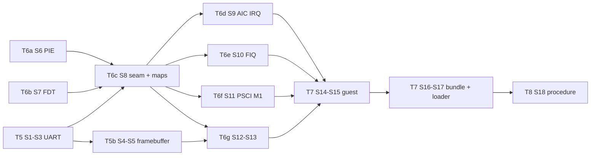

# PLAN: implementation steps for T5-T8 (watari-el2-m1boot)

- Project: Watari Boot, subsystem "watari-el2-m1boot" · Date: 2026-11-10 · Version: 0.2 (revised 2026-11-11 after the independent review of 0.1) · Status: draft
- Linked documents: [README](README.md) · [DESIGN](DESIGN.md) · [RISKS](RISKS.md) · [draft ADR](../../adr/draft-m1-first-boot.md)
- Marking as in DESIGN section 0. "D 5.2" means DESIGN.md section 5.2.

## Rules for every step

- No downloads, no installations. `dtc` (already installed, `docs/INSTALLED.md`) and the Homebrew LLVM are the only tools.
- QEMU must keep working: after every step `make -C el2 test` and `el2/boot/run-all.sh` are 15/15 in the default configuration and with `WEL2_ARGS="wel2.e2h=0 wel2.gran=4k"`. Steps that touch the boot path also need one Windows boot (`run-m2.sh`, trap mode, GICv2m) before the task is closed.
- Nothing M1-specific can run on the bench: each M1 piece is written behind an accessor (MMIO or system-register function pointers) and **host-tested with a fake**, the way `pirq_aic.c` / `tests/fake_aic.h` already are. Code that cannot be host-tested (assembly, the seam itself) is exercised in QEMU through the platform-neutral path.
- Written from the specifications and from DESIGN; nothing copied from m1n1, Linux or KVM. Every hardware constant carries its [verified: …] source in a comment, taken from DESIGN.
- The platform is chosen **at run time from the FDT** (a node compatible with `apple,aic`, D 4.3), never by a build flag: one binary for QEMU and the M1.
- The layer never prints the FDT's `serial-number`, `/smbios`, MAC-address or seed properties (D 4.3).

## Task mapping (for `ralph/TASKS-m3a.md`)

T5 is being done now with the s5l UART only (steps S1-S3). Everything else:

| Task | Steps | One-line completion criterion |
|---|---|---|
| **T5b** Framebuffer output | S4, S5 | `test_fb.c` green (both pixel formats, bounds, text); `putc_` mirrors to the framebuffer when the FDT has one; a checkpoint can be painted with the MMU off; `run-all.sh` 15/15 both configs (no framebuffer in QEMU = no-op). |
| **T6a** Position-independent image, run-time layout | S6 | The ELF has only `R_AARCH64_RELATIVE` relocations and `start.S` has no `ldr =sym` (build checks); the same `wel2.bin` passes `run-all.sh` 15/15 in both configs, linked at 0 and loaded at `0x40080000`; `test_pt.c` covers a carve-out at a high 32 MB aligned base. |
| **T6b** FDT queries for the M1 | S7 | `test_fdt_m1.c` green on a j293-shaped tree (8 cpus, several memory ranges incl. one wholly reserved, reservations, AIC, UART, WDT, framebuffer), on malformed blobs and on a QEMU-shaped tree; `fdt_m1_dump` host tool builds and prints the same facts without any identifying property. |
| **T6c** Platform seam and M1 memory maps | S8 | All QEMU hardware access goes through `g_plat` (`plat_qemu.c`); `run-all.sh` 15/15 both configs and one Windows boot to the desktop (pure refactor); `test_pt.c` builds the j293 EL2 and guest maps from the T6b fixture within the table pools. |
| **T6d** AIC IRQ path | S9 | `plat_m1` drains the AIC through `pirq_aic_poll` → `pirq_arrive`; drain-loop host test green; `run-m1-6.sh` unchanged. Needs T2. |
| **T6e** Apple FIQ module | S10 | `test_apple_fiq.c` green (every cause, timer-control reset before the gates open, IPI value by `Aff1`/`Aff0`, spurious budget); the `llvm-objdump` encoding check passes; vector 10 and the three physical-GIC uses in `cpuif.c` go through `g_plat`; QEMU unchanged. |
| **T6f** PSCI on the M1 | S11 | `test_cpu_start.c` green (store → clean → `SEV`; park and re-start by wake flag + `SEV`; timers reset on re-entry); no `smc` reachable on the M1 platform; `run-m1-3.sh` passes CPU_ON/OFF/ON through the seam. |
| **T6g** Trap configurations, ID registers, PAuth, M1 boot sequence | S12, S12b, S13 | `CPUIF=trap-notc` passes every run script; `wel2.tid3=1` run shows ID registers unchanged except GIC; `HCR_EL2.API\|APK` set when PAuth exists; `wel2.step=1` resets right after relocation and `wel2.step=2` after the banner, in QEMU; checkpoint numbers documented in `el2/boot/README.md`. |
| **T7** Test guest and packaging | S14-S17 | `run-m1guest.sh` prints `G1 PASS` … `G11` with `-smp 4` in `trap`, `trap-notc` and `hw`, both E2H/granule configs, all guest output arriving through `WEL2_LOG`/`WEL2_CHECKPOINT`; `tools/m3a/build-m1-payload.sh` builds the bundle (layer, guest, minimal DTB, loader, `fdt_m1_dump` source, sums) with no network; the loader's call-order test passes. |
| **T8** Day-2 hardware procedure | S18 | `docs/procedures/m3a-day2-hardware.md` covers rungs L0-L5 with the exact commands, expected checkpoints and text, abort and recovery; reviewed by an independent agent against DESIGN, PLAN and the T5-T7 code; every step not run is marked [check]. |

## Order and dependencies

T6a and T6b are independent of each other and of T5.

## T5 and T5b: Apple UART and the framebuffer

| # | Step | Files | Test |
|---|---|---|---|
| S1 | UART driver behind an accessor: `struct wel2_uart { type (PL011, S5L), io {rd32, wr32, ctx}, stats }`; `wel2_uart_putc()` with a **bounded** wait (PL011: `FR.TXFF` clear; S5L: `UTRSTAT` (`0x10`) bit 1 set, then `UTXH` (`0x20`)), dropped-byte counter (D 7) | new `el2/include/wel2_uart.h`, `el2/vgic/uart.c` (pure, host-buildable) | new `el2/tests/test_uart.c` + `tests/fake_uart.h`: byte order, wait until the status bit flips, timeout drops and counts, PL011 behaviour unchanged |
| S2 | `putc_` goes through one global `g_uart` (MMIO accessor over a base address). Default = PL011 at `0x09000000`, so QEMU output is identical from the first byte | `el2/boot/util.c`, `el2/boot/boot.h`, `el2/boot/Makefile` | `run-all.sh` 15/15 (every script compares UART text) |
| S3 | FDT lookup `fdt_find_compatible_reg(fdt, "apple,s5l-uart", &base, &size)` (first match; reads only, `-mstrict-align`), called early; when found, `g_uart` = S5L at that base. Before that, output goes to a small early buffer that is flushed once the UART is known. (The EL2 stage-1 mapping of the UART page on the M1 comes with S8.) | `el2/boot/fdt.c`, `fdt.h`, `el2/boot/stage1.c`, `util.c` | host test: lookup on a synthetic FDT with and without the node; QEMU unchanged |
| S4 (T5b) | Framebuffer back end: `struct wel2_fb { base, width, height, stride, format }` from `/chosen/framebuffer@*`; `fb_checkpoint(index, colour)` (a square in a row at the top), formats `x2r10g10b10` and `x8r8g8b8`; every call is a no-op without a framebuffer. The checkpoint routine uses only aligned 32-bit stores and no global state beyond `g_fb`, so it can run **with the MMU off** (`-mstrict-align`); the EL2 stage 1 later maps the framebuffer as Normal non-cacheable (D 7; the mapping itself is S8) | new `el2/include/wel2_fb.h`, `el2/vgic/fb.c`; `fdt.c` (`fdt_get_framebuffer`) | new `el2/tests/test_fb.c`: draws into a host buffer, checks pixel values for both formats, bounds (never writes outside `height * stride`), no-op without a framebuffer |
| S5 (T5b) | Text on the framebuffer: an original 5 x 7 bitmap font (digits, A-Z, space and `. : = - _ x /`; lower case drawn as upper case), integer scaling, line wrap, scroll by clearing; `putc_` mirrors to it when present. `fatal()` and `fatal_msg()` paint the current checkpoint red first | `el2/vgic/fb.c`, new `el2/vgic/font5x7.h` (drawn for this project, MIT), `el2/boot/util.c`, `main.c` | `test_fb.c`: glyph placement and scaling, wrap, unknown character → blank; a PPM written by the test, looked at once |

## T6a: position-independent image, run-time layout

| # | Step | Files | Test |
|---|---|---|---|
| S6 | PIE build (D 2.3 "Build details"): compile with `-fpie -fvisibility=hidden` (drop `-fno-pic`); link `-pie --no-dynamic-linker -z norelro` at address 0, `.rela.dyn` kept in the image with `__rela_start/__rela_end`, **no RELR**. `start.S`: remove **every** `ldr xN, =symbol` (use `adrp` + `add`), in `reset`, `secondary_entry`, `bad_core` and `s1_enable` alike; mask all of DAIF first at `reset` and `secondary_entry` (D 2.2); on the boot core apply each `R_AARCH64_RELATIVE` entry before any C and before `.bss` is zeroed; then `DC IVAC` over the **whole image**, `.bss` and stacks. `image_size` in the header covers image, `.bss`, stacks and pools. Replace the constants `0x40080000`, `GUEST_RAM_BASE`, `WEL2_CARVE_SIZE` by run-time values: `g_layer_base` (address of `_start`), `g_carve_base/g_carve_size` (QEMU: RAM base and 2 MB as today; M1: the layer's 32 MB block, D 2.3) | `el2/boot/start.S`, `linker.ld`, `Makefile`, `boot.h`, `stage1.c`, `main.c`, `el2/vgic/maps.c`, `el2/include/wel2_maps.h`, `tests/test_pt.c` | Makefile checks: `llvm-readelf -r` shows only `R_AARCH64_RELATIVE` and no `.relr.dyn`/GOT section; `grep` finds no `ldr .*, =` in `start.S`. `run-all.sh` 15/15 in both configurations (QEMU loads at `0x40080000` ≠ link address 0, so the relocation loop runs); `test_pt.c`: the carve-out at a high, 32 MB aligned base |

## T6b: FDT parsing for the M1

| # | Step | Files | Test |
|---|---|---|---|
| S7 | Read-only queries, all bounded and `-mstrict-align`: memory reservation block iterator; all `/memory` `reg` pairs; `/reserved-memory` children; `/cpus/cpu@*` (`reg` 2 cells, `cpu-release-addr` 8 bytes) in node order; `fdt_find_compatible_reg` for `apple,aic`, `apple,s5l-uart`, `apple,wdt`; `/chosen/framebuffer@*`; boot arguments `wel2.guest=<hex>`, `wel2.step=<n>`, `wel2.cpuif=trap-notc`. The file must also build for the host (no EL2-only dependency), for `fdt_m1_dump`: a small host program that prints, for a `.dtb` file, exactly what the layer would use (platform, RAM ranges after rounding, reservations, cores, device bases, framebuffer geometry) and **nothing else** from the blob | `el2/boot/fdt.c`, `fdt.h`, `el2/boot/main.c` (`parse_bootargs`), new `tools/m3a/fdt_m1_dump.c` | new `el2/tests/test_fdt_m1.c` with a small FDT builder for tests (`tests/fdt_build.h`): a j293-shaped tree (8 cpus with the measured MPIDRs; three `/memory` pairs, **one of them lying entirely inside a `/reserved-memory` child**, as m1n1 produces when it adds reserved regions back to the RAM map; reservation-block entries; AIC, UART, WDT, framebuffer; a `serial-number` property that must never appear in any output), malformed and truncated blobs, a QEMU-shaped tree (no Apple node → platform QEMU). Second fixture: the DTB compiled from the DTS of S16 when `dtc` is present (skipped with a message otherwise) |

## T6c: the platform seam and the M1 memory maps

| # | Step | Files | Test |
|---|---|---|---|
| S8 | `struct plat_ops` (INTERFACES 8.4, trimmed to what exists): `name`, `discover_cpus()`, `init_boot()`, `init_cpu()`, `cpu_start(idx, entry)`, `cpu_park()`, `kick(idx)`, `timer_mask(virt)`, `timer_unmask(virt)`, `irq()`, `fiq()`, `reset()`, `poweroff()`. `plat_qemu.c` wraps today's `gic_phys.c`, `psci_smc`, and the physical-GIC part of `cpuif_irq`; `plat_m1.c` starts as stubs that `fatal_msg("not implemented")`. All direct calls from `main.c`, `psci.c`, `cpuif.c` go through `g_plat`. The vGIC window bases (`GICD_PHYS`, `GICR_PHYS`) become platform values: QEMU as today, M1 `0xF_0000_0000` / `0xF_1000_0000` (INTERFACES 4). M1 maps: EL2 stage 1 = RAM ranges (Normal) + AIC, UART, WDT (Device) + framebuffer (**Normal non-cacheable**, a new MAIR attribute); guest stage 2 = RAM ranges minus reservations minus the layer block, all at 32 MB granularity (D 4.3), and **no device at all** (the test guest talks through hypercalls, D 8); everything else faults to EL2 and is reported | new `el2/boot/plat.h`, `plat_qemu.c`, `plat_m1.c`; `main.c`, `psci.c`, `cpuif.c`, `boot.h`, `stage1.c`, `el2/vgic/maps.c`, `pt.c`, `wel2_maps.h`, `wel2_pt.h`, `Makefile` | `run-all.sh` 15/15 both configurations and one Windows boot (pure refactor on QEMU); `test_pt.c`: the j293 maps from the S7 fixture (RAM at `0x8…`, 36-bit PA, reservations and the wholly reserved range removed, layer block unmapped, vGIC holes fault, AIC/UART not mapped for the guest, framebuffer attribute), table count within the pools |

## T6d-T6g: M1 back ends

| # | Step | Files | Test |
|---|---|---|---|
| S9 (T6d) | AIC IRQ path: `plat_m1` `init_boot` = `pirq_aic_init` over the mapped AIC with the FDT core list as `cpu_of_vcpu`; `init_cpu` = `pirq_aic_init_cpu` (WHOAMI check); `irq()` = drain loop `pirq_aic_poll` → `pirq_arrive` (move the logic of `pirq_qemu_aic_irq` to a shared place). Needs T2 (SW_CLR on take, AIC window `0xc000`) merged first | `el2/boot/plat_m1.c`, `el2/boot/pirq_qemu.c`, `el2/vgic/pirq.c` | existing `test_pirq_aic.c` plus a drain-loop test with `fake_aic.h` (several pending sources, spurious zero, bad event); the hybrid QEMU script `run-m1-6.sh` stays inert/green |
| S10 (T6e) | Apple FIQ module behind a system-register accessor (`struct apple_sysreg_io { rd(id), wr(id, v) }`; ids for `VM_TMR_FIQ_ENA_EL2`, `CNTV_CTL_EL02`, `CNTP_CTL_EL02`, the `CNTHV`/`CNTHP` controls, `IPI_SR_EL1`, `IPI_RR_GLOBAL_EL1`, `PMCR0`, `UPMCR0`, `UPMSR`, `ICH_HCR_EL2`, `ICH_MISR_EL2`). `apple_fiq_init_cpu()` in the order of D 5.2: quiesce, **write 0 to `CNTV_CTL_EL02` and `CNTP_CTL_EL02`, then** open the gates. `apple_fiq()` = D 5.2 steps 1-6 with counters and the spurious budget. `apple_ipi_send(target_mpidr)` = one write to **`IPI_RR_GLOBAL_EL1`**, core = `Aff0` in [7:0], cluster = **`Aff1`** in [23:16] (D 5.1); the local form is not used. `apple_timer_mask/unmask`. The real accessor (`mrs`/`msr` by generic encoding name) lives in `plat_m1.c`, one small function per register. `el2_exception`: index 10 → `g_plat->fiq()`. `cpuif.c`: the three physical-GIC uses (timer PPI mask/unmask, maintenance PPI, SGI kick) go through `g_plat` | new `el2/include/wel2_apple_fiq.h`, `el2/vgic/apple_fiq.c`; `el2/boot/plat_m1.c`, `main.c`, `cpuif.c`, `Makefile` | new `el2/tests/test_apple_fiq.c` + `tests/fake_apple_sysreg.h`: each cause alone and combined; **init with `CNTV_CTL_EL02` = 5 (enabled, firing, unmasked) preset: the recorded write order must show the control written 0 before the gate bit is set, and no timer injection follows**; the same after a park/re-entry; the gate closes and reopens with the timer line; IPI ack; maintenance left pending → enable bits cleared, no loop; PMU switched off; spurious budget → reported; IPI register value for E→E, E→P, P→E (cluster field 0 or 1 from `Aff1`). **Build check (Makefile):** `llvm-objdump -d plat_m1.o`, extract the `mrs`/`msr` instructions with IMPLEMENTATION DEFINED encodings and compare the set with the table of D 5.1 (`s3_5_c15_c1_3`, `s3_5_c15_c0_1`, `s3_5_c15_c1_1`, `s3_1_c15_c0_0`, `s3_7_c15_c0_4`, `s3_7_c15_c6_4`, plus `S3_5_C14_C3_1` for `CNTV_CTL_EL02` [verified: R:el2/boot/README.md] and `S3_5_C14_C2_1` for `CNTP_CTL_EL02` **[hypothesis: by analogy, CRm 2 = physical timer; check against the Arm ARM when writing the code]**); an unexpected or missing encoding fails the build |
| S11 (T6f) | PSCI on the M1: `cpu_start`, first time = store the little-endian address of `secondary_entry` at the core's release address, `DC CVAC`, `DSB`, `SEV`; after a park = set the wake flag, `SEV` (**no IPI**, D 3.3). `cpu_park` = the EL2 loop `wfe` + re-read the flag, timer gates closed first. On re-entry the core runs `apple_fiq_init_cpu()` again (timer controls reset) before its `eret`. `reset` = watchdog sequence (D 6), `poweroff` = halt with message and checkpoint. `psci.c` keeps the checks and calls `g_plat`; no `smc` is reachable when the platform is M1 (`psci_smc` moves into `plat_qemu.c`) | `el2/boot/psci.c`, `plat_m1.c`, `plat_qemu.c`, `main.c` (`el2_secondary_main` re-entry after park) | host test of the release/park state machine with fake memory and recorded "clean"/"sev" hooks (`el2/tests/test_cpu_start.c`): order store → clean → event; second start uses the wake flag and only `SEV`; bad index refused. QEMU: `run-m1-3.sh` (CPU_ON/OFF/ON through the seam) |
| S12 (T6g) | ID-register emulation: `HCR_EL2.TID3` when the platform is M1 or `wel2.tid3=1`; sysreg trap (EC 0x18) for the ID group: the real value read at EL2 for the registers the CPU implements, `ID_AA64PFR0_EL1.GIC` forced to 1, zero for the rest of the group; `ELR` advanced (D 5.4). PAuth fields are passed through unchanged (D 5.1) | new `el2/boot/idreg.c`, `el2/vgic/idreg_tbl.c`; `main.c` | host test of the decode table; QEMU: a `wel2.tid3=1` run of the guest of S15 compares every ID register it reads with and without the trap (`-cpu max` already reports GIC = 1) |
| S12b (T6g) | Trap configuration `trap-notc` (D 5.4): boot argument `wel2.cpuif=trap-notc` → `ICH_HCR_EL2 = En \| TALL0 \| TALL1 \| TDIR` (no `TC`); when loading hardware state into the model, PMR comes from `ICH_VMCR_EL2.VPMR` and EOImode from `VEOIM` (already the storage in trap mode: check that nothing in `vcif` keeps a private copy that the untrapped registers would bypass); per-register trap counters exported through `WEL2_STATS`. On the M1 only `trap` and `trap-notc` are accepted (`hw` is refused with a log line and replaced by `trap`) | `el2/boot/cpuif.c`, `el2/vgic/vcif.c`, `el2/include/wel2_vcif.h`, `main.c`, every `run-*.sh` (accept `CPUIF=trap-notc`), `run-all.sh` | `test_vcif.c`: with the three `TC` registers untrapped, a PMR change made "by hardware" (written into the fake `ICH_VMCR`) is honoured at the next IAR/flush; `run-all.sh` with `CPUIF=trap-notc`; one Windows boot in `trap-notc` |
| S13 (T6g) | M1 boot sequence and its checkpoints. `g_hcr` gains `API \| APK` when the ID registers report PAuth (all platforms). Order and checkpoint numbers: **`start.S`/`stage1.c`, MMU off:** relocate → `wel2.step=1`? then watchdog reset (rung L1; needs only the FDT lookups of S7) → framebuffer lookup → **checkpoint 0** → build stage 1 → `s1_enable` → **checkpoint 1**. **C, MMU on:** UART known + banner → 2; platform discover → 3; `apple_fiq_init_cpu` → 4; AIC init → 5; stage 2 on → 6; `cpuif_init` (`trap` or `trap-notc`) → 7; "entering the guest" → 8; guest checks G1.. use squares from 16 on (`WEL2_CHECKPOINT`). `wel2.step=2` resets after 5 (rung L2); steps 3-5 select the guest's checks (D 9). The numbers and their meaning go into `el2/boot/README.md`, which is what T8 quotes | `el2/boot/start.S`, `stage1.c`, `main.c`, `README.md` | QEMU: `WEL2_ARGS=wel2.step=1` ends in a reset before any UART text from C; `wel2.step=2` ends in a reset after the banner; host test of the checkpoint-number table against the README list; `run-all.sh` |

## T7: test guest and packaging

| # | Step | Files | Test |
|---|---|---|---|
| S14 | Guest hand-over and the guest's channel to the outside. `struct wel2_guest_info` (magic `WEL2GINF`, version, platform name, GICD/GICR bases, core count, MPIDR list, selected checks), written by the layer into guest RAM, pointer in x0. Generalise `chain_to_edk2` into "enter the guest at `wel2.guest`" (EDK2 behaviour kept when the argument is absent). **Vendor hypercalls** (INTERFACES 9 range): `WEL2_LOG` `0xC600_0002` (x1 = guest PA, x2 = length ≤ 160; range checked against guest RAM; one line to **all sinks**: UART, framebuffer text, log ring; returns 0 or `INVALID_PARAMETERS`), `WEL2_CHECKPOINT` `0xC600_0003` (x1 = check number, x2 = 0 running / 1 pass / 2 fail → square 16 + number, plus one log line), `WEL2_STATS` `0xC600_0001` (trap counters per ICC register into a guest buffer) | new `el2/include/wel2_guest_info.h`, `el2/include/wel2_hvc.h`; `el2/boot/main.c` (`handle_hvc`), `cpuif.c` (counters), `docs/design/watari-el2/INTERFACES.md` is **not** edited by this task (the addition is recorded here and in DESIGN 8) | host test of the info-block fill and of the hypercall argument checks (bad address, length, range straddling the end of RAM); QEMU through S15 |
| S15 | The EL1 guest: separate PIE flat binary, own `start.S` (stack, `.bss`, relocation, `VBAR_EL1` table with a real IRQ handler and a reporting handler for every other vector), **all output through `WEL2_LOG` / `WEL2_CHECKPOINT`** (no UART code, no code or lock shared with EL2), checks G1-G11 of D 8 with **G5a (`TALL1` group) and G5b (`TC` group, judged with `WEL2_STATS` against the configuration named in the info block)**, G3 including a PAuth sign/authenticate when available. Secondary entry for G9/G10. Ends with `SYSTEM_RESET` (or `SYSTEM_OFF` when asked) | new `el2/guest/` (`start.S`, `main.c`, `gic.c`, `hvc.S`, `linker.ld`, `Makefile`), new `el2/boot/run-m1guest.sh` (QEMU: chain build + `-device loader,file=m1guest.bin,addr=<in RAM>,force-raw=on` + `-append "wel2.guest=0x…"`), added to `run-all.sh` | `run-m1guest.sh` expects `G1 PASS` … `G11`, `-smp 4`, with `CPUIF=trap`, `trap-notc` and `hw`, both E2H/granule configurations; a negative control: the layer built with the `TC` bit forced off while reporting `trap` must make G5b fail and name `TC` |
| S16 | Minimal j293 DTS (D 4.2) and the bundle script. `tools/m3a/build-m1-payload.sh`: builds the chain-style layer image, the guest, compiles the DTS with `dtc -I dts -O dtb` (clear error if `dtc` is missing; no download), checks the layer image against the 32 MB block and the `Image` header fields, writes `SHA256SUMS`, copies everything plus `boot_wel2.py` and `fdt_m1_dump.c` into one folder `build-m1/bundle/` (git-ignored) to carry to the host Mac | new `tools/m3a/dts/watari-j293-min.dts`, `tools/m3a/build-m1-payload.sh`; `.gitignore`; `tools/m3a/README.md` | the script runs clean twice (identical sums); `dtc -I dtb -O dts` round trip of the DTB; `test_fdt_m1.c` second fixture parses it; `fdt_m1_dump` on it prints the expected platform, cores and bases |
| S17 | Host loader `tools/m3a/boot_wel2.py` (D 2.5): no `m1n1.setup`. Order: connect → **allocate and write** DTB, layer, guest → cache maintenance → **then** build and set the boot arguments (they contain the guest address) → optional `smp_start_secondaries` → `kboot_prepare_dt` → (`--dry-run`: read the prepared FDT back to a file in the host folder, run `fdt_m1_dump` on it, stop: rung L0) → `kboot_boot`, where **a timeout or serial error after the request was sent counts as success** ("handed over"). Arguments `--step N`, `--cpuif trap|trap-notc`, `--dtb`, `--no-smp`, `--dry-run`, `--fdt-addr 0x…` (manual address if the console line cannot be captured), `--args`. Prints every address it used and the SHA-256 of what it sent; refuses to run if the bundle sums do not match; never prints FDT contents | new `tools/m3a/boot_wel2.py`, `tools/m3a/tests/fake_proxy.py`; `tools/m3a/README.md` (new row: writes on the target = RAM only) | `python3 -m py_compile`; a run against the stub proxy that records the call order (allocations before `kboot_set_chosen`; cache maintenance before `prepare_dt`; `--dry-run` never calls `kboot_boot`; an exception raised by the stub's `kboot_boot` after "send" ends with exit 0, one raised before does not). Real behaviour: [check] on day 2 |

Manual hardware-day step to document instead of automating (T7 criterion): the **fallback DTB**. If m1n1 rejects the minimal DTB at rung L0, the people may supply an upstream `t8103-j293.dtb` (`--dtb`): built beforehand on Marco's Mac from a Linux tree he already has or obtains after the usual backup confirmation, or taken from an Asahi installation's ESP **[check: where the installer stores it]**. Never fetched by a script.

## T8: day-2 hardware procedure

| # | Step | Files | Test |
|---|---|---|---|
| S18 | `docs/procedures/m3a-day2-hardware.md`, same shape as day 1: instructions for Claude on the host Mac first (one step at a time, never type on Marco's Mac, zero footprint on the host: the bundle lives in `~/WatariBoot-host/`, FDT dumps never leave it); prerequisites (fresh Time Machine backup on Marco's Mac, DFU dry run offered again, the bundle and its sums, the m1n1 proxyclient already in the host folder, `fdt_m1_dump` compiled there with the existing `cc`); the optional serial kit (D 7) as an explicit people decision with its footprint (`sudo`, clone, build), the port and cable points marked [check], the non-rebooting `macvdmtool serial` command, and the "m1n1's own text is visible first" test; the read-only ADT check of the vGIC windows (RISKS R-11) before L3; the ladder **L0-L5** (D 9), for each rung: the exact command, **the expected checkpoint row and text lines** (from `el2/boot/README.md` and the `run-m1guest.sh` expectations), what to photograph, abort criteria (L1: no restart within 5 s; later rungs: 60 s without progress, a red square, any text containing `FATAL`/`unexpected`), recovery (power button, boot macOS, picker); L3 twice (`--cpuif trap`, then `trap-notc`) and what each outcome means for the default; what to record in `re/m3a-day2-first-boot.md` (per rung: reached checkpoint, text, counters; the [hypothesis] items of DESIGN 5.4 and RISKS section 2 settled or not; no serial numbers); end-of-day state (macOS default, nothing left on the target, host cleanup as day 1 section 7). Every step that was not run is marked [check] | new `docs/procedures/m3a-day2-hardware.md` | review by an independent agent against DESIGN, PLAN and the code of T5-T7 (file names, argument names, expected lines must match what the scripts print); a dry read-through that every command exists in the bundle |

## Definition of done for "ready for day 2"

1. `make -C el2 test` green including the new suites (`test_uart`, `test_fb`, `test_fdt_m1`, `test_apple_fiq`, `test_cpu_start`, the extended `test_pt` and `test_vcif`).
2. `run-all.sh` 15/15 + `run-m1guest.sh` in `trap`, `trap-notc` and `hw` and both E2H/granule configurations; one Windows boot to the desktop in `trap` and one in `trap-notc`.
3. `tools/m3a/build-m1-payload.sh` produces the bundle from a clean tree with no network access; the Makefile build checks (relocation types, Apple encodings) pass.
4. The procedure exists, is reviewed, and lists the open [hypothesis] items each rung settles.
5. An independent review (Fable, per `ralph/TASKS-m3a.md`) of T6 and T7 against DESIGN sections 2-6.

## What this plan does not cover

EDK2 on the M1 (T11/T12), ACPI tables (T10), device interrupts for real devices (devirq design), `SYSTEM_OFF` through the SMC, real core power-down, the standalone appended-payload boot (path B), cpufreq, a "return to m1n1" mode (RISKS Q-10).
