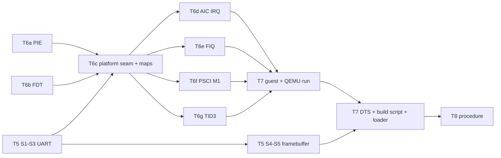

# PLAN: implementation steps for T5-T8 (watari-el2-m1boot)

- Project: Watari Boot, subsystem "watari-el2-m1boot" · Date: 2026-11-10 · Version: 0.1 · Status: draft
- Linked documents: [README](README.md) · [DESIGN](DESIGN.md) · [RISKS](RISKS.md) · [draft ADR](../../adr/draft-m1-first-boot.md)
- Marking as in DESIGN section 0. Section numbers below ("D 5.2") point into DESIGN.md.

## Rules for every step

- No downloads, no installations. `dtc` (already installed, `docs/INSTALLED.md`) and the Homebrew LLVM are the only tools.
- QEMU must keep working: after every step `make -C el2 test` and `el2/boot/run-all.sh` are 15/15 in the default configuration and with `WEL2_ARGS="wel2.e2h=0 wel2.gran=4k"`. Steps that touch the boot path also need one Windows boot (`run-m2.sh`, trap mode, GICv2m) before the task is closed, as T6's criterion says.
- Nothing M1-specific can be run on the bench: each M1 piece is written behind an accessor (MMIO or system-register function pointers) and **host-tested with a fake**, the way `pirq_aic.c` / `tests/fake_aic.h` already are. Code that cannot be host-tested (assembly, the seam itself) is exercised in QEMU through the platform-neutral path.
- Written from the specifications and from DESIGN; nothing copied from m1n1, Linux or KVM. Every hardware constant carries its [verified: …] source in a comment, taken from DESIGN.
- The platform is chosen **at run time from the FDT** (a node compatible with `apple,aic`, D 4.3), never by a build flag: one binary for QEMU and the M1.

## Order and dependencies

T6 is too large for one task: it is split into **T6a-T6g** below (the task list allows it). T6a and T6b are independent of each other and of T5.

## T5: Apple UART and the framebuffer

| # | Step | Files | Test |
|---|---|---|---|
| S1 | UART driver behind an accessor: `struct wel2_uart { type (PL011, S5L), io {rd32, wr32, ctx}, stats }`; `wel2_uart_putc()` with a **bounded** wait (PL011: `FR.TXFF` clear; S5L: `UTRSTAT` (`0x10`) bit 1 set, then `UTXH` (`0x20`)), dropped-byte counter (D 7) | new `el2/include/wel2_uart.h`, `el2/vgic/uart.c` (pure, host-buildable) | new `el2/tests/test_uart.c` + `tests/fake_uart.h`: byte order, `\n` → `\r\n` stays in `puts_`, wait until the status bit flips, timeout drops and counts, PL011 behaviour unchanged |
| S2 | `putc_` goes through one global `g_uart` (MMIO accessor over a base address). Default = PL011 at `0x09000000` so that QEMU output is identical from the first byte | `el2/boot/util.c`, `el2/boot/boot.h`, `el2/boot/Makefile` | `run-all.sh` 15/15 (every script compares UART text) |
| S3 | FDT lookup `fdt_find_compatible_reg(fdt, "apple,s5l-uart", &base, &size)` (first match; reads only, `-mstrict-align`), called early; when found: `g_uart` = S5L at that base. Until then output goes to a small early buffer that is flushed once the UART is known. The EL2 stage 1 must map the UART page before the first `putc_` with the MMU on (S8 does the M1 map; in this step only the lookup and the switch) | `el2/boot/fdt.c`, `fdt.h`, `el2/boot/stage1.c`, `util.c` | host test: lookup on a synthetic FDT with and without the node (helper of S7); QEMU unchanged |
| S4 | Framebuffer back end: `struct wel2_fb { base, width, height, stride, format }` from `/chosen/framebuffer@*`; `fb_checkpoint(index, colour)` (a square in a row at the top), formats `x2r10g10b10` and `x8r8g8b8`; every call is a no-op when no framebuffer was found | new `el2/include/wel2_fb.h`, `el2/vgic/fb.c`; `fdt.c` (`fdt_get_framebuffer`) | new `el2/tests/test_fb.c`: draws into a host buffer, checks pixel values for both formats, bounds (never writes outside `height * stride`), no-op without a framebuffer |
| S5 | Text on the framebuffer: an original 5 x 7 bitmap font (digits, A-Z, space and `. : = - _ x /`; lower case is drawn as upper case), integer scaling, line wrap, scroll by clearing; `putc_` mirrors to it when present. `fatal()` and `fatal_msg()` paint the current checkpoint red first | `el2/vgic/fb.c`, new `el2/vgic/font5x7.h` (drawn for this project, MIT), `el2/boot/util.c`, `main.c` | `test_fb.c`: glyph placement and scaling, wrap, unknown character → blank; a visual check (a PPM written by the test, looked at once) |

S4-S5 were not in T5's original text; DESIGN section 1 item 2 explains why they are needed for day 2. If T5 must stay small, S4-S5 become T5b, but they are a precondition of T8.

## T6a: position-independent image, run-time layout

| # | Step | Files | Test |
|---|---|---|---|
| S6 | Build the layer as PIE: `-fpie` (drop `-fno-pic`), link `-pie` at address 0 with `.rela.dyn` kept and `__rela_start/__rela_end` exported; `start.S`: no absolute literal before relocation (use `adrp`/`add`), apply every `R_AARCH64_RELATIVE` (type 1027: `*(base + offset) = base + addend`) on the boot core before `.bss` is zeroed, and nothing else (any other relocation type = link-time `ASSERT` or a build check with `llvm-readelf -r`); mask all of DAIF first at `reset` and `secondary_entry` (D 2.2). `image_size` in the header covers the image, `.bss`, stacks and pools. Replace the constants `0x40080000`, `GUEST_RAM_BASE`, `WEL2_CARVE_SIZE` by run-time values: `g_layer_base` (address of `_start`), `g_carve_base/g_carve_size` (QEMU: RAM base, 2 MB as today; M1: the layer's 32 MB block, D 2.3) | `el2/boot/start.S`, `linker.ld`, `Makefile`, `boot.h`, `stage1.c`, `main.c`, `el2/vgic/maps.c`, `el2/include/wel2_maps.h`, `tests/test_pt.c` | build check: only `R_AARCH64_RELATIVE` in the ELF; `run-all.sh` 15/15 in both configurations (QEMU loads at `0x40080000` ≠ link address 0, so the relocation loop runs); `test_pt.c` extended: the carve-out at a high, 32 MB aligned base |

## T6b: FDT parsing for the M1

| # | Step | Files | Test |
|---|---|---|---|
| S7 | Read-only queries, all bounded and `-mstrict-align`: memory reservation block iterator; all `/memory` `reg` pairs; `/reserved-memory` children; `/cpus/cpu@*` (`reg` 2 cells, `cpu-release-addr` 8 bytes) in node order; `fdt_find_compatible_reg` for `apple,aic`, `apple,s5l-uart`, `apple,wdt`; `/chosen/framebuffer@*`; boot arguments `wel2.guest=<hex>` and `wel2.step=<n>` | `el2/boot/fdt.c`, `fdt.h`, `el2/boot/main.c` (`parse_bootargs`) | new `el2/tests/test_fdt_m1.c` with a small FDT builder for tests (`tests/fdt_build.h`): a j293-shaped tree (8 cpus with the measured MPIDRs, two memory ranges, three reservations, AIC, UART, WDT, framebuffer), malformed and truncated blobs, a QEMU-shaped tree (no Apple node → platform QEMU). Second fixture: the DTB compiled from the DTS of S16, when `dtc` is present (skipped with a message otherwise) |

## T6c: the platform seam and the M1 memory maps

| # | Step | Files | Test |
|---|---|---|---|
| S8 | `struct plat_ops` (INTERFACES 8.4, trimmed to what exists): `name`, `discover_cpus()`, `init_boot()`, `init_cpu()`, `cpu_start(idx, entry)`, `cpu_park()`, `kick(idx)`, `timer_mask(virt)`, `timer_unmask(virt)`, `irq()`, `fiq()`, `reset()`, `poweroff()`. `plat_qemu.c` wraps today's `gic_phys.c`, `psci_smc`, the physical-GIC part of `cpuif_irq`; `plat_m1.c` starts as stubs that `fatal_msg("not implemented")`. All direct calls from `main.c`, `psci.c`, `cpuif.c` go through `g_plat`. The vGIC window bases (`GICD_PHYS`, `GICR_PHYS`) become platform values: QEMU as today, M1 `0xF_0000_0000` / `0xF_1000_0000` (INTERFACES 4). M1 maps: EL2 stage 1 = RAM ranges + AIC + UART + WDT + framebuffer; guest stage 2 = RAM ranges minus reservations minus the layer block, all at 32 MB granularity (D 4.3), devices **default-deny** except the UART page for the test guest; everything else faults to EL2 and is reported | new `el2/boot/plat.h`, `plat_qemu.c`, `plat_m1.c`; `main.c`, `psci.c`, `cpuif.c`, `boot.h`, `stage1.c`, `el2/vgic/maps.c`, `wel2_maps.h`, `Makefile` | `run-all.sh` 15/15 both configurations and one Windows boot (pure refactor on QEMU); `test_pt.c`: the j293 map from the S7 fixture (RAM `0x8…`, 36-bit PA, reservations removed, layer block unmapped, vGIC holes fault, UART mapped, AIC not mapped for the guest), table count within the pool |

## T6d-T6g: M1 back ends

| # | Step | Files | Test |
|---|---|---|---|
| S9 (T6d) | AIC IRQ path: `plat_m1` `init_boot` = `pirq_aic_init` over the mapped AIC with the FDT core list as `cpu_of_vcpu`; `init_cpu` = `pirq_aic_init_cpu` (WHOAMI check); `irq()` = drain loop `pirq_aic_poll` → `pirq_arrive` (move the logic of `pirq_qemu_aic_irq` to a shared place). Needs T2 (SW_CLR on take, AIC window `0xc000`) merged first | `el2/boot/plat_m1.c`, `el2/boot/pirq_qemu.c`, `el2/vgic/pirq.c` | existing `test_pirq_aic.c` plus a drain-loop test with `fake_aic.h` (several pending sources, spurious zero, bad event); the hybrid QEMU script `run-m1-6.sh` stays inert/green |
| S10 (T6e) | Apple FIQ module behind a system-register accessor (`struct apple_sysreg_io { rd(id), wr(id, v) }`, ids for `VM_TMR_FIQ_ENA_EL2`, `CNTV_CTL_EL02`, `CNTP_CTL_EL02`, `CNTHV/CNTHP` control, `IPI_SR_EL1`, `IPI_RR_LOCAL/GLOBAL_EL1`, `PMCR0`, `UPMCR0`, `UPMSR`, `ICH_HCR_EL2`, `ICH_MISR_EL2`): `apple_fiq_init_cpu`, `apple_fiq()` implementing D 5.2 steps 1-6 with counters and the spurious budget, `apple_ipi_send(mpidr_from, mpidr_to)` (local vs global by cluster, D 5.1), `apple_timer_mask/unmask`. The real accessor (`mrs`/`msr` by encoding, `S3_5_C15_C1_3` style) lives in `plat_m1.c`. `el2_exception`: index 10 → `g_plat->fiq()`. `cpuif.c`: the three physical-GIC uses (timer PPI mask/unmask, maintenance PPI, SGI kick) go through `g_plat` | new `el2/include/wel2_apple_fiq.h`, `el2/vgic/apple_fiq.c`; `el2/boot/plat_m1.c`, `main.c`, `cpuif.c` | new `el2/tests/test_apple_fiq.c` + `tests/fake_apple_sysreg.h`: each cause alone and combined; the gate closes and reopens with the timer line; IPI ack; maintenance left pending → enable bits cleared, no loop; PMU switched off; spurious budget → reported; IPI register value for E→E, E→P, P→E |
| S11 (T6f) | PSCI on the M1: `cpu_start` first time = store the little-endian address of `secondary_entry` at the core's release address, `DC CVAC`, `DSB`, `SEV`; after a park = wake flag + `SEV` + fast IPI. `cpu_park` = the EL2 park loop (D 3.3). `reset` = watchdog sequence (D 6), `poweroff` = halt with message and checkpoint. `psci.c` keeps the checks and calls `g_plat`; no `smc` is reachable when the platform is M1 (`psci_smc` moves into `plat_qemu.c`) | `el2/boot/psci.c`, `plat_m1.c`, `plat_qemu.c`, `main.c` (`el2_secondary_main` re-entry after park) | host test of the release/park state machine with fake memory and a recorded "sev"/"ipi" hook (`el2/tests/test_cpu_start.c`): order store → clean → event, second start uses the wake flag, bad index refused. QEMU: `run-m1-3.sh` (CPU_ON/OFF/ON through the seam) |
| S12 (T6g) | ID-register emulation: `HCR_EL2.TID3` when the platform is M1 or `wel2.tid3=1`; sysreg trap (EC 0x18) for the ID group: real value read at EL2 for the registers the CPU implements, `ID_AA64PFR0_EL1.GIC` forced to 1, zero for the rest of the group; `ELR` advanced (D 5.4) | new `el2/boot/idreg.c`; `main.c` | host test of the decode table (pure part in `el2/vgic/idreg_tbl.c`); QEMU: `WEL2_ARGS=wel2.tid3=1` run of the guest of S14 compares every ID register it reads with and without the trap (`-cpu max` already reports GIC = 1) |
| S13 | M1 boot sequence in `el2_main` / `el2_secondary_main`: order = UART/framebuffer → stage-1 report → platform discover → `apple_fiq_init_cpu` → AIC init → stage 2 → `cpuif_init` (trap mode forced on the M1: `g_cpuif_trap = true` whatever the boot argument says, with a log line) → checkpoint → guest. `wel2.step` stops after the rung asked for (D 9) and resets. Checkpoint numbers documented in `el2/boot/README.md` | `el2/boot/main.c`, `README.md` | QEMU: `WEL2_ARGS=wel2.step=1` ends in a reset after the banner; `run-all.sh` |

## T7: test guest and packaging

| # | Step | Files | Test |
|---|---|---|---|
| S14 | Guest info block: `struct wel2_guest_info` (magic `WEL2GINF`, version, UART type/base, GICD/GICR bases, core count, MPIDR list, framebuffer) filled by the layer inside guest RAM, pointer in x0 | new `el2/include/wel2_guest_info.h`; `el2/boot/main.c` (generalise `chain_to_edk2` into "enter the guest at `wel2.guest`", keep the EDK2 behaviour when no argument is given) | host test of the fill function; QEMU through S15 |
| S15 | The EL1 guest: separate PIE flat binary, own `start.S` (stack, `.bss`, relocation, `VBAR_EL1` table with a real IRQ handler and a reporting handler for everything else), own polled UART output from the info block (no code or lock shared with EL2), checks G1-G11 of D 8, a `guest.tests=` style selection read from the info block (set by the layer from `wel2.step`). Secondary entry for G9/G10. Ends with `SYSTEM_RESET` (or `SYSTEM_OFF` when asked) | new `el2/guest/` (`start.S`, `main.c`, `gic.c`, `uart.c`, `linker.ld`, `Makefile`), new `el2/boot/run-m1guest.sh` (QEMU: chain build + `-device loader,file=m1guest.bin,addr=<in RAM>,force-raw=on` + `-append "wel2.guest=0x… "`), added to `run-all.sh` | `run-m1guest.sh` expects `G1 PASS` … `G11`, `-smp 4`, in `CPUIF=trap` and `CPUIF=hw`, both E2H/granule configurations. This is the "payload runs under the layer in QEMU" criterion of T7 |
| S16 | Minimal j293 DTS (D 4.2) and the bundle script. `tools/m3a/build-m1-payload.sh`: builds the chain-style layer image (trap mode default), the guest, compiles the DTS with `dtc -I dts -O dtb` (clear error if `dtc` is missing; no download), checks the layer image against the 32 MB block and the `Image` header fields, writes `SHA256SUMS`, copies everything plus `boot_wel2.py` into one folder `build-m1/bundle/` (git-ignored) to carry to the host Mac | new `tools/m3a/dts/watari-j293-min.dts`, `tools/m3a/build-m1-payload.sh`; `.gitignore`; `tools/m3a/README.md` | the script runs clean twice (reproducible sums); `dtc -I dtb -O dts` round trip of the DTB; `test_fdt_m1.c` second fixture parses it; `fdt_check` of the layer accepts it |
| S17 | Host loader `tools/m3a/boot_wel2.py` (D 2.5): no `m1n1.setup`; arguments `--step N`, `--dtb`, `--no-smp`, `--dry-run` (stops after `kboot_prepare_dt`: rung L0), `--args "extra wel2 arguments"`; prints every address it used and the SHA-256 of what it sent; refuses to run if the bundle sums do not match | new `tools/m3a/boot_wel2.py`; `tools/m3a/README.md` (new table row: what it writes on the target = RAM only) | `python3 -m py_compile`; a run against a stub proxy object (`tools/m3a/tests/fake_proxy.py`) that records the call order: set_chosen → writes → cache maintenance → (smp) → prepare_dt → boot. Real behaviour: [check] on day 2 |

Manual hardware-day step to document instead of automating (T7 criterion): the **fallback DTB**. If m1n1 rejects the minimal DTB at rung L0, the people may supply an upstream `t8103-j293.dtb` (`--dtb`): built beforehand on Marco's Mac from a Linux tree he already has or obtains after the usual backup confirmation, or taken from an Asahi installation's ESP **[check: where the installer stores it]**. Never fetched by a script.

## T8: day-2 hardware procedure

| # | Step | Files | Test |
|---|---|---|---|
| S18 | `docs/procedures/m3a-day2-hardware.md`, same shape as day 1: instructions for Claude on the host Mac first (one step at a time, never type on Marco's Mac, zero footprint on the host: the bundle lives in `~/WatariBoot-host/`); prerequisites (fresh Time Machine backup on Marco's Mac, DFU dry run offered again, the bundle and its sums, the m1n1 proxyclient already in the host folder); optional serial kit (D 7) as an explicit people decision with its footprint (`sudo`, clone, build) and the "m1n1 text visible first" check; the ladder L0-L4 (D 9), for each rung: the exact command, **the expected checkpoint row and the expected text lines** (taken from the `run-m1guest.sh` expectations and the layer's banner), what to photograph, abort criteria (60 s without progress, a red checkpoint, any text containing `FATAL`/`unexpected`), recovery (power button, boot macOS, picker); what to record in `re/m3a-day2-first-boot.md` (per rung: reached checkpoint, text, counters; the [hypothesis] items of DESIGN 5.4 settled or not); end-of-day state (macOS default, nothing left on the target, host cleanup as day 1 section 7). Every step that was not run is marked [check] | new `docs/procedures/m3a-day2-hardware.md` | review by an independent agent against DESIGN, PLAN and the code of T5-T7 (file names, argument names, expected lines must match what the scripts print); a dry read-through that every command exists in the bundle |

## Definition of done for "ready for day 2"

1. `make -C el2 test` green including the new suites (`test_uart`, `test_fb`, `test_fdt_m1`, `test_apple_fiq`, `test_cpu_start`, the extended `test_pt`).
2. `run-all.sh` 15/15 + `run-m1guest.sh` in both cpuif modes and both E2H/granule configurations; one Windows boot to the desktop.
3. `tools/m3a/build-m1-payload.sh` produces the bundle from a clean tree with no network access.
4. The procedure exists, is reviewed, and lists the open [hypothesis] items each rung settles.
5. An independent review (Fable, per `ralph/TASKS-m3a.md`) of T6 and T7 against DESIGN sections 2-6.

## What this plan does not cover

EDK2 on the M1 (T11/T12), ACPI tables (T10), device interrupts for real devices (devirq design), `SYSTEM_OFF` through the SMC, real core power-down, the standalone appended-payload boot (path B), cpufreq.
