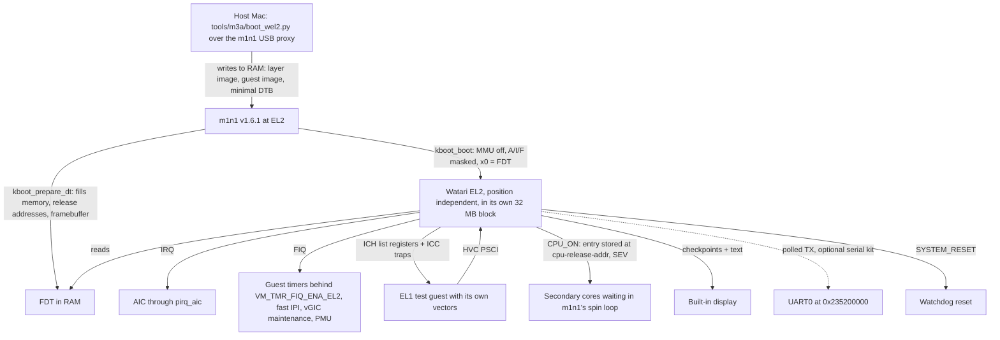

# watari-el2-m1boot: first boot of Watari EL2 on the real M1 through m1n1

- Project: Watari Boot · Ralph task T4 (`ralph/TASKS-m3a.md`) · Date: 2026-11-10 · Version: 0.1 · Status: **draft, not yet reviewed by an independent agent**
- Scope: how the layer in `el2/` gets from "boots in QEMU" to "boots on Marco's 13" M1 MacBook Pro (j293, t8103) from m1n1 v1.6.1, with the EL1 test payload as its first guest". Day 2 of M3a.
- Out of scope: EDK2 and ACPI on the M1 (T10-T12), device interrupts for real devices (`../watari-el2-devirq/`), Windows.

## Files

| File | Content |
|---|---|
| [DESIGN.md](DESIGN.md) | The questions of T4 answered with sources: m1n1 hand-over, secondary cores, device tree, FIQ timer and the virtual CPU interface, PSCI, log output, first guest, recovery |
| [PLAN.md](PLAN.md) | Numbered steps S1-S18 for T5, T6 (split into T6a-T6g), T7, T8: files to touch and the test of each step |
| [RISKS.md](RISKS.md) | Risk table R-1..R-16 and open questions Q-1..Q-12 |
| [draft ADR](../../adr/draft-m1-first-boot.md) | The decisions that need Marco's approval |

Deviation from the standard design-session file set (as in `watari-el2-devirq`): no PRD and no separate TEST_STRATEGY. The requirement is one sentence (the scope above) and the tests are part of each plan step.

## The design in one page

## Decisions (evidence in DESIGN, approval in the ADR)

| ID | Decision | DESIGN |
|---|---|---|
| D-1 | Hand-over through m1n1's **Linux boot path driven from the proxy** (`kboot_prepare_dt` + `kboot_boot`), everything in RAM; the layer becomes a **position-independent** `Image` | 2 |
| D-2 | The layer lives in one **32 MB, 32 MB aligned block** chosen by the loader | 2.3 |
| D-3 | Device tree = an FDT prepared by m1n1 from **our own minimal j293 DTS** (built with the `dtc` already installed); upstream `t8103-j293.dtb` as manual fallback; the layer never reads the ADT | 4 |
| D-4 | The **platform is chosen at run time from the FDT** (`apple,aic` present): one binary for QEMU and the M1, a `plat_ops` seam in front of UART, core discovery, physical interrupt controller, firmware calls and memory layout | 4.3, 10 |
| D-5 | Guest timers: FIQ at EL2, masked with the **`VM_TMR_FIQ_ENA_EL2` gate bits**, injected as vPPI 27/30 through the existing vGIC | 5.2 |
| D-6 | Virtual CPU interface on the M1: **hardware list registers plus all `ICC_*` traps (`TRAP_EMULATE`), forced**; `ID_AA64PFR0_EL1.GIC` presented as 1 through `HCR_EL2.TID3` | 5.4 |
| D-7 | PSCI entirely in the layer: `CPU_ON` = **m1n1 spin-table release**, `CPU_OFF` = park inside the layer, `SYSTEM_RESET` = watchdog, `SYSTEM_OFF` = halt; never `smc` | 3.3, 6 |
| D-8 | Output: **framebuffer checkpoints and text first**, UART0 polled TX as the full log for whoever has the serial kit | 7 |
| D-9 | First guest = a **separate** EL1 test binary with its own vectors, the same binary in QEMU and on the M1; hardware runs climb a **ladder L0-L4** | 8, 9 |

## Three findings the task text did not expect

1. The M1 **does** have the GICv3 virtual CPU interface (`ICH_*`), although its ID register says it has no GIC system registers. The layer keeps using it; a pure software CPU interface could not serve an unmodified guest at all (DESIGN 1 and 5.4).
2. The USB link used on day 1 **disappears at hand-over**, and the hardware UART needs a special set-up. Hence the framebuffer (DESIGN 1 and 7).
3. The layer is linked at a fixed QEMU address today; the M1 needs it relocatable (DESIGN 1 and 2.3).

## Status of the evidence

Read on 2026-11-10 in m1n1 v1.6.1, Linux v6.12 and the Asahi docs, or measured on day 1: the hand-over state, the spin-table mechanism, the FIQ sources and their registers, the UART and watchdog registers, KVM's use of the vGIC traps on M1 cores. Still **[hypothesis]** until hardware: everything in RISKS section 2, above all Q-1 (the `ICC_*` traps on this machine) and Q-5 (what the screen shows). Nothing in this folder was run on hardware.
