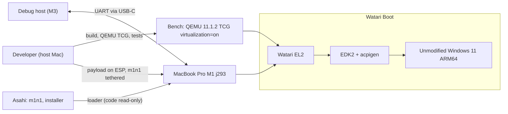
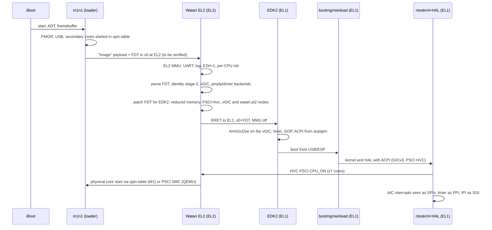
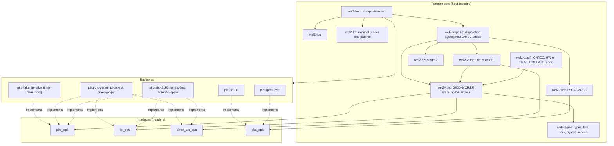
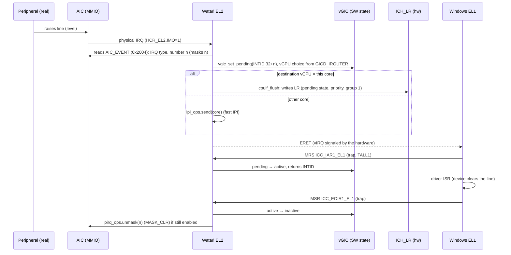
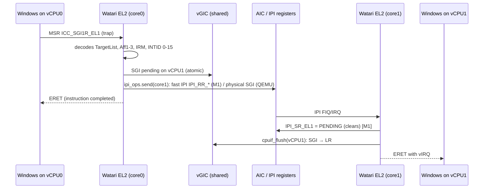

# ARCHITECTURE: Watari EL2

- Project: Watari Boot, subsystem Watari EL2 · Date: 2026-10-14 · Version: 0.1 · Status: draft
- Linked documents: [PRD](PRD.md) · [INTERFACES](INTERFACES.md) · [TEST_STRATEGY](TEST_STRATEGY.md) · [RISKS](RISKS.md) · [DESIGN-STATUS](DESIGN-STATUS.md)
- Marking: **[verified: source]** = verified by reading the source; **[hypothesis]** = hypothesis. Short sources: `PB` = `re/planB-feasibility.md`; `F0` = `re/f0-m1-fiq-irq.md`; `FAL` = `docs/FAILURES.md`; `NTASP` = `re/ntasp-analysis.md`/`ntasp-quality-audit.md`.

## 1. Base facts (and corrections to the starting hypotheses)
1. The M1 implements in hardware the CPU interface of the virtual GICv3: 8 list registers, 32 priority levels, 16-bit IDs, TDIR, no GICv4 [verified: NTASP `hv_vgic.c` 51-62, via PB §1].
2. **Important correction to the plan B decision.** On M1/M1 Pro/Max/M2 the vGIC has the SEIS errata: the guest can generate a physical SError on the host. KVM works around it by **intercepting all guest accesses to the group ICC registers (`group0_trap`/`group1_trap`) and hiding `SEIS` in `ICC_CTLR_EL1`**, using the hardware only to *signal* the interrupt [verified: commits torvalds/linux `d11a327ed9` and `df652bcf1136`, read on 2026-10-14]. Therefore "CPU interface entirely in hardware, with no exits for ack/EOI" **is not the baseline assumption on M1**: the default mode is `TRAP_EMULATE` (2 extra traps per interrupt). The `HW` mode remains for QEMU and for a possible future safety confirmation. Since in KVM's solution `ICC_CTLR_EL1` (and, with `TC`, possibly `ICC_PMR_EL1`) is also intercepted, the trap variants A (maximum) and B (reduced) and the measurement of the `PMR` frequency in Windows are in INTERFACES §7.2. Performance impact: RISKS R-05.
3. On M1 the CPU is **stuck with `HCR_EL2.E2H=1`** (VHE): the Linux kernel has a dedicated patch "Cope with CPUs stuck in VHE mode" [verified: patch title, web search result 2026-10-14; the detail is a hypothesis]. The layer is therefore a *VHE host*: it uses the `*_EL12`/`*_EL02` registers to read/write the guest's EL1 state. In QEMU the layer sets `E2H=1` itself to reproduce the same mode.
4. The M1 ARM timer is FIQ-only; the guest EL1 timers are the AIC "guest phys/virt" sources (hwirq 2/3), with the real mask in the IMP-DEF register `VM_TMR_FIQ_ENA_EL2` (bit 0 = V, bit 1 = P) [verified: F0 §1 lines 4-5, from `irq-apple-aic.c` 187-189, 500-531]. The vGIC maintenance interrupt arrives as a "fake FIQ" and is recognized by reading `ICH_MISR_EL2` [verified: PB §1].
5. m1n1 **since version 2.0.0 is GPL-2.0-or-later** (MIT up to 1.9.9): README and `src/hv/hv_vm.c` have `SPDX: GPL-2.0-or-later` [verified: README and file read on 2026-10-14]. This contradicts the brief's note "m1n1 MIT" and weighs on the choice in the license ADR.
6. m1n1 hands control to the "next stage" with 4 arguments after shutting down NVMe, exceptions, USB, display, framebuffer and **MMU** [verified: `src/main.c`]. At which exception level and with which registers is a **[hypothesis]** to be verified (M3a): EL2 is assumed, `x0` = FDT pointer as in the Linux arm64 boot protocol.
7. QEMU `virt`: with `virtualization=on` and without `secure` the QEMU PSCI conduit is **SMC**, otherwise HVC [verified: `hw/arm/virt.c`, `machvirt_init`]. Therefore in QEMU the "guest" PSCI is provided **by the layer via HVC**, and the layer in turn uses QEMU's SMC PSCI to power on the emulated physical cores.

## 2. Choice: extend m1n1 hv or write a new layer
Full decision in `docs/adr/draft-el2-base-m1n1-or-new.md`. Summary:

| Criterion | A. Extend m1n1 hv | B. Fork NTASP `m1n1_windows` | **C. New layer, m1n1 only as loader (chosen)** |
|---|---|---|---|
| Already has stage-2, MMIO traps, timer FIQ | yes [verified: PB §2] | yes | to write (≈ 600-900 lines [hypothesis]) |
| Has a vGIC | **no** (injects a virtual FIQ and the guest talks to the AIC) [verified: PB §2] | yes, incomplete: pending/active "not implemented", 1 core, SGI "TODO" [verified: PB §3] | to write (2,500-4,000 lines [hypothesis]) |
| Autonomy | **no**: every unhandled exception yields to the Python proxy and the guest stops; slow single-threaded path [verified: PB §2] | same as A | yes, by design |
| Testability off the Mac | no: code tied to Apple hardware, no automated tests | no | **yes**: portable core + backends, host tests and QEMU TCG |
| License | GPL-2.0-or-later (≥ 2.0.0) [verified] | MIT declared, but derived from m1n1 and "inspired by KVM" (GPL-2.0): uncertain status [verified: NTASP §6] | our code; references only read |
| Quality/risks | debug code, not production [hypothesis] | "to be rewritten" (Mu audit), 1 maintainer | writing cost, but controlled |
| Consistency with ADR-0007 | — | **contradicts** (independent path) | consistent |

**Choice C**: m1n1 remains the *loader* (iBoot → m1n1 → payload, already supported by the Asahi installer, "UEFI environment only"), and is **not** the hypervisor. m1n1 hv remains a **measurement tool** (to observe read-only how macOS programs AIC/timer, or to test the meaning of `VM_TMR_FIQ_ENA_EL2` before implementing it), never in the production path.

Language: **freestanding C11 + AArch64 assembly**, clang (the same toolchain already used for EDK2 CLANGDWARF). Rejected: Rust `no_std` (toolchain to install, forbidden without backup/confirmation; no expertise in the repo), C++ (runtime).

## 3. C4 view

### 3.1 Context


### 3.2 Container: boot flow iBoot → m1n1 → Watari EL2 → EDK2 → Windows

In QEMU the scheme is identical, with `-kernel wel2.elf` in place of iBoot+m1n1 and QEMU's PSCI SMC in place of the spin-table.

### 3.3 Components

The link dependency graph is acyclic: `boot` is the root, the backends depend only on `types` and on their own interface, and the `vgic` never includes a backend. `tools/check-deps.sh` (to be written) verifies via `#include` that no file in `vgic/` includes `plat/` or `backend/`.

## 4. Modules
Convention: prefix `wel2_`; proposed directory `el2/` at the repository root (update the "Structure" section of CLAUDE.md at merge).

| Module | Single responsibility | Public interface | Depends on |
|---|---|---|---|
| `wel2-types` | Provide base types, bit helpers, locks and system register access | `types.h`, `sysreg.h`, `lock.h` | none |
| `wel2-log` | Record events in a ring buffer with output to serial | `log_event()`, `log_panic()`, `log_dump()` | types |
| `wel2-fdt` | Read an FDT and modify a few properties in place | `fdt_find_node()`, `fdt_get_prop()`, `fdt_set_prop_inplace()`, `fdt_trim_memory()` | types |
| `wel2-vgic` | Maintain the architectural state of the virtual GICv3 and enforce its rules | `vgic_mmio_read/write()`, `vgic_set_pending()`, `vgic_next_for_vcpu()`, `vgic_sgi_send()` | types, `pirq_ops`, `ipi_ops` |
| `wel2-cpuif` | Drive the `ICH_*`/`ICC_*` registers for a vCPU | `cpuif_flush()`, `cpuif_fold()`, `cpuif_trap_icc()`, `cpuif_maintenance()` | vgic |
| `wel2-vtimer` | Turn the guest timer event into a virtual PPI at a consistent level | `vtimer_on_fire()`, `vtimer_on_eoi()` | vgic, `timer_src_ops` |
| `wel2-psci` | Answer PSCI/SMCCC calls | `psci_handle(vcpu, regs)` | `plat_ops` |
| `wel2-s2` | Build and modify the stage-2 tables | `s2_init()`, `s2_map_ram()`, `s2_map_mmio()`, `s2_map_hook()`, `s2_unmap()` | types |
| `wel2-trap` | Dispatch exceptions from the guest to handler tables | `trap_sync_lower()`, `trap_irq_lower()`, `trap_fiq_lower()`, `trap_serror_lower()`, `trap_register_*()` | vgic, cpuif, vtimer, psci, s2 |
| `wel2-boot` | Compose the modules in the correct order and launch EDK2 | `boot_main_bsp()`, `boot_main_ap()` | all modules, backends chosen at build time |
| `pirq-*` | Normalize the physical events (IRQ and FIQ) of a platform and translate device sources into virtual SPIs (mask/unmask) | `pirq_ops` (INTERFACES §8.1) | types |
| `ipi-*` | Send and receive a physical notification IPI between cores | `ipi_ops` (INTERFACES §8.2) | types |
| `timer-*` | Intercept and mask at the source the guest timer | `timer_src_ops` (INTERFACES §8.3) | types |
| `plat-qemu-virt` | Describe the QEMU platform (UART, RAM, core start via SMC) | `plat_ops` (INTERFACES §8.4) | types |
| `plat-t8103` | Describe the t8103 (UART, RAM, spin-table, reset) | `plat_ops` | types |

"Single 'and'" check: no responsibility description above contains more than one task; `wel2-cpuif` and `wel2-vgic` are separate because the former talks to the hardware and the latter does not (so the latter is tested on the host).

### 4.1 Pattern per module (rationale, rejected alternatives)
| Module | Pattern | Why | Rejected alternatives | Cost |
|---|---|---|---|---|
| backend | **Strategy** via tables of function pointers (`*_ops`) | same core on QEMU, M1 and host tests | per-platform `#ifdef` (unreadable, not testable together) | one indirection per call, negligible |
| vgic | **Pure-state model + explicit effects** (functions return actions to execute) | host-testable without hardware, deterministic | direct register access in the vgic (like KVM hyp) | a small "actions" layer |
| trap | **Ordered declarative tables** (sysreg by encoding, HVC by ID range, MMIO by region) | extending = one row | giant `switch` | binary search on a small table |
| boot | **Composition root** | the only point that knows the backends | global service locator | none |
| log | **Lock-free per-CPU ring buffer** | do not lose events close to the panic, no lock in IRQ | synchronous `printf` on UART (alters timing) | reserved memory |
| cpuif | **Selectable mode (HW / TRAP_EMULATE)** | same logic tested in TCG for M1 | HW only (fragile due to SEIS errata) | ICC emulation code (≈ 500 lines [hypothesis]) |
| psci | **Per-vCPU state machine** (OFF, ON_PENDING, ON) as in TF-A | avoids double `CPU_ON` | scattered flags | per-vCPU table |

## 5. Memory and privilege
- **Layout (M1)** [hypothesis for the sizes]: the layer occupies a reserved contiguous region (e.g. 64 MB) at the top of RAM; it contains code, EL2 tables, per-CPU stacks, ring log, stage-2 tables. The region is **not mapped in the guest's stage-2**, and is removed from the memory declared to EDK2 (patch of the FDT `/memory` node, `fdt_trim_memory`).
- **EL2 stage-1**: identity with MMU and caches on, because the locks use atomic/exclusive instructions that require Normal cacheable memory [hypothesis, architectural rule]. *Implemented in the QEMU spike (#53, 2026-10-20): 4 KB granule, 39-bit, Device-nGnRnE for MMIO, Normal WB Inner-Shareable XN for RAM, code RO+X, built MMU-off then switched on by every core; runs with `HCR_EL2.E2H = 0` (E2H0 `TCR_EL2` layout); the E2H = 1 layout needed on the M1 is coded, untested. The M1 port needs 16 KB tables.*
- **Stage-2**: identity, 16 KB granule (like m1n1 hv, `VTCR_TG0=2` [verified: m1n1 `hv_vm.c`, `hv_pt_init`]). Windows uses 4 KB in stage-1; stage-2 is independent of the stage-1 granule [hypothesis: architecture; strong hint: Windows 11 runs as a KVM guest on an Asahi host at 16 KB, `AsahiLinux/docs windows-11-vm.md`, via PB §0]. Large blocks where possible (fewer TLB entries).
- **MMIO attributes**: stage-2 forces **Device-nGnRnE** on peripheral regions. Reason [hypothesis]: the Apple interconnect does not handle "posted" writes (Linux uses the DT property `nonposted-mmio` to use nGnRnE); Windows maps MMIO as nGnRE; the stage-1/stage-2 combination takes the most restrictive attribute, hence nGnRnE. To be verified in M3a with a self-test.
- **Per-CPU**: `TPIDR_EL2` points to the `pcpu` structure (stack, vCPU, event queue). The layer does not use a scheduler: 1 vCPU = 1 pCPU.
- **Guest HCR_EL2** (initial values, details in INTERFACES §6): `RW=1, VM=1, E2H=1, TGE=0, IMO=1, FMO=1, AMO=1, TSC=1, TID3=1`. `IMO/FMO` route IRQ/FIQ to EL2 and make `ICC_SGI*R_EL1` trap (check against the ARM manual still to do: [hypothesis]).

## 6. Interrupt paths

### 6.1 Peripheral interrupt: AIC → vGIC → Windows (`TRAP_EMULATE` mode, default on M1)

Notes:
- **Level** semantics: the IRQ stays masked in the AIC from the moment of the ack until the EOI; if the line is still high it shows up again as a new physical IRQ. For SPIs configured as *edge* (`GICD_ICFGR`) it is unmasked immediately at injection.
- With more than 8 pending interrupts: the excluded ones stay in the software state; `ICH_HCR_EL2.UIE` generates an underflow maintenance interrupt to reload the LRs.
- `HW` mode (QEMU, optional): Windows reads `ICC_IAR1_EL1`/writes `EOIR1` without traps; the software EOI is obtained with `LR.EOI=1` and the maintenance interrupt (`ICH_MISR_EL2.EOI`), which on M1 arrives as a fake FIQ.
- The core receiving the physical IRQ decides whom to forward to; `GICD_IROUTER[n]` translates into the AIC's `TARGET_CPU` (v1: one mask per IRQ) [verified: F0 §4, audit D5], so normally the physical IRQ already arrives at the right core.

### 6.2 Timer: physical FIQ → vPPI
```mermaid
sequenceDiagram
  participant W as Windows EL1
  participant T as Timer HW (CNTP/CNTV)
  participant E as Watari EL2
  participant V as vGIC
  W->>T: writes CNTP_CVAL/CTL (no trap)
  T->>E: FIQ (guest timer, unmasked by VM_TMR_FIQ_ENA_EL2)
  E->>E: timer_src.fired(): reads CNTP_CTL_EL02/CNTV_CTL_EL02 (ENABLE and ISTATUS and !IMASK)
  E->>T: masks at the source: bit P/V of VM_TMR_FIQ_ENA_EL2 = 0 (guest CTL untouched)
  E->>V: vgic_set_level(PPI 30 or 27, 1)
  E-->>W: ERET with vIRQ
  W->>E: ICC_IAR1 / ICC_EOIR1 (trap)
  E->>E: vtimer_on_eoi(): if the timer is still "firing" → pending again (level); otherwise VM_TMR_FIQ_ENA_EL2 = 1
```
- Masking is done with the IMP-DEF bit and not with `IMASK` so that Windows does not see a modified `CNTP_CTL` [hypothesis: transparency reason; the bit is "the only real mask" of the guest timers according to the Linux comment, F0 §1 line 4].
- In the QEMU backend (`timer-gic-ppi`) the timer arrives as physical PPI 30/27 of the real GIC: same `vtimer`, different source. **The Apple FIQ path cannot be tested in QEMU** (RISKS R-04): it is covered with host tests (fake sysregs), with the on-hardware self-test (M3a) and with m1n1 hv as a measurement tool.
- PMU: at the initialization of each core the actions of `aic_init_cpu` are replicated (PMCR0.IMODE=OFF, UPMCR0 off, pending IPIs cleared) [verified: F0 §5], otherwise an FIQ storm results.

### 6.3 Windows SGI → AIC IPI

- Fast IPI on t8103 (selected by Linux for `apple,t8103-aic` [verified: F0 §4.1]); the "legacy" IPIs remain an alternative backend [hypothesis].
- A vCPU in guest `WFI` (not intercepted) wakes up with the IPI FIQ.
- SGIs do not carry the sender's identity in GICv3 (unlike GICv2): no per-sender queue is needed [hypothesis].

## 7. Shared data and concurrency
- Distributor (SPI: enable, priority, routing, config, pending) with **a ticket lock** (spin), short critical section; per-vCPU (PPI/SGI, LR) without a shared lock except for incoming SGIs, which are atomic bits (`sgi_pending[vcpu]`).
- Lock order: distributor then vCPU; never two vCPU locks together.
- No dynamic allocation after `boot_main_bsp()`: static tables sized by `WEL2_MAX_CPUS=8`.
- Handlers never block: if a lock is held for more than N cycles it is logged and the layer panics with a dump (anti-deadlock; F-15 teaches that silent hangs are the risk).

## 8. Boundaries and contracts between modules
1. `vgic` knows neither AIC, QEMU nor Apple registers: it talks to `pirq_ops` and `ipi_ops`. A new SoC does not touch it.
2. `trap` is the only one that reads `ESR_EL2`/`FAR_EL2`/`HPFAR_EL2` and produces `trap_ctx` structures; handlers receive `trap_ctx`, not registers.
3. `boot` is the only one that builds the FDT for EDK2 and knows the initialization order.
4. Errors are values (`wel2_err_t`), never exceptions; an unrecoverable error calls `log_panic()`, which does not return.
5. No module writes into another's region: shared state passes only through declared functions.

## 9. Explicit extension points
1. **New SoC** (M1 Pro/Max, M2): `plat/<soc>` folder + `pirq-aicv2` backend implementing `pirq_ops`; no change to `vgic`, `trap`, `psci`.
2. **New physical interrupt controller**: new implementation of `pirq_ops`/`ipi_ops`/`timer_src_ops`.
3. **Emulated device** (e.g. PCIe MSI → SPI): register an MMIO region with `trap_register_mmio()` and a handler; no change to the dispatcher.
4. **System register to intercept**: one row in the `trap` sysreg table.
5. **Vendor HVC function** (e.g. counters, log): one row in the HVC table.
6. **cpuif mode**: new mode (e.g. optimized once it is established that the SEIS errata does not affect certain paths) = new enum value, same interface.
7. **Log sinks**: `log` accepts registered sinks (serial, framebuffer, ring).
In all the cases above code is **added** without modifying existing modules, except the registration table in the composition root (`boot`), declared as the only point of modification.

## 10. Requirements → modules traceability
| Requirement | Modules |
|---|---|
| FR-1 | boot, fdt, plat-* |
| FR-2 | s2, trap |
| FR-3, FR-4, FR-13 | vgic, trap |
| FR-5 | cpuif, vgic |
| FR-6 | pirq-*, vgic |
| FR-7 | vtimer, timer-*, vgic |
| FR-8 | vgic, ipi-*, trap |
| FR-9, FR-10 | psci, plat-* |
| FR-11, FR-12 | trap |
| FR-14, FR-15 | log, trap |
| FR-16 | all backends, boot |
| NFR-1 | cpuif, trap (counters) |
| NFR-2 | all (style rules); log |
| NFR-3 | Makefile, tools/ (reproducible build) |
| NFR-4 | dependency structure (section 3.3), `check-deps.sh` |
| NFR-5 | section 9 |
| NFR-6 | s2, trap, boot |
| NFR-7 | all |
| NFR-8 | process (license ADR) |
| NFR-9 | log, trap |

## 11. Assessment of the four cross-cutting requirements
- **Maintainability:** declared single responsibilities (§4), errors as values, uniform naming (INTERFACES §10), structured logging.
- **Reproducibility:** pinned toolchain and QEMU, bit-for-bit build, fixed seeds, no "depends on the machine" (TEST_STRATEGY §7).
- **Modularity:** core without hardware dependencies, backends behind `*_ops`, acyclic graph verified by script.
- **Extensibility:** §9; the cost of a new SoC is a backend.
