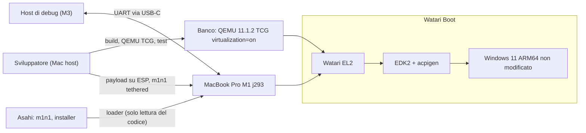
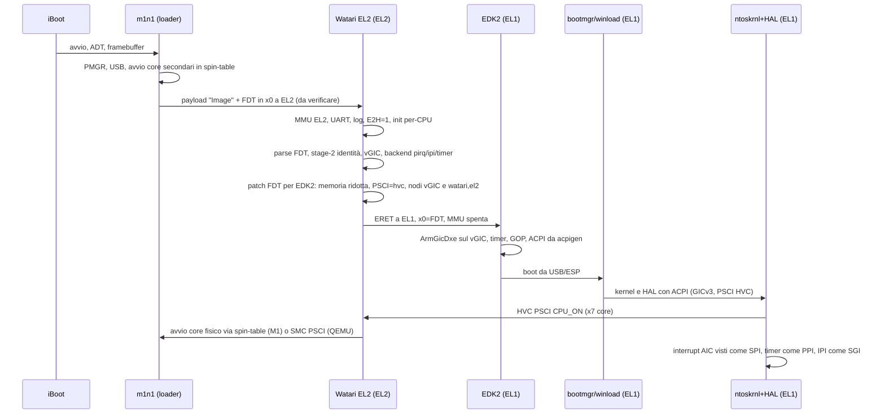
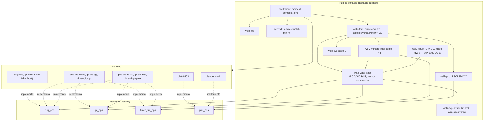
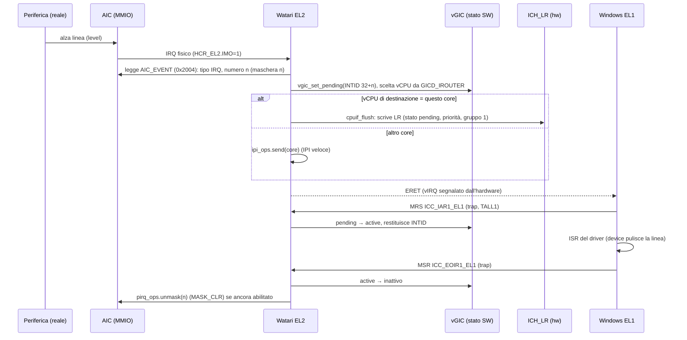
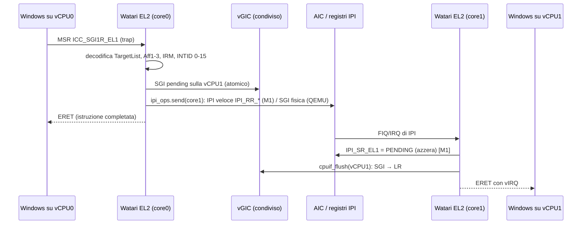

# ARCHITECTURE: Watari EL2

- Progetto: Watari Boot, sottosistema Watari EL2 · Data: 2026-10-14 · Versione: 0.1 · Stato: draft
- Documenti collegati: [PRD](PRD.md) · [INTERFACES](INTERFACES.md) · [TEST_STRATEGY](TEST_STRATEGY.md) · [RISKS](RISKS.md) · [DESIGN-STATUS](DESIGN-STATUS.md)
- Marcatura: **[V: fonte]** = verificato leggendo la fonte; **[I]** = ipotesi. Fonti brevi: `PB` = `re/pianoB-fattibilita.md`; `F0` = `re/f0-m1-fiq-irq.md`; `FAL` = `docs/FALLIMENTI.md`; `NTASP` = `re/ntasp-analisi.md`/`ntasp-audit-qualita.md`.

## 1. Fatti di base (e correzioni alle ipotesi di partenza)
1. Il M1 implementa in hardware l'interfaccia CPU del GICv3 virtuale: 8 list register, 32 livelli di priorità, ID a 16 bit, TDIR, niente GICv4 [V: NTASP `hv_vgic.c` 51-62, via PB §1].
2. **Correzione importante alla decisione del piano B.** Sul M1/M1 Pro/Max/M2 il vGIC ha l'errata SEIS: il guest può generare un SError fisico sull'host. KVM la aggira **intercettando tutti gli accessi del guest ai registri ICC di gruppo (`group0_trap`/`group1_trap`) e nascondendo `SEIS` in `ICC_CTLR_EL1`**, usando l'hardware solo per *segnalare* l'interrupt [V: commit torvalds/linux `d11a327ed9` e `df652bcf1136`, letti il 2026-10-14]. Quindi "interfaccia CPU tutta in hardware, senza uscite per ack/EOI" **non è l'assunzione di base su M1**: il modo di default è `TRAP_EMULATE` (2 trap in più per interrupt). Il modo `HW` resta per QEMU e per un'eventuale conferma futura di sicurezza. Poiché nella soluzione di KVM anche `ICC_CTLR_EL1` (e, con `TC`, forse `ICC_PMR_EL1`) è intercettato, le varianti di trap A (massima) e B (ridotta) e la misura della frequenza di `PMR` in Windows sono in INTERFACES §7.2. Impatto su prestazioni: RISKS R-05.
3. Su M1 la CPU è **bloccata con `HCR_EL2.E2H=1`** (VHE): il kernel Linux ha una patch apposita "Cope with CPUs stuck in VHE mode" [V: titolo del patch, risultato di ricerca web 2026-10-14; il dettaglio è [I]]. Lo strato è quindi un *host VHE*: usa i registri `*_EL12`/`*_EL02` per leggere/scrivere lo stato EL1 del guest. In QEMU lo strato imposta `E2H=1` da solo per riprodurre la stessa modalità.
4. Il timer ARM del M1 è solo FIQ; i timer del guest EL1 sono le sorgenti AIC "guest phys/virt" (hwirq 2/3), con maschera reale nel registro IMP-DEF `VM_TMR_FIQ_ENA_EL2` (bit 0 = V, bit 1 = P) [V: F0 §1 righe 4-5, da `irq-apple-aic.c` 187-189, 500-531]. Il maintenance interrupt del vGIC arriva come "FIQ finto" e si riconosce leggendo `ICH_MISR_EL2` [V: PB §1].
5. m1n1 **dalla versione 2.0.0 è GPL-2.0-or-later** (MIT fino a 1.9.9): README e `src/hv/hv_vm.c` hanno `SPDX: GPL-2.0-or-later` [V: README e file letti il 2026-10-14]. Questo contraddice la nota "m1n1 MIT" del brief e pesa sulla scelta dell'ADR licenza.
6. m1n1 consegna il controllo al "next stage" con 4 argomenti dopo aver spento NVMe, eccezioni, USB, display, framebuffer e **MMU** [V: `src/main.c`]. A che livello di eccezione e con quali registri è un'**[I]** da verificare (M3a): si assume EL2, `x0` = puntatore FDT come nel protocollo di boot Linux arm64.
7. QEMU `virt`: con `virtualization=on` e senza `secure` il conduit PSCI di QEMU è **SMC**, altrimenti HVC [V: `hw/arm/virt.c`, `machvirt_init`]. Quindi in QEMU il PSCI "guest" lo fornisce **lo strato via HVC**, e lo strato usa a sua volta il PSCI SMC di QEMU per accendere i core fisici emulati.

## 2. Scelta: estendere m1n1 hv o scrivere uno strato nuovo
Decisione completa in `docs/adr/bozza-el2-base-m1n1-o-nuovo.md`. Sintesi:

| Criterio | A. Estendere m1n1 hv | B. Fork di NTASP `m1n1_windows` | **C. Strato nuovo, m1n1 solo loader (scelto)** |
|---|---|---|---|
| Ha già stage-2, trap MMIO, FIQ timer | sì [V: PB §2] | sì | da scrivere (≈ 600-900 righe [I]) |
| Ha un vGIC | **no** (inietta FIQ virtuale e il guest parla con AIC) [V: PB §2] | sì, incompleto: pending/active "not implemented", 1 core, SGI "TODO" [V: PB §3] | da scrivere (2.500-4.000 righe [I]) |
| Autonomia | **no**: ogni eccezione non gestita cede al proxy Python e il guest si ferma; percorso lento single-thread [V: PB §2] | come A | sì, per progetto |
| Testabilità fuori dal Mac | no: codice legato all'hardware Apple, nessun test automatico | no | **sì**: nucleo portabile + backend, test host e QEMU TCG |
| Licenza | GPL-2.0-or-later (≥ 2.0.0) [V] | MIT dichiarata, ma derivata da m1n1 e "ispirata a KVM" (GPL-2.0): stato incerto [V: NTASP §6] | codice nostro; riferimenti solo letti |
| Qualità/rischi | codice di debug, non di produzione [I] | "da riscrivere" (audit Mu), 1 manutentore | costo di scrittura, ma controllato |
| Coerenza con ADR-0007 | — | **contraddice** (strada indipendente) | coerente |

**Scelta C**: m1n1 resta il *loader* (iBoot → m1n1 → payload, già supportato dall'installer Asahi, "UEFI environment only"), e **non** è l'hypervisor. m1n1 hv resta uno **strumento di misura** (per osservare in sola lettura come macOS programma AIC/timer, o per provare il significato di `VM_TMR_FIQ_ENA_EL2` prima di implementarlo), mai nel percorso di produzione.

Linguaggio: **C11 freestanding + assembly AArch64**, clang (lo stesso toolchain già usato per EDK2 CLANGDWARF). Scartati: Rust `no_std` (toolchain da installare, vietato senza backup/conferma; non c'è competenza nel repo), C++ (runtime).

## 3. Vista C4

### 3.1 Contesto


### 3.2 Container: flusso di boot iBoot → m1n1 → Watari EL2 → EDK2 → Windows

In QEMU lo schema è identico, con `-kernel wel2.elf` al posto di iBoot+m1n1 e il PSCI SMC di QEMU al posto della spin-table.

### 3.3 Componenti

Il grafo delle dipendenze di link è aciclico: `boot` è la radice, i backend dipendono solo da `types` e dalla propria interfaccia, il `vgic` non include mai un backend. `tools/check-deps.sh` (da scrivere) verifica con `#include` che nessun file di `vgic/` includa `plat/` o `backend/`.

## 4. Moduli
Convenzione: prefisso `wel2_`; directory proposta `el2/` alla radice del repository (aggiornare la sezione "Struttura" di CLAUDE.md al merge).

| Modulo | Responsabilità singola | Interfaccia pubblica | Dipende da |
|---|---|---|---|
| `wel2-types` | Fornire tipi base, bit helper, lock e accesso ai registri di sistema | `types.h`, `sysreg.h`, `lock.h` | nessuno |
| `wel2-log` | Registrare eventi in un ring buffer con uscita su seriale | `log_event()`, `log_panic()`, `log_dump()` | types |
| `wel2-fdt` | Leggere un FDT e modificare in loco poche proprietà | `fdt_find_node()`, `fdt_get_prop()`, `fdt_set_prop_inplace()`, `fdt_trim_memory()` | types |
| `wel2-vgic` | Mantenere lo stato architetturale del GICv3 virtuale ed eseguire le sue regole | `vgic_mmio_read/write()`, `vgic_set_pending()`, `vgic_next_for_vcpu()`, `vgic_sgi_send()` | types, `pirq_ops`, `ipi_ops` |
| `wel2-cpuif` | Pilotare i registri `ICH_*`/`ICC_*` per una vCPU | `cpuif_flush()`, `cpuif_fold()`, `cpuif_trap_icc()`, `cpuif_maintenance()` | vgic |
| `wel2-vtimer` | Trasformare l'evento del timer del guest in un PPI virtuale a livello coerente | `vtimer_on_fire()`, `vtimer_on_eoi()` | vgic, `timer_src_ops` |
| `wel2-psci` | Rispondere alle chiamate PSCI/SMCCC | `psci_handle(vcpu, regs)` | `plat_ops` |
| `wel2-s2` | Costruire e modificare le tabelle di stage-2 | `s2_init()`, `s2_map_ram()`, `s2_map_mmio()`, `s2_map_hook()`, `s2_unmap()` | types |
| `wel2-trap` | Smistare le eccezioni dal guest alle tabelle di gestori | `trap_sync_lower()`, `trap_irq_lower()`, `trap_fiq_lower()`, `trap_serror_lower()`, `trap_register_*()` | vgic, cpuif, vtimer, psci, s2 |
| `wel2-boot` | Comporre i moduli nell'ordine corretto e lanciare EDK2 | `boot_main_bsp()`, `boot_main_ap()` | tutti i moduli, backend scelti a build-time |
| `pirq-*` | Normalizzare gli eventi fisici (IRQ e FIQ) di una piattaforma e tradurre le sorgenti dispositivo in SPI virtuali (mask/unmask) | `pirq_ops` (INTERFACES §8.1) | types |
| `ipi-*` | Inviare e ricevere un'IPI fisica di notifica tra core | `ipi_ops` (INTERFACES §8.2) | types |
| `timer-*` | Intercettare e mascherare alla fonte il timer del guest | `timer_src_ops` (INTERFACES §8.3) | types |
| `plat-qemu-virt` | Descrivere la piattaforma QEMU (UART, RAM, avvio core via SMC) | `plat_ops` (INTERFACES §8.4) | types |
| `plat-t8103` | Descrivere il t8103 (UART, RAM, spin-table, reset) | `plat_ops` | types |

Controllo "una sola e": nessuna descrizione di responsabilità sopra contiene più di un compito; `wel2-cpuif` e `wel2-vgic` sono separati perché il primo parla con l'hardware e il secondo no (così il secondo si testa su host).

### 4.1 Pattern per modulo (motivazioni, alternative scartate)
| Modulo | Pattern | Perché | Alternative scartate | Costo |
|---|---|---|---|---|
| backend | **Strategy** via tabelle di puntatori a funzione (`*_ops`) | stesso nucleo su QEMU, M1 e test host | `#ifdef` per piattaforma (illeggibile, non testabile insieme) | una indirezione per chiamata, trascurabile |
| vgic | **Modello a stato puro + effetti espliciti** (le funzioni restituiscono azioni da eseguire) | testabile su host senza hardware, deterministico | accesso diretto ai registri nel vgic (come KVM hyp) | un piccolo strato di "azioni" |
| trap | **Tabelle dichiarative ordinate** (sysreg per codifica, HVC per range di ID, MMIO per regione) | estendere = una riga | `switch` gigante | ricerca binaria su tabella piccola |
| boot | **Radice di composizione** | l'unico punto che conosce i backend | service locator globale | nessuno |
| log | **Ring buffer lock-free per CPU** | non perdere eventi vicino al panic, nessun lock in IRQ | `printf` sincrono su UART (altera i tempi) | memoria riservata |
| cpuif | **Modalità selezionabile (HW / TRAP_EMULATE)** | stessa logica testata in TCG per M1 | solo HW (fragile per errata SEIS) | codice di emulazione ICC (≈ 500 righe [I]) |
| psci | **Macchina a stati per vCPU** (OFF, ON_PENDING, ON) come in TF-A | evita doppi `CPU_ON` | flag sparsi | tabella per vCPU |

## 5. Memoria e privilegio
- **Layout (M1)** [I per le dimensioni]: lo strato occupa una regione contigua riservata (es. 64 MB) in cima alla RAM; contiene codice, tabelle EL2, stack per CPU, ring log, tabelle stage-2. La regione **non è mappata nello stage-2** del guest, ed è tolta dalla memoria che si dichiara a EDK2 (patch del nodo `/memory` dell'FDT, `fdt_trim_memory`).
- **EL2 stage-1**: identità con MMU e cache accese, perché i lock usano istruzioni atomiche/esclusive che richiedono memoria Normal cacheable [I, regola architetturale].
- **Stage-2**: identità, granulo 16 KB (come m1n1 hv, `VTCR_TG0=2` [V: m1n1 `hv_vm.c`, `hv_pt_init`]). Windows usa 4 KB nello stage-1; lo stage-2 è indipendente dal granulo dello stage-1 [I: architettura; indizio forte: Windows 11 gira come guest KVM su host Asahi a 16 KB, `AsahiLinux/docs windows-11-vm.md`, via PB §0]. Blocchi grandi dove possibile (meno TLB).
- **Attributi MMIO**: stage-2 forza **Device-nGnRnE** sulle regioni periferiche. Motivo [I]: l'interconnessione Apple non gestisce le scritture "posted" (Linux usa la proprietà DT `nonposted-mmio` per usare nGnRnE); Windows mappa l'MMIO come nGnRE; la combinazione stage-1/stage-2 prende l'attributo più restrittivo, quindi nGnRnE. Da verificare in M3a con un autotest.
- **Per-CPU**: `TPIDR_EL2` punta alla struttura `pcpu` (stack, vCPU, coda eventi). Lo strato non usa lo scheduler: 1 vCPU = 1 pCPU.
- **HCR_EL2** del guest (valori iniziali, dettagli INTERFACES §6): `RW=1, VM=1, E2H=1, TGE=0, IMO=1, FMO=1, AMO=1, TSC=1, TID3=1`. `IMO/FMO` instradano IRQ/FIQ a EL2 e fanno trappare `ICC_SGI*R_EL1` (verifica sul manuale ARM da fare: [I]).

## 6. Percorsi degli interrupt

### 6.1 Interrupt periferica: AIC → vGIC → Windows (modo `TRAP_EMULATE`, default su M1)

Note:
- Semantica **level**: l'IRQ resta mascherato nell'AIC dal momento dell'ack fino all'EOI; se la linea è ancora alta si ripresenta come nuovo IRQ fisico. Per SPI configurati *edge* (`GICD_ICFGR`) si smaschera subito all'iniezione.
- Con più di 8 interrupt pendenti: gli esclusi restano nello stato software; `ICH_HCR_EL2.UIE` genera un maintenance interrupt di underflow per ricaricare gli LR.
- Modo `HW` (QEMU, opzionale): Windows legge `ICC_IAR1_EL1`/scrive `EOIR1` senza trap; l'EOI software si ottiene con `LR.EOI=1` e il maintenance interrupt (`ICH_MISR_EL2.EOI`), che su M1 arriva come FIQ finto.
- Il core che riceve l'IRQ fisico decide a chi inoltrare; `GICD_IROUTER[n]` traduce in `TARGET_CPU` dell'AIC (v1: una maschera per IRQ) [V: F0 §4, audit D5], quindi di norma l'IRQ fisico arriva già al core giusto.

### 6.2 Timer: FIQ fisico → vPPI
```mermaid
sequenceDiagram
  participant W as Windows EL1
  participant T as Timer HW (CNTP/CNTV)
  participant E as Watari EL2
  participant V as vGIC
  W->>T: scrive CNTP_CVAL/CTL (nessun trap)
  T->>E: FIQ (guest timer, sbloccato da VM_TMR_FIQ_ENA_EL2)
  E->>E: timer_src.fired(): legge CNTP_CTL_EL02/CNTV_CTL_EL02 (ENABLE e ISTATUS e !IMASK)
  E->>T: maschera alla fonte: bit P/V di VM_TMR_FIQ_ENA_EL2 = 0 (CTL del guest intatto)
  E->>V: vgic_set_level(PPI 30 o 27, 1)
  E-->>W: ERET con vIRQ
  W->>E: ICC_IAR1 / ICC_EOIR1 (trap)
  E->>E: vtimer_on_eoi(): se il timer ancora "firing" → di nuovo pending (level); altrimenti VM_TMR_FIQ_ENA_EL2 = 1
```
- Si maschera con il bit IMP-DEF e non con `IMASK` per non far vedere a Windows un `CNTP_CTL` modificato [I: motivo di trasparenza; il bit è "l'unico mask vero" dei timer guest secondo il commento di Linux, F0 §1 riga 4].
- Nel backend QEMU (`timer-gic-ppi`) il timer arriva come PPI fisico 30/27 del GIC reale: stesso `vtimer`, sorgente diversa. **Il percorso FIQ Apple non è provabile in QEMU** (RISKS R-04): si copre con host test (sysreg finti), con l'autotest su hardware (M3a) e con m1n1 hv come strumento di misura.
- PMU: all'inizializzazione di ogni core si replicano le azioni di `aic_init_cpu` (PMCR0.IMODE=OFF, UPMCR0 off, IPI pendenti azzerate) [V: F0 §5] altrimenti tempesta di FIQ.

### 6.3 SGI di Windows → IPI AIC

- Fast IPI su t8103 (selezionata da Linux per `apple,t8103-aic` [V: F0 §4.1]); le IPI "legacy" restano un backend alternativo [I].
- Una vCPU in `WFI` del guest (non intercettato) si sveglia con la FIQ dell'IPI.
- Le SGI non portano l'identità del mittente in GICv3 (a differenza di GICv2): non serve nessuna coda per mittente [I].

## 7. Dati condivisi e concorrenza
- Distributor (SPI: enable, priorità, routing, config, pending) con **un lock a ticket** (spin), sezione critica corta; per-vCPU (PPI/SGI, LR) senza lock condiviso se non per le SGI in arrivo, che sono bit atomici (`sgi_pending[vcpu]`).
- Ordine dei lock: distributor poi vCPU; mai due lock vCPU insieme.
- Nessuna allocazione dinamica dopo `boot_main_bsp()`: tabelle statiche dimensionate da `WEL2_MAX_CPUS=8`.
- Gli handler non bloccano mai: se un lock è occupato da più di N cicli si registra e si va in panic con dump (anti-deadlock; F-15 insegna che gli hang silenziosi sono il rischio).

## 8. Confini e contratti tra moduli
1. `vgic` non conosce AIC, QEMU né registri Apple: parla con `pirq_ops` e `ipi_ops`. Un nuovo SoC non lo tocca.
2. `trap` è l'unico che legge `ESR_EL2`/`FAR_EL2`/`HPFAR_EL2` e produce strutture `trap_ctx`; i gestori ricevono `trap_ctx`, non registri.
3. `boot` è l'unico che costruisce l'FDT per EDK2 e conosce l'ordine di inizializzazione.
4. Gli errori sono valori (`wel2_err_t`), mai eccezioni; un errore non recuperabile chiama `log_panic()` che non ritorna.
5. Nessun modulo scrive nella regione di un altro: lo stato condiviso passa solo da funzioni dichiarate.

## 9. Punti di estensione espliciti
1. **Nuovo SoC** (M1 Pro/Max, M2): cartella `plat/<soc>` + backend `pirq-aicv2` che implementa `pirq_ops`; nessuna modifica a `vgic`, `trap`, `psci`.
2. **Nuovo controller di interrupt fisico**: nuova implementazione di `pirq_ops`/`ipi_ops`/`timer_src_ops`.
3. **Dispositivo emulato** (es. MSI PCIe → SPI): registrare una regione MMIO con `trap_register_mmio()` e un gestore; nessuna modifica al dispatcher.
4. **Registro di sistema da intercettare**: una riga nella tabella sysreg di `trap`.
5. **Funzione HVC vendor** (es. contatori, log): una riga nella tabella HVC.
6. **Modalità cpuif**: nuova modalità (es. ottimizzata una volta stabilito che l'errata SEIS non colpisce certi percorsi) = nuovo valore dell'enum, stessa interfaccia.
7. **Sorgenti di log**: `log` accetta sink registrati (seriale, framebuffer, ring).
In tutti i casi sopra si **aggiunge** codice senza modificare moduli esistenti, tranne la tabella di registrazione nella radice di composizione (`boot`), dichiarata come unico punto di modifica.

## 10. Tracciabilità requisiti → moduli
| Requisito | Moduli |
|---|---|
| FR-1 | boot, fdt, plat-* |
| FR-2 | s2, trap |
| FR-3, FR-4, FR-13 | vgic, trap |
| FR-5 | cpuif, vgic |
| FR-6 | pirq-*, vgic |
| FR-7 | vtimer, timer-*, vgic |
| FR-8 | vgic, ipi-*, trap |
| FR-9, FR-10 | psci, plat-* |
| FR-11, FR-12 | trap |
| FR-14, FR-15 | log, trap |
| FR-16 | tutti i backend, boot |
| NFR-1 | cpuif, trap (contatori) |
| NFR-2 | tutti (regole di stile); log |
| NFR-3 | Makefile, tools/ (build riproducibile) |
| NFR-4 | struttura delle dipendenze (sezione 3.3), `check-deps.sh` |
| NFR-5 | sezione 9 |
| NFR-6 | s2, trap, boot |
| NFR-7 | tutti |
| NFR-8 | processo (ADR licenza) |
| NFR-9 | log, trap |

## 11. Valutazione dei quattro requisiti trasversali
- **Mantenibilità:** responsabilità singole dichiarate (§4), errori come valori, naming uniforme (INTERFACES §10), logging strutturato.
- **Riproducibilità:** toolchain e QEMU pinnati, build bit-a-bit, seed fissi, nessun "dipende dalla macchina" (TEST_STRATEGY §7).
- **Modularità:** nucleo senza dipendenze hardware, backend dietro `*_ops`, grafo aciclico verificato da script.
- **Estensibilità:** §9; il costo di un nuovo SoC è un backend.
