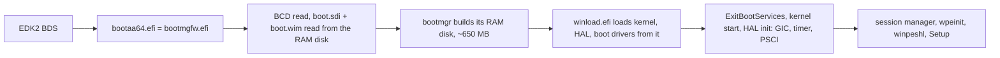

# DESIGN: Windows from a RAM disk on the M1 (watari-winram)

- Project: Watari Boot, subsystem "watari-winram" (Ralph task T20) · Date: 2026-11-14 · Version: 0.2 · Status: draft, reviewed once
- Linked documents: [README](README.md) · [RISKS](RISKS.md) · [PLAN](PLAN.md) · [draft ADR](../../adr/draft-winram.md) · parent [watari-edk2-m1 DESIGN](../watari-edk2-m1/DESIGN.md) ("EDK2 D n" below)

## 0. Marking and sources

Every technical claim carries **[verified: source]** or **[hypothesis]**. "Verified" = read in that source on 2026-11-14 (or measured on the ISO file listing). Nothing here was built or run.

| Short name | Source |
|---|---|
| `E:path` | EDK2 `edk2-stable202608` at `$WATARI_DATA/src/edk2` (upstream `https://github.com/tianocore/edk2/tree/edk2-stable202608/` + path), BSD-2-Clause-Patent |
| `R:path` | this repository |
| `ISO` | file names and sizes of `Windows11_Client_arm64_it-it_26300_9457.iso`, read-only `hdiutil attach` + `ls`/`os.path.getsize`, detached afterwards. No file was opened |
| `MS-PE` | Microsoft Learn, "Windows PE (WinPE)", https://learn.microsoft.com/en-us/windows-hardware/manufacture/desktop/winpe-intro |
| `MS-WALK` | Microsoft Learn (archive), "Walkthrough: Boot Windows PE from a UEFI-based Hard Disk", https://learn.microsoft.com/en-us/previous-versions/windows/it-pro/windows-7/hh265131(v=ws.10) (a Windows 7 / amd64 text: the BCD element names are the same in current Windows [hypothesis]) |
| `MS-UEFI` | Microsoft Learn, "UEFI Requirements for Windows on SoC Platforms", https://learn.microsoft.com/en-us/windows-hardware/drivers/bringup/uefi-requirements-that-apply-to-all-windows-platforms |
| `WIMBOOT` | iPXE, "wimboot architecture", https://ipxe.org/appnote/wimboot_architecture (third-party description of bootmgr's RAM-disk behaviour; GPL project, **not** read as code) |
| `M1N1` | m1n1 v1.6.1 `proxyclient/m1n1/proxy.py` and `proxyutils.py`, https://github.com/AsahiLinux/m1n1/tree/v1.6.1 (GPL-2.0; facts and protocol only, cited) |

## 1. The image

### 1.1 What Windows' boot manager needs

- A UEFI boot application `\EFI\BOOT\BOOTAA64.EFI` (on the ISO: the same size as `bootmgfw.efi`, 3 120 648 bytes [verified: ISO]) and the BCD at `\EFI\Microsoft\Boot\BCD` (16 384 bytes on the ISO [verified: ISO]).
- For a RAM-disk boot the BCD's loader entry has `device` and `osdevice` = `ramdisk=[<device>]\sources\boot.wim,{ramdiskoptions}`, and `{ramdiskoptions}` has `ramdisksdidevice` and `ramdisksdipath` (`\sources\boot.sdi` or `\boot\boot.sdi`) [verified: MS-WALK step 4: `device`/`osdevice` `ramdisk=[C:]\sources\boot.wim,{ramdiskoptions}`, `ramdisksdidevice partition=C:`, `ramdisksdipath \sources\boot.sdi`]. Boot manager reads the BCD, the SDI (a template RAM disk) and the WIM, appends the WIM to the template, builds a RAM disk and starts `winload` from it [verified: WIMBOOT, "mounts the blank template SDI ramdisk and appends the WIM image to it"; whether the WIM is copied or used in place is **not** stated there, see R-W9]. MS-WALK is titled "boot Windows PE directly from a hard disk instead of into a RAM disk" yet its BCD uses the `ramdisk=` syntax: it is evidence for the BCD element names, not for booting from a RAM-disk-protocol device.
- The OS and boot files "must reside on a GPT partitioned storage solution" with an ESP; Windows needs **Block I/O and Device Path** protocols for the boot storage [verified: MS-UEFI "Installation requirements", "Local storage boot"].
- WinPE: "no hard drive is required"; the base version needs 512 MB; RAM-disk boot needs "a contiguous portion of physical memory (RAM) which can hold the entire Windows PE (WIM) image", and manufacturers "should ensure that their firmware reserves memory locations either at the beginning or at the end of the physical memory address space" [verified: MS-PE "Hardware requirements"].
- FAT32 limits: 4 GB per file, 32 GB per drive [verified: MS-PE "Limitations"].

### 1.2 What is on the ISO (names and sizes only)

| Path on the ISO | Size | Needed? |
|---|---|---|
| `sources\boot.wim` | 642 437 002 | **yes**: WinPE and, as an index inside it, Windows Setup |
| `sources\install.wim` | 7 498 807 154 | **no**: above FAT32's 4 GB file limit and 11 x the whole image; Setup then has nothing to install (accepted: the goal is to reach the Setup GUI) |
| `sources\*` other (967 files, 203 entries) | about 235 MB besides the two WIMs | no [hypothesis: Setup inside WinPE uses `X:\sources` from `boot.wim`] |
| `efi\boot\bootaa64.efi` | 3 120 648 | **yes** |
| `efi\microsoft\boot\bcd` | 16 384 | **yes** |
| `efi\microsoft\boot\fonts` (20 files) | 14 248 000 | yes (boot menu and error text) [hypothesis] |
| `efi\microsoft\boot\resources` | 262 880 | yes |
| `efi\microsoft\boot\{boot.stl, winsipolicy.p7b, cipolicies\}` | 12 006 + 10 341 + 52 945 | yes (small, Secure Boot policy; harmless) |
| `efi\microsoft\boot\{cdboot*.efi, efisys*.bin}` | 968 096 x 2, 1 720 320 x 2 | no (El Torito stubs, "press any key") |
| `boot\boot.sdi` | 3 170 304 | **yes** (MS-WALK copies it next to the WIM) |
| `boot\fonts`, `boot\resources` | 14 248 000, 262 976 | optional (BIOS side) [hypothesis]; kept in the first image (the builder copies `boot\` whole) |
| `boot\{bootsect.exe, etfsboot.com}`, root `bootmgr.efi`, `bootmgfw.efi`, `setup.exe`, `support\` | 88 064, 4 096, 3 099 128, 3 120 648, 80 312, 345 472 | no |

[verified: ISO for every size above.] The ISO as a whole is 8 430 166 016 bytes.

**Payload** = 642 437 002 + 3 170 304 + 3 120 648 + 14 602 556 (EFI boot dir) + 14 510 976 (`boot\fonts`, `boot\resources`) = **677 841 486 bytes (about 646 MiB)**; 663 330 510 without `boot\fonts` and `boot\resources`.

### 1.3 The image file

The image is built by the existing `tools/m3a/build-winram-image.sh` (written in parallel with this design): a raw image on the data disk, `--gpt` (default: protective MBR, primary and backup GPT, one partition of type EFI System, FAT32 by `newfs_msdos -F 32 -S 512`), `--mbr` or `--superfloppy` (FAT32 straight on the disk). It copies `efi\`, `boot\`, the root `bootmgr*`/`bootmgfw*` files and `sources\boot.wim` only (no other `sources\` file, no `install.wim`), refuses an output inside the repository, and writes `<out>.sha256` and `<out>.manifest.txt` (names and sizes only) [verified: R:tools/m3a/build-winram-image.sh and R:tools/m3a/README.md on branch `ralph/m3a-night5-work`]. It has **no** `--minimal` option and no `hdiutil create -srcfolder` step; an earlier draft of this design named a `make-winram-image.sh` with those, superseded. (The FAT16 image of the T16a bench is a different thing [verified: R:el2/boot/run-t16a.sh line 43].)

- **Size:** the tool computes payload + per-entry cluster slack + 5 % + 16 MiB, rounded up to 1 MiB, and prints it [verified: R:tools/m3a/build-winram-image.sh, size comment and `SIZE=` line]: for the 677 841 486-byte payload that is about **695-700 MiB**. This design uses **704 MiB (738 197 504 bytes)** as a budget ceiling in the tables below. (An earlier draft derived 704 MiB from `ceil((payload x 1.03 + 4 MiB) / 16 MiB) x 16 MiB`; that formula actually gives 672 MiB, so 704 MiB is now a round ceiling, not a computed value.) The loader, not the builder, enforces the heap limit (section 2.3).
- **Trailer** (section 2.2): 4 KiB written by the loader **after** the image bytes, outside the disk the firmware sees (the GPT's backup header is at the end of the image file; the trailer is not part of the file and the builder does not write it). `wel2.ramdisk=` covers image + trailer.
- Sector size 512: `RamDiskDxe` exposes 512-byte blocks [verified: E:MdeModulePkg/Universal/Disk/RamDiskDxe/RamDiskImpl.h:48 `RAM_DISK_DEFAULT_BLOCK_SIZE 512`].
- **BCD:** taken **unchanged** from the ISO. Its device elements are, from public descriptions of install media, boot-device relative (`[boot]`) **[hypothesis: not inspected; Microsoft's file is not opened]**. MS-WALK's own BCD uses an absolute `partition=` device and keeps `boot.sdi` under `\sources\` (its step 3.4 copies it there) [verified: MS-WALK steps 3.4 and 4]; iPXE's wimboot, which feeds ISO-style media, shows `ramdisk=[boot]\...\boot.wim` and `ramdisksdidevice boot` [verified: WIMBOOT]. The ISO's `[boot]`-relative form is therefore plausible, not proven; `boot.sdi` is on our image only at `\boot\boot.sdi` (the builder copies `boot\` whole). If bootmgr reports a BCD or device error (status `0xc000000f`, "error reading the boot configuration data" or "required device is inaccessible" [verified: WIMBOOT, which also says these messages are vague and usually mean wrong BCD paths]), the fallbacks in order are: the builder's `--superfloppy` and `--mbr` layouts (another device-path shape, same files); a BCD authored with `bcdedit` per MS-WALK step 4 inside the bench Windows VM, kept on the data disk (never committed), with `boot.sdi` also copied to `\sources\`; see PLAN T22.
- UDF alternative (an ISO as `EfiVirtualCd`): `UdfDxe` is in the firmware [verified: R:edk2-apple/WatariM1Pkg/WatariM1Pkg.fdf:114], and an El Torito image avoids FAT, but needs a UDF/ISO writer for a partial tree and gives no gain in size or in what bootmgr reads. **Not chosen** (FAT32 is also what Microsoft's own USB media uses [verified: MS-PE "Limitations"]).

## 2. Getting the image into RAM

### 2.1 The loader's fourth block

`watari-load.py` already writes up to three 32 MB aligned heap blocks (layer, test guest or spacer, EDK2) with `ProxyUtils.memalign` and `iface.writemem`, cleans the caches with `dc_cvau`/`dc_cvac`/`ic_ivau`, **then** sets the boot arguments, so that the arguments can name the addresses [verified: R:tools/m3a/watari-load.py lines 11-25, 505-545]. The image is one more block:

- Allocated **first** (before the layer block): the block lands low in the heap, so the range left above it keeps the EDK2 image in a large first `/memory` piece (section 3.3). D0 mirrors the order. The allocator is first-fit from the low end of the heap: `malloc`/`memalign` walk the block list from the start and take the first free run that fits [verified: M1N1 `proxyclient/m1n1/malloc.py` v1.6.1]; D0 still prints the addresses before anything jumps. The `ProxyUtils` heap starts 128 MiB after m1n1's own heap [verified: M1N1 proxyutils.py `heap_base += m1n1_heap`], and the first `memalign(32 MB, ...)` may skip up to 32 MiB to reach alignment (those bytes stay in `/memory` as a small piece).
- `memalign(32 MB, size)`, size rounded up to 1 MiB.
- The existing block check (`check_blocks`) must cover the **whole** range, not the first 32 MB (new, PLAN T23).

### 2.2 Slices, checksums, the trailer

- **Fact:** `UartInterface.writemem(addr, data)` computes one checksum over `data`, sends `<addr, size, checksum>`, streams the bytes in **8192-byte** writes, and the reply carries `ST_CSUMERR` on a mismatch; there is no retry, and `Feature.DISABLE_DATA_CSUMS` replaces the checksum by a fixed end sentinel [verified: M1N1 proxy.py `writemem`, `data_checksum`]. The data checksum is a rolling hash (`sum = sum*31337 ^ (byte ^ 0x5a)`, 32 bit) [verified: M1N1 proxy.py `checksum`]. Whether it is computed in a Python byte loop at about 5-10 MB/s on the host is **[hypothesis]**; if it is, the checksum, not USB, is the bottleneck.
- **Design:** the loader writes the image in **16 MiB slices**, each its own `writemem` (own checksum, own progress line, a bounded retry of that slice on `UartChecksumError`), after a first rate test (the rate test, first step of rung W1) and a decision on `DISABLE_DATA_CSUMS` [hypothesis: negotiable by the client in `nop()`; `Feature.get_all()` is what the client sends, M1N1 proxy.py]. A whole-image SHA-256 is computed on the host from the file before sending and printed; the **sidecar** `winram.img.sha256` made by the image tool must match, or the loader refuses.
- **Trailer** (in the 4 KiB after the disk, written last): magic `WRAMDSK1`, `image_bytes` (u64), CRC-32 of the image (u32, the UEFI `CalculateCrc32` polynomial), the host's SHA-256 (32 bytes, informational), zero padding. EDK2 recomputes the CRC with `gBS->CalculateCrc32` over `image_bytes` before registering (a few seconds [hypothesis]; skipped on request, **never** silently on mismatch). This catches corruption that survives m1n1's per-slice check (cache maintenance errors, a block overwritten after the write).
- **Cache maintenance:** `dc_cvau` + `dc_cvac` + `ic_ivau` over the whole range [verified as the existing pattern: R:tools/m3a/watari-load.py 540-545]; the real guarantee remains m1n1's set/way flush in `mmu_shutdown` [verified: comment in the same file].

### 2.3 Time and budget

Image 738 197 504 bytes. Rates are **[hypothesis]**; nothing in the repository or the m1n1 documentation reads gives a measured proxy rate (m1n1 `proxy.py` carries no throughput figure; searches of the Asahi documentation found none).

| Effective rate | Time for 704 MiB | Verdict |
|---|---|---|
| 0.5 MB/s (a slow serial-style path) | 24 min | the plan stops here: shrink the image (a hand-trimmed image, 663 MB, saves only 2 %) or find another path |
| 1 MB/s | 12 min | acceptable once per day |
| 3 MB/s | 4 min | comfortable |
| 10 MB/s | 74 s | good |
| 30 MB/s (about USB 2.0 high-speed bulk ceiling [hypothesis]) | 25 s | best case |

Compression does not help: the WIM is already compressed, the remainder is 2 % of the image; `compressed_writemem` (gzip level 1 + `gzdec` on the target [verified: M1N1 proxyutils.py]) is not used.

Heap budget: `ProxyUtils` creates its heap with **1 GiB** by default [verified: M1N1 proxyutils.py: `heap_size=1024*1024*1024`, "128MB heap, 128MB after the m1n1 heap, without telling it about it"]. Image 704 MiB + layer 32 + spacer 32 + EDK2 32 + DTB + up to 32 MiB alignment skip = about 850 MiB fits. Worst case for the limit: the image rounded up to 32 MiB, plus the 32 MiB skip, plus the three 32 MiB blocks, must be at most 1024 MiB, so the **loader refuses an image above 896 MiB** (an earlier draft said 900 MiB, which can overflow by a few MiB). A larger image needs `ProxyUtils(p, heap_size=...)`, whose region must itself lie in usable RAM (the D0 check).

Alternatives, none needed now: (a) keep RAM across a layer restart (no: iBoot/m1n1 re-initialise memory use, **[hypothesis]** unreliable); (b) serve the image over a faster link (m1n1 offers USB only); (c) a smaller WinPE: needs Windows-side tooling (DISM) the Mac does not have, and Microsoft's WinPE add-on is a download, so **not now**.

## 3. How the layer describes it

### 3.1 Boot argument

`wel2.ramdisk=0x<base>,0x<size>` (next to `wel2.guest=`; `size` includes the 4 KiB trailer). The layer refuses (a `fatal_msg`, the existing pattern) when: base or size not 16 KB aligned; the range is not wholly inside **one** guest RAM range (`g_guest_ram[]`); it overlaps the layer block, the EDK2 image or the FDT; or `wel2.abi=fdt` is absent.

### 3.2 Guest FDT

The builder (`guest_fdt_build`, `wel2_gfdt_in`) gets `ramdisk_base`, `ramdisk_size`:

```
/reserved-memory { #address-cells = <2>; #size-cells = <2>; ranges;
    ramdisk@<base> { compatible = "watari,ramdisk"; reg = <base size>; no-map;
                     watari,format = "disk-image"; }; };
```

- `/reserved-memory`, `no-map` and `reg` are the Devicetree Specification's reserved-memory binding (section 3.5) **[hypothesis: from memory of the specification; the layer's other nodes follow the same spec]**. Nothing in the EDK2 tree reads `/reserved-memory` or memory reservations [verified: grep of `reserved-memory|memreserve|fdt_num_mem_rsv` in E:ArmVirtPkg, E:EmbeddedPkg, E:OvmfPkg/Fdt: no match], so the node is private to our driver and cannot be misinterpreted by stock code.
- The node is found by `FdtClient->FindCompatibleNodeReg("watari,ramdisk")`, as the GOP driver finds its node (EDK2 D 8.4) [verified: R:docs/design/watari-edk2-m1/DESIGN.md 8.4].
- The existing `/chosen/watari,el2` node is **not** used for this: the earlier design said the layer "names it in `/chosen/watari,el2`" (EDK2 D 9.4); a separate node keeps that node's version-1 schema unchanged. Superseded here.
- Size: a node of about 100 bytes; the guest FDT limit is 32 KB - 64 B [verified: R:el2/include/wel2_fdt_build.h `WEL2_GFDT_MAX`].

### 3.3 Cutting the range out of `/memory`

The image sits in guest RAM (it is a heap block), and `/memory` must **not** list it, otherwise PrePi/`HighMemDxe` declare it as free system memory and any allocation (EDK2's own, bootmgr's) can overwrite it. The layer therefore removes `[base, base+size)` from the range list before it orders the ranges (`wel2_gfdt_place`), splitting a range in two when the image is in its middle:

- `wel2_ranges_carve(in, n, base, size, out, &n_out)`: a pure function, host-tested (one range, split, edge cases, no overlap, too many pieces).
- Then the existing rules apply to the pieces: the piece containing the EDK2 entry is listed first, must be at least 128 MB, and must leave PrePi's 64 MB UEFI region plus the image and the FDT [verified: R:el2/include/wel2_fdt_build.h `wel2_gfdt_place`, `WEL2_GFDT_MIN_RANGE`, `WEL2_GFDT_UEFI_REGION`; EDK2 D 3.3]. If the loader places the image block first (section 2.1), the EDK2 block lies above it in the same large range and the piece above the image is gigabytes.
- **Stage 2 is not changed:** the carved range stays mapped read-write Normal write-back for the guest, as all guest RAM [verified: R:el2/boot/stage1.c 365-380: `g_guest_ram[]` is what stage 2 maps; this design leaves that list alone and only edits the FDT's view]. Reading it from EL1 therefore works the same as any RAM. It is **RAM**, never a stage-2 hole.
- `gfdt_dump` and the loader's D0 preview run the same carve (the tool compiles the same `fdt_build.c`), so a placement the layer would refuse is seen on the host first.

## 4. How EDK2 exposes it

### 4.1 The driver: `WatariM1RamDiskDxe`

Replaces the bench-only `WatariM1BenchRamDiskDxe` (fixed address `0xB0000000`, T16a) with an FDT-driven driver that is part of the **production** firmware (no node: returns at once, as the bench driver does without an image). Depex: `gFdtClientProtocolGuid AND gEfiRamDiskProtocolGuid AND gEfiCpuArchProtocolGuid` (the last as `HighMemDxe`'s [verified: E:OvmfPkg/Fdt/HighMemDxe/HighMemDxe.inf Depex]). Steps:

1. Read the node (`FindCompatibleNodeReg`): `base`, `size`.
2. `gDS->GetMemorySpaceDescriptor(base)`: the range is in no `/memory` node (the layer carved it), so it is `EfiGcdMemoryTypeNonExistent`; if it is already system memory (a layer that did not carve), the driver logs it and goes on to step 3, whose `AllocateAddress` claim then decides; `gDS->AddMemorySpace(EfiGcdMemoryTypeSystemMemory, base, size, EFI_MEMORY_WB)` then `SetMemorySpaceAttributes(... EFI_MEMORY_WB)`, **the same two calls `HighMemDxe` makes for ranges beyond the first, followed by its third call `Cpu->SetMemoryAttributes(Cpu, base, size, EFI_MEMORY_WB [| EFI_MEMORY_XP per PcdDxeNxMemoryProtectionPolicy])`** [verified: E:OvmfPkg/Fdt/HighMemDxe/HighMemDxe.c, the memory-node loop: `AddMemorySpace`, `SetMemorySpaceAttributes`, then `Cpu->SetMemoryAttributes`]; the driver copies all three, the third is what installs the page-table mapping for a range PEI never mapped (the early map covers only the first `/memory` range and the FV [verified: R:WatariM1MemInfoLib.c `ArmVirtGetMemoryMap`]).
3. `gBS->AllocatePages(AllocateAddress, EfiBootServicesData, pages, &base)`: from now on nothing in boot services (EDK2's pools, bootmgr's `AllocatePages`) can take these pages, because `AllocatePages` only hands out `EfiConventionalMemory` [verified: E:MdeModulePkg/Core/Dxe/Mem/Page.c, the allocation-range table at line 44 and `CoreConvertPagesEx` accepting only `EfiConventionalMemory` for an allocation; the semantics are UEFI 2.x section 7.2, **[hypothesis: uefi.org unreadable here, 403]**].
4. Read the trailer, check magic and `image_bytes <= size - 4096`, `CalculateCrc32`; on mismatch log and **do not register**.
5. `RamDisk->Register(base, image_bytes, &gEfiVirtualDiskGuid, NULL, &DevicePath)`. `RamDiskDxe` installs Block I/O, Block I/O 2 and Device Path (with a MEDIA_RAM_DISK node) and calls `ConnectController`, so `PartitionDxe` (GPT) and the FAT driver follow [verified: E:RamDiskProtocol.c `RamDiskRegister` (lines 597-740 of the 202608 file: `InstallMultipleProtocolInterfaces`, `ConnectController`, then `RamDiskPublishNfit`); R:WatariM1Pkg.fdf 108-115 lists PartitionDxe, Fat, UdfDxe, RamDiskDxe].

The boot manager needs no change: the removable path `\EFI\BOOT\BOOTAA64.EFI` is found by EDK2's own discovery, and `bootmgfw.efi` by T16a's probe [verified: R:WatariM1BootManagerLib.c header comment, T16a entry in ralph/PROGRESS-m3a.md]. It boots discovered options first, then the self-test.

### 4.2 Memory type: what each choice does

| Type of the range in the UEFI memory map | EDK2 effect | Windows effect |
|---|---|---|
| **`EfiBootServicesData`** (chosen) | pages allocated, nobody can take them in boot services; `RamDiskPublishNfit` scans the memory map for an `EfiReservedMemoryType` entry covering the disk, finds none and returns `EFI_NOT_FOUND`: **no NFIT and no SSDT** [verified: E:RamDiskProtocol.c, `RamDiskPublishNfit`, the `MemoryFound` loop (lines 188-215 of the 202608 file)] | bootmgr cannot allocate over it (conventional memory only); after `ExitBootServices` the range is ordinary free memory, **reclaimed by Windows** (about 700 MB saved) **[hypothesis: Windows treats BootServicesData as free after the loader block is built, the usual UEFI OS behaviour]**. Nothing after the handover needs the source copy: bootmgr already built its own RAM disk (README finding 2) |
| `EfiReservedMemoryType` | same protection, forever; **and** `RamDiskDxe` publishes an NFIT with one SPA range (GUID `77AB535A-45FC-624B-5560-F7B281D1F96E`, "virtual disk, volatile") **and an SSDT that declares the NVDIMM root device** (`RamDisk.asl`, `ACPI0012`, installed by `RamDiskPublishSsdt`), because both ACPI protocols exist [verified: E:RamDiskProtocol.c `RamDiskPublishNfit` (the Reserved test) and `RamDiskPublishSsdt`, called from `RamDiskRegister`'s tail; E:RamDiskDxe/RamDisk.asl listed in the INF sources; E:MdePkg/Include/IndustryStandard/Acpi61.h:1415 for the GUID]. If the SSDT section cannot be found in the FV the publish fails and no NFIT appears [verified: same function, `if (EFI_ERROR (Status)) return Status` after `RamDiskPublishSsdt`] | Windows never uses the range (700 MB lost); it **would** see an `ACPI0012` NVDIMM root device and an NFIT in front of a kernel that has no reason to expect them **[hypothesis: Windows ignores a volatile virtual-disk SPA range, but an NVDIMM root device with no NVDIMMs is untested]**. Kept as a debug switch (`PcdWatariRamDiskType`), never the default |
| `EfiPersistentMemory` | not registered by `RamDiskDxe` for virtual disks; would need NFIT | Windows' persistent-memory stack (DAX) is for NVDIMM-N/NVDIMM-P; **not wanted** |
| `/memory` (conventional) | EDK2 and bootmgr may allocate it: the image gets overwritten during boot | **forbidden** |

The recommendation for the Microsoft advice ("firmware reserves memory locations at the beginning or end"): that concerns the room for the **second** copy; our guest ranges are multi-gigabyte pieces, the largest free conventional run after the carve is far above 650 MB [verified: arithmetic on the ranges of DESIGN EDK2 5, "somewhat under 7.5 GB" on the j293], so the contiguity condition is not at risk **[hypothesis until the day-3 memory map is seen]**.

### 4.3 What the image path looks like to Windows

The partition's device path is `RamDisk(<start>,<end>,<guid>,0)/HD(1,GPT,...)`. Whether Windows' boot manager accepts a boot device whose path has a RAM-disk node is **[hypothesis]**: Microsoft requires Block I/O + Device Path and says nothing about parents [verified: MS-UEFI "Local storage boot"]; the same construct is what UEFI HTTP-boot ISO installs present **[hypothesis: not verified, no source read]**. It is the single most important thing the bench run settles (R-W1). Contingency C-1 if bootmgr refuses it: register the disk with a parent device path that looks like a controller (`RamDisk->Register(..., ParentDevicePath, ...)` accepts one [verified: E:RamDiskProtocol.c `RamDiskRegister`, `ParentDevicePath OPTIONAL`, `AppendDevicePathNode`]) or give the disk its own Block I/O driver with a vendor-defined node (more code, a follow-up task if T22 shows it is needed).

## 5. Windows' boot chain on this platform, stage by stage

Stages are named **S1-S5** here; the hardware **rungs** of the day-4 procedure are W1-W3 (section 9). Task numbering follows `ralph/TASKS-m3a.md` Part 5: T21 layer + production driver, T22 bench Windows run, T23 loader + bundle, T24 procedure.



| Stage | What runs | What it tells us when it works / fails |
|---|---|---|
| **S1** bootmgr starts | EDK2 BDS runs `bootaa64.efi` | works: the removable path and the RamDisk device path are acceptable. Fails with a firmware message (`Unable to boot`): discovery (T16a's probe) or the FAT driver |
| **S2** BCD + SDI + WIM read | bootmgr's file reads over Block I/O | works: BCD fits, `[boot]` resolves, paths right, `CopyMem` speed fine. Fails with a bootmgr error screen (`0xc000000f`, `0xc0000225`, ... **[hypothesis: the usual codes]**): BCD or layout; the screen is a photo of text on the GOP, which also proves the GOP works |
| **S3** winload + kernel load | `winload.efi` | works: the loader accepts the ACPI tables and the memory map, the SDI ramdisk is contiguous. A black screen **after** S2's text: GOP format (R-W4) or `ExitBootServices` |
| **S4** kernel start, HAL | `ntoskrnl`, `hal`: GIC, timer, PSCI, IPIs | the layer's first real client: a stop code `0x5C HAL_INITIALIZATION_FAILED` (as F-15 [verified: R:docs/FAILURES.md F-15]) = ACPI/GIC/timer mismatch; `0x7B INACCESSIBLE_BOOT_DEVICE` = the RAM disk was not usable by the kernel; a hang = interrupts/IPI (layer) |
| **S5** session, WinPE shell, Setup | `smss`, `wpeinit`, `winpeshl`, `setup.exe` | works: full CPU bring-up (PSCI `CPU_ON` x 7), timer ticks, BasicDisplay on the framebuffer. The first Setup screen (language/region) is the milestone: it needs **no input device** to be drawn. It then waits for a key we cannot send (no keyboard): accepted. Setup would later look for `install.wim` and fail: out of scope |

A bugcheck screen is drawn by the display miniport on the same framebuffer and is photographable **[hypothesis]**; there is no serial or kernel debugger (no debug port, R-E13 of the EDK2 design), so photos of the screen are the only observability, as on days 2-3.

## 6. GOP for Windows

- Microsoft: native resolution, `PixelsPerScanLine == HorizontalResolution`, **`PixelFormat` must be `PixelBlueGreenRedReserved8BitPerColor`**, physical framebuffer, scanned out after `ExitBootServices`; the firmware must not touch the buffer once a boot application runs [verified: MS-UEFI "Protocol requirements"]. The panel is 2560 x 1600 `x2r10g10b10`, stride 10240 (4 x width, **[hypothesis]** until measured) [verified: R:re/m3b-usb-display-windows.md; EDK2 D 8.1].
- The two firmware builds that exist: truthful `PixelBitMask` (red `0x3FF00000`, green `0x000FFC00`, blue `0x000003FF`) and `--bgr8` (8-bit BGR reported, `WATARI_M1_EFI-bgr8.fd`) [verified: R:ralph/PROGRESS-m3a.md T12c entry].
- **Choice for the first hardware attempt: `--bgr8`.** Reason: it matches Microsoft's rule, so the boot manager and BasicDisplay take their normal path; the price is wrong colours (arithmetic of EDK2 D 8.5: white appears cyan, black stays black, text stays readable).
- **Before that, the bench decides** (T22): QEMU has no panel, but the layer's fake framebuffer (`wel2.fakefb=`, 10-bit; `wel2.fakefb8=`, 8-bit [verified: R:ralph/PROGRESS-m3a.md E9 entry]) exists in both formats and Windows' software does not know which hardware is behind it. Run WinPE with (a) truthful `PixelBitMask` on the 10-bit fake panel, (b) `--bgr8` on the 10-bit fake panel, (c) native 8-bit; the memory is dumped (`pmemsave`, as `run-fb.sh` does [verified: R:el2/boot/run-fb.sh lines 12, 90]) and converted to a PNG. That answers Q-E1 with real Windows code, no hardware.
- Option (c) of re/m3b (iBoot asked for a BGRA surface, shadow framebuffer) stays a decision for Marco; this design does not need it unless (a) and (b) both fail.

## 7. ACPI

- **Same tables as the day-3 firmware:** MADT, GTDT, FADT, PPTT from `acpigen -m j293` plus the DSDT with eight `ACPI0007` processor devices [verified: R:edk2-apple/WatariM1Pkg/AcpiTables/Dsdt.asl exists; EDK2 D 9.1, 9.2]. No DBG2, SPCR, MCFG, IORT, NFIT.
- **Is that enough for WinPE?** The E13 bench runs showed Windows reaching the desktop with QEMU's tables minus DBG2/SPCR and with a clean-room DSDT of processors **plus a PCI host bridge** (needed there for the NVMe system disk) [verified: R:docs/design/watari-edk2-m1/DESIGN.md 9.2, E13 table]. Two things E13 did **not** test, and both apply here: a DSDT **without** a PCI host bridge, and one **without** devices at all other than processors. With a RAM-disk boot there is no device Windows must find to boot, so the expectation is yes **[hypothesis]**. The bench run of T22 (same DSDT as the M1, QEMU's `qemu-virt` acpigen model) is that test, before any hardware.
- **MSI/"no MSI controller" finding:** F-25/#65 said Windows does not boot on the bench "with no MSI controller at all", which concerns the NVMe disk; with no PCI device at all it should not apply **[hypothesis]**. The layer's GICv2m frame is still in the MADT (`msi_frame_base`).
- **Debugging port:** Microsoft's "Debugging" platform requirement (one of xHCI/EHCI/serial powered and initialised) is not met and is not needed to boot (R-E13 of the EDK2 design; the bench passed without DBG2) **[hypothesis for the M1]**.

## 8. What Windows needs from the layer, and what the layer has

| Need | The layer today | Gap for WinPE |
|---|---|---|
| GICv3 (GICD/GICR MMIO, ICC system registers) | emulated; trap or `trap-notc` per rung D4 [verified: R:docs/procedures/m3a-day3-hardware.md rung D4] | EDK2's uni-core run proves one core; Windows is the first multi-core consumer of the vGIC on hardware |
| Timer interrupts | virtual PPI 27 and EL1 physical PPI 30 injected from the Apple FIQ; guest timers reset before the gate opens [verified: R:docs/design/watari-el2-m1boot/DESIGN.md lines 180-205]. Day 2's G7 (virtual) and G8 (EL1 physical) tested both, EDK2 uses the virtual one | which timer Windows' HAL programs is **[hypothesis]**; both paths have a test (G7/G8 [verified: R:docs/design/watari-el2-m1boot/DESIGN.md lines 310-311]), neither under Windows load |
| IPIs (`ICC_SGI1R_EL1`) | SGIs to other vCPUs, mapped to the Apple IPI FIQ [verified: R:ralph/PROGRESS-m3a.md T6e entry] | Windows IPI rate is high (reschedule, TLB shoot-down); first run with real traffic. Layer's `kick` path must hold |
| PSCI `CPU_ON` for 7 cores, `CPU_OFF`, `SYSTEM_RESET`, `SYSTEM_OFF`, `AFFINITY_INFO` | `CPU_ON/OFF/ON` passes on the M1 (day 2 L5), parking inside the layer [verified: R:docs/design/watari-el2-m1boot/DESIGN.md line 123; day-2 results]; reset works through the seam (`SELFTEST PASS` ends in `SYSTEM_RESET`) | needs the host to have started the secondaries (`--smp`, rung D4): `CPU_ON` of a core m1n1 never started cannot succeed **[hypothesis]**; Windows `SYSTEM_OFF` on the M1: untested (no real power-off) |
| Device interrupts | none | none needed (no devices) |
| ID registers | `TID3`: GIC field forced to 1, the rest real [verified: R:EDK2 D 5, 6.1] | Windows may read more of them than EDK2 does; same real values as on a bare M1 |
| Physical memory map with big free ranges | guest ranges from the loader's heap and m1n1's reservations | the carve-out (section 3.3) |
| Coherent DMA / IOMMU | not applicable | none |
| Real-time clock | virtual RTC in EDK2 | time is wrong; WinPE does not care |

**Summary:** the layer lacks nothing that WinPE structurally needs, but the multi-core and interrupt-heavy behaviour of Windows is its first real exercise; the bench Windows runs (M2, 4 cores, 30+ min soaks) are the evidence it works logically [verified: R:docs/STATUS.md M2, M2.x], hardware timing is the unknown.

## 9. How far it can get, and the bench-first order

Order of the evidence, each step a decision point (rungs W1-W3 are the names used by T24's procedure; they run after day 3's D3 gate):

| Rung | Where | Result that matters |
|---|---|---|
| bench (T22) | QEMU TCG | **WinPE to the Setup language screen (stage S5)** on the M1 firmware + layer, `-m 8G -smp 4`, M1-shaped FDT, fake framebuffer in three pixel configurations; processors-only DSDT; image in RAM via `-device loader` |
| W1 | hardware: first the proxy rate test (a 64 MiB block, no layer, no EDK2; the former "W0"), then the D0-style preview and the D2-style jump with `--ramdisk` | the rate decides go/no-go; the RAM disk is registered and EDK2 lists the file system (the console ticker shows `RamDisk` lines); `\EFI\BOOT\BOOTAA64.EFI` starts and bootmgr's first screen appears (stages S1-S2) |
| W2 | hardware | bootmgr loads `boot.wim`, `winload` runs, kernel and HAL start (S3-S4): the layer's first real Windows client |
| W3 | hardware | session manager, WinPE shell, the first Setup screen (S5) |

Hardware rungs are only attempted after the bench reached S5 for the same firmware build (bar the pixel format and the ACPI model).

## 10. Package changes at a glance

| Where | Change |
|---|---|
| `tools/m3a/build-winram-image.sh` (exists) | the image builder, its sidecar and manifest |
| `tools/m3a/watari-load.py` | `--ramdisk `, `--ramdisk-test <MiB>` (the rate test, first step of rung W1), slices, trailer, whole-range block check, D0 preview |
| `el2/boot/main.c`, `el2/vgic/fdt_build.c`, `el2/include/wel2_fdt_build.h`, `el2/include/wel2_maps.h` + `el2/vgic/maps.c` (new `wel2_ranges_carve` next to `wel2_ranges_inward`) | `wel2.ramdisk=`, the node, the carve |
| `tools/m3a/gfdt_dump.c` | `--ramdisk` |
| `edk2-apple/WatariM1Pkg/Drivers/WatariM1RamDiskDxe/` (new), DSC/FDF | the driver; the bench driver retired |
| `el2/boot/run-winram.sh` (new) and `tools/m3a/fb-png.py` (new) | the bench WinPE run and a pmemsave-to-PNG converter (standard library only) |
| `docs/procedures/m3a-day4-hardware.md` (new), `tools/m3a/build-m1-payload.sh` | hardware procedure; the bundle does **not** carry the image (about 700 MiB, copied separately, sidecar checked) |

## 11. Implementation notes of T21 (differences from the text above)

- **Alignment:** the layer requires `base` aligned to the stage-2 granule (16 KB by default, 4 KB with `wel2.gran=4k`) and `size` a multiple of **4 KB**, not 16 KB: image + 4 KiB trailer cannot be a multiple of 16 KB when the image is. EDK2 needs 4 KB (pages) only. [verified: R:el2/include/wel2_fdt_build.h `wel2_gfdt_place_ramdisk`, tests]
- **One function:** the validation, the carve and the placement are `wel2_gfdt_place_ramdisk` (host-tested), called by `main.c` `chain_fdt` and by `gfdt_dump --ramdisk`, instead of the layer and the tool each repeating the sequence. "Overlaps the layer block / EDK2 image / FDT" is: not inside one guest RAM range (the layer's block is not in the list), or overlaps `[entry, FDT end)`.
- **Driver:** `WatariM1RamDiskDxe` does the three `HighMemDxe` steps including `Cpu->SetMemoryAttributes`, accepts an already-system-memory range, and uses `FindCompatibleNode` + `GetNodeProperty("reg")` (as `WatariSimpleFbDxe`). `PcdWatariRamDiskType` (default 4 = BootServicesData; 0 = Reserved debug) and `PcdWatariRamDiskVerify` (default TRUE). Trailer format and the host helper: `tools/m3a/winram_trailer.py` (also what T23's loader should import). The SHA-256 field is informational; EDK2 checks the CRC-32 only.
- **Bench:** the stand-in run is `el2/boot/run-winram-stub.sh` (image above 4 GB through `-device loader`), not `run-winram.sh`, which stays the name for T22's real-Windows run. [verified: bench run on QEMU TCG, 2026-11-14]
