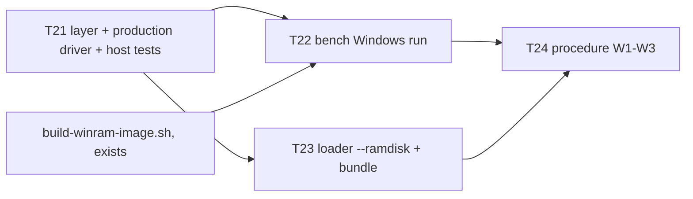

# PLAN: steps for T21-T24 (watari-winram)

- Project: Watari Boot, subsystem "watari-winram" · Date: 2026-11-14 · Version: 0.2 (reviewed, renumbered to `ralph/TASKS-m3a.md` Part 5) · Status: draft
- Linked documents: [README](README.md) · [DESIGN](DESIGN.md) ("D n") · [RISKS](RISKS.md) · [draft ADR](../../adr/draft-winram.md)

## Numbering

The steps map one to one onto `ralph/TASKS-m3a.md` Part 5; they are **not** a renumbered plan:

| Task | Content here |
|---|---|
| **T21** | layer: `wel2.ramdisk=`, guest FDT node, carve from `/memory`; the production `WatariM1RamDiskDxe` driver in `WatariM1Pkg`; host tests (and the regression: the regular firmware still reaches the Windows desktop) |
| **T22** | bench Windows run from the RAM disk under the layer, QEMU TCG, M1-shaped FDT; image from the existing `tools/m3a/build-winram-image.sh`; run matrix (GOP, memory type, cores) |
| **T23** | loader `watari-load.py --ramdisk` (slices, trailer, block check, rate test) and the bundle |
| **T24** | procedure: hardware rungs W1-W3 after the D3 gate |

The image builder is **not** a task of this plan: `tools/m3a/build-winram-image.sh` already exists (GPT default, `--mbr`, `--superfloppy`, `--verify-only`, sidecar `.sha256` and `.manifest.txt`) [verified: R:tools/m3a/README.md on branch `ralph/m3a-night5-work`]. T22 uses it; a change to it, if T22 needs one, is a small commit inside T22. (An earlier draft of this plan had its own `make-winram-image.sh` and a different task split; superseded.)

## Rules for every step

- **No download, no installation, no new package.** `hdiutil`, `python3` (standard library), the existing Homebrew LLVM, QEMU and EDK2 tree are enough. The ISO is read through a read-only mount and its **file names and sizes** are what the tools look at; no Microsoft binary is opened, hashed for analysis, disassembled or copied into the repository; the BCD is not read (F-01, ADR-0005).
- The image, its sidecar and every PNG of a Windows screen live on the data disk (`$WATARI_DATA/winram/`), **never** in the repository; the builder refuses an output inside the working tree; the ignore file gets `*.img` and `winram/`.
- Backup rule: building the image and the bench runs write only to the data disk and `/tmp`; the **hardware day** (T24) needs Marco's backup confirmation first (CLAUDE.md).
- QEMU: TCG; the image is RAM, so F-31's disk guard is moot, but `-no-reboot` and one QEMU at a time stay.
- One small commit per step; `make -C el2 test`, `el2/boot/run-all.sh` (both configurations), `make -C tools/acpigen test`, and the loader/gfdt/ehw2 tests stay green after each.
- Every claim in results: **[verified: ...]** or **[hypothesis]**; failures are reported with the output.
- **Approval:** the work proceeds on the ralph branch as a **draft** ADR; no task waits for Marco. He reviews the layer and driver decisions (ADR decisions 3 and 4) in the PR; his approval stays an open question (ADR, open question 1), and a change he asks for is made on the branch afterwards.

## Dependencies

The loader parts of T23 that need no layer (slices, trailer, rate test, sidecar check) can be written in parallel with T21; `gfdt_dump --ramdisk` needs T21a's builder.

## T21: layer FDT RAM disk, production driver, host tests

### T21a. The layer: `wel2.ramdisk=`, the FDT node, the carve

| Item | Detail |
|---|---|
| Files | `el2/include/wel2_maps.h` + `el2/vgic/maps.c`: `int wel2_ranges_carve(const struct wel2_range *in, unsigned n, uint64_t base, uint64_t size, struct wel2_range *out, unsigned max, unsigned *n_out)`; `el2/include/wel2_fdt_build.h` + `el2/vgic/fdt_build.c`: `struct wel2_gfdt_in` gains `uint64_t ramdisk_base, ramdisk_size` and the node of DESIGN 3.2; `el2/boot/main.c`: parse `wel2.ramdisk=0x<base>,0x<size>`, the validations of DESIGN 3.1, the carve before `wel2_gfdt_place`, `put_kv` lines (`Watari EL2: ramdisk at ...`), checkpoint text; `el2/boot/README.md` |
| Unit tests | `el2/tests/test_maps_carve.c` (or in `test_pt.c`): carve at the start / middle / end / whole range / outside / overlapping two ranges / too many pieces; `test_fdt_build.c`: the node present with `compatible`, `reg`, `no-map`, absent without a ramdisk (byte-identical FDT when the new fields are zero), the forbidden-property list unchanged, size bound; placement after a carve (a first piece below 128 MB refused, a piece above fine) |
| Bench test | `el2/boot/run-winram-fdt.sh` (or a case in `run-m1-8.sh`): QEMU TCG, `-m 6G`, the existing EDK2 bench firmware, a 32 MiB dummy block above the EDK2 image, `wel2.ramdisk=`: the layer's log shows the carve; the guest FDT dumped with `pmemsave` + `dtc -I dtb` has the node and `/memory` nodes without the range; a misaligned or overlapping range gives a `FATAL` line and no jump |
| Acceptance | `make -C el2 test` ALL PASSED; `run-all.sh` in both configurations all PASS |

### T21b. The production driver `WatariM1RamDiskDxe`

| Item | Detail |
|---|---|
| Files | `edk2-apple/WatariM1Pkg/Drivers/WatariM1RamDiskDxe/{WatariM1RamDiskDxe.c,.inf}` (BSD-2-Clause-Patent, SPDX header); `WatariM1Pkg.dsc` / `.fdf`: in the production and bench builds (after `RamDiskDxe`); `WatariM1Pkg.dec`: `PcdWatariRamDiskType` (default `EfiReservedMemoryType` since T22, `EfiBootServicesData` fails with 0x1A on the bench); the bench driver `WatariM1BenchRamDiskDxe` and its PCDs retired, `tools/build-edk2-m1.sh` check 2 adjusted (the new driver is allowed everywhere; it does nothing without the node) |
| Function | DESIGN 4.1 steps 1-5 (GCD add, `SetMemorySpaceAttributes`, `Cpu->SetMemoryAttributes`, `AllocatePages(AllocateAddress)`, trailer + CRC, `Register`), one `DEBUG` line per step (visible on the ticker); any failure leaves the platform as if there were no node |
| Tests | build checks (module list, header, no forbidden library); `el2/boot/run-t16a.sh` migrated to the new path (`wel2.ramdisk=` instead of the fixed `0xB0000000`): its four cases still PASS; new cases `crcbad` (one flipped byte after the trailer was made: **no** registration, the self-test runs) and `notrailer`; the UEFI `CalculateCrc32` result is compared with Python's `zlib.crc32` on the same bytes (settles the polynomial **[hypothesis]** of T23) |
| Regression | the regular firmware under QEMU (`snapshot=on`, the usual Windows test) still reaches the desktop: the driver is inert without the node |
| Acceptance | production and `--bench` builds pass their checks; `run-t16a.sh` PASS in all cases; `run-all.sh` unchanged |

## T22: Windows from the RAM disk on the M1-shaped bench

### T22a. The run script and the PNG tool: `el2/boot/run-winram.sh`, `tools/m3a/fb-png.py`

| Item | Detail |
|---|---|
| Image | `tools/m3a/build-winram-image.sh` on the real ISO under `$WATARI_DATA` (no download): `winram.img` + `.sha256` + `.manifest.txt`; the attached image lists `efi/boot/bootaa64.efi`, `efi/microsoft/boot/bcd`, `boot/boot.sdi`, `sources/boot.wim` with the ISO's sizes (names and sizes only); `--superfloppy` and `--mbr` variants are built for run R6 |
| `run-winram.sh` | QEMU TCG, `-m 8G -smp 4 -nographic -no-reboot`, no disk, `-device loader,file=winram.img,addr=<32 MB aligned address above the EDK2 image, below RAM top>,force-raw=on` plus the trailer loaded right after (the loader's `build_trailer` once T23 has it, a small standalone script until then); the BGR8 production-shaped M1 firmware; the M1-shaped FDT (`wel2.abi=fdt`, no virtio, no PCI); layer arguments `wel2.guest=... wel2.abi=fdt wel2.gfdt=build wel2.ramdisk=... wel2.fakefb=2560x1600` (or `fakefb8`) `wel2.fb=guest`; env `GOP=mask|bgr8|native8`, `CPUIF=hw|trap|trap-notc`; the QEMU monitor socket as in `run-fb.sh`: `pmemsave` of the fake panel at intervals; stops on a timeout (default 25 min) or a success marker |
| `fb-png.py` | standard library only (`zlib`, `struct`): reads a `pmemsave` dump + width/height/stride/format (x2r10g10b10 or x8r8g8b8, with the panel's channel order), writes a PNG; `--selftest` makes colour bars and re-reads them |
| Tests | `fb-png.py --selftest`; `run-winram.sh` with a **stand-in** image (T16a's stand-in app, no Microsoft file): PASS = `T16A BOOTED from \EFI\BOOT\BOOTAA64.EFI`, so the plumbing (image in RAM, trailer, carve, driver, GPT/FAT mount) is proven before the real files are involved |

### T22b. The run matrix (Windows decisions without hardware)

Each run's console log, a PNG every 30 s, the final PNG and a one-line verdict go to `$WATARI_DATA/winram/runs/<tag>/`; results are written to `re/m3b-winram-bench.md` (text and transcribed verdicts only; PNGs stay out of the repository unless Marco asks).

| Run | Variable | Question settled |
|---|---|---|
| R1 | GOP `native8` (`fakefb8`, BGR8 truthful), `trap` | does WinPE boot from the RAM disk at all; **R-W1, R-W2**; how far (stages S1..S5); time to the Setup screen |
| R2 | GOP `mask` (truthful `PixelBitMask`, 10-bit fake panel) | **Q-E1 / Q-W5**: what bootmgr and BasicDisplay do with the mask |
| R3 | GOP `bgr8` (reports BGR8, 10-bit buffer) | the colours and legibility (PNG) |
| R4 | `PcdWatariRamDiskType = Reserved` | the NFIT and the NVDIMM-root-device SSDT appear; does Windows care; memory seen by WinPE |
| R5 | `trap-notc`, `-smp 8` | multi-core behaviour as the M1 will see it; PSCI `CPU_ON` x 7 |
| R6 | bootmgr variants if R1 failed at S1/S2: the `--superfloppy` and `--mbr` images, C-1 (parent device path), a BCD authored in the bench VM with `boot.sdi` also in `\sources\` | a working construct; if none: **stop and report to Marco** (no hardware day) |
| R7 | (optional) DSDT without the processor devices | closes the E13 "not tested" row |

Acceptance of T22: the furthest stage reached is recorded with evidence (ideally Windows Setup's first screen, S5); every run has a verdict in `re/m3b-winram-bench.md`; the GOP decision table of DESIGN 6 is filled in; R-W1, R-W2 and Q-W6 change from hypothesis to verified or failed; failures get an F-NN entry; fixes needed on our side (ACPI, GOP, memory map, timer) are made and the run repeated. An independent reviewer re-runs R1 from the document alone (the stage reached is compared, not pixels).

## T23: loader and bundle for the Windows rung

### T23a. `watari-load.py --ramdisk` (tests need no device)

| Item | Detail |
|---|---|
| New options | `--ramdisk <winram.img>` (with `--edk2`; rungs D0/D2), `--ramdisk-test <MiB>` (the rate test: allocate a block, write N MiB in slices, read it back, compare, print MB/s each way; no layer, no jump), `--ramdisk-slice <MiB>` (default 16), `--no-data-csums` (try `DISABLE_DATA_CSUMS`) |
| Functions | `build_trailer(image) -> bytes` (magic, size, CRC-32 over the image with `zlib.crc32`, SHA-256) **[hypothesis: the UEFI `CalculateCrc32` polynomial is the standard CRC-32; checked in T21b's test]**; `write_sliced(target, addr, data, slice, progress)`; the sidecar `winram.img.sha256` checked **before any proxy call**; `check_blocks` extended to take `(base, size)` and check the whole range; boot arguments `wel2.ramdisk=0x..,0x..` appended only after the allocation (the existing ordering test); the ramdisk block allocated **first**; refusal of an image above 896 MiB (DESIGN 2.3) |
| Preview | D0 prints the ramdisk range, its position relative to the layer and EDK2 blocks, and calls `gfdt_dump --ramdisk <base>,<size>` (T21a's builder), failing on a placement the layer would refuse; D0 reads back a sample (first and last 4 KiB) of the written block |
| Tests | `test_watari_load.py` extended with the fake target: call order (ramdisk first, slices, trailer last, cache maintenance over the whole range, **then** `set_chosen`), a slice that raises a checksum error is retried once then aborts, a sidecar mismatch refuses, `--ramdisk-test` makes no `kboot_*` call and no write outside its block, `wel2.ramdisk=` in the dry-run line; `test_gfdt_dump.py` for `--ramdisk` |
| Acceptance | all loader tests ALL PASSED; `watari-load.py --rung D2 --edk2 ... --ramdisk <image> --dry-run` against the **real image** prints the expected arguments; the heap use is asserted at most 1 GiB |

### T23b. The bundle

`tools/m3a/build-m1-payload.sh`: the firmware (the GOP build T22 chose) and the loader; **the image is not in the bundle** (SHA256SUMS covers the bundle; the image of about 700 MiB is copied separately with its sidecar; the loader checks the sidecar). Acceptance: the bundle builds, its checksums verify, the dry run of T23a runs from the bundle.

## T24: procedure, hardware rungs W1-W3 after the D3 gate

`docs/procedures/m3a-day4-hardware.md` (or an appendix to the day-3 file), in the style of day 3 (instructions for Claude on Ciani's Mac; Marco's backup first; zero footprint; photo protocol; every unverified step `[check]`):

| Rung | Content |
|---|---|
| **W1** | the rate test first (`--ramdisk-test 64`, with and without `--no-data-csums`; continue/stop limit decided with Marco from DESIGN 2.3's table), then the D0-style preview with `--ramdisk` (whole-range block check, the placement, the read-back sample), then the D2-style jump with `--fb band`: EDK2 `RamDisk` lines on the ticker, bootmgr's first screen (stages S1-S2) |
| **W2** | bootmgr loads `boot.wim`, `winload`, kernel and HAL start (S3-S4); the stop-code table from T22's bench results |
| **W3** | session manager, WinPE, the first Setup screen (S5) |

Also: the expected screens from the T22 bench run, the photo protocol, abort criteria (no change on screen for N minutes, the power button), the decision table, the results template `re/m3b-winram-day4.md`. Acceptance: independent review against T20-T23 and the bench logs, as T13 was; every unverified step marked; dry runs with the real image path print the expected lines; day 3's gate (G-1..G-8 for the same commit, rungs D3 and D4) is a precondition.

**The hardware day itself** is not a Ralph task: Marco/Ciani run the procedure; Opus reads the photo transcriptions; results to `re/m3b-winram-day4.md`, failures to `docs/FAILURES.md`.

## Summary table

| Task | Delivers | Needs | Gate |
|---|---|---|---|
| T21 | layer arg + FDT node + carve, `WatariM1RamDiskDxe`, host tests | nothing (draft ADR; Marco reviews in the PR) | `make -C el2 test`, `run-all`, `run-t16a`, regular Windows regression |
| T22 | bench Windows run, run matrix, `re/m3b-winram-bench.md`, `fb-png.py` | T21, `build-winram-image.sh`, the ISO on the data disk | furthest stage recorded with evidence |
| T23 | loader `--ramdisk`, rate test, bundle | T21a for `gfdt_dump --ramdisk` | loader tests, dry run on the real image |
| T24 | day-4 procedure, then the hardware day | T22, T23, day-3 D3/D4 pass, Marco's backup | independent review, then people |
