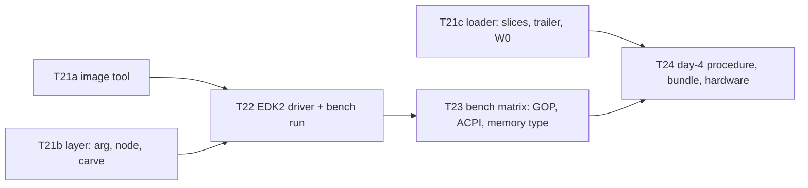

# PLAN: steps for T21-T24 (watari-winram)

- Project: Watari Boot, subsystem "watari-winram" · Date: 2026-11-14 · Version: 0.1 · Status: draft
- Linked documents: [README](README.md) · [DESIGN](DESIGN.md) ("D n") · [RISKS](RISKS.md) · [draft ADR](../../adr/draft-winram.md)

## Rules for every step

- **No download, no installation, no new package.** `hdiutil`, `python3` (standard library), the existing Homebrew LLVM, QEMU and EDK2 tree are enough. The ISO is read through a read-only mount and its **file names and sizes** are what the tools look at; no Microsoft binary is opened, hashed for analysis, disassembled or copied into the repository; the BCD is not read (F-01, ADR-0005).
- The staged files, the image, its sidecar and every PNG of a Windows screen live on the data disk (`$WATARI_DATA/winram/`), **never** in the repository; the image tool refuses an output inside the working tree; `.gitignore` gets `*.img`, `winram/`.
- Backup rule: building the image and the bench runs write only to the data disk and `/tmp`; the **hardware day** (T24) needs Marco's backup confirmation first (CLAUDE.md).
- QEMU: TCG, no Windows disk is attached (the image is RAM), so F-31's disk guard is moot, but `-no-reboot` and one QEMU at a time stay.
- One small commit per step; `make -C el2 test`, `el2/boot/run-all.sh` (both configurations), `make -C tools/acpigen test`, and the loader/gfdt/ehw2 tests stay green after each.
- Every claim in results: **[verified: ...]** or **[hypothesis]**; failures are reported with the output.
- The layer-side changes (boot argument, node, carve) are **blocked until Marco approves the ADR** (they extend the guest FDT builder's scope); T21's image tool and loader slice work may start earlier.

## Dependencies

Suggested order and split of `ralph/TASKS-m3a.md`: **T21** = T21a + T21b + T21c (three small commits sets), **T22**, **T23**, **T24** (the procedure and bundle, then the hardware day itself which is for people).

## T21: image, layer, loader (no EDK2 needed)

### T21a. The image tool: `tools/m3a/make-winram-image.sh`

| Item | Detail |
|---|---|
| Inputs | `--iso <path>` (default `$WATARI_DATA/iso/Windows11_Client_arm64_it-it_26300_9457.iso`), `--out <dir>` (default `$WATARI_DATA/winram`), `--minimal` |
| Steps | `hdiutil attach -readonly -nobrowse -noverify`; copy the DESIGN 1.2 subset into a staging folder with `ditto`/`cp` (explicit file list, **not** a glob of `sources\`); refuse if `boot.wim` or any file is above 4 GiB or a listed file is missing; `hdiutil create -fs "MS-DOS FAT32" -layout GPTSPUD -srcfolder <staging> -format UDTO` sized by DESIGN 1.3; `hdiutil detach` in a trap; remove the staging folder; write `winram.img` and `winram.img.sha256` (and a text `winram.manifest` with names and sizes only) |
| Guards | output inside the git working tree: refuse; ISO attached read-only only; no write to the ISO volume; image above 900 MiB: refuse (DESIGN 2.3) |
| Test | `tools/m3a/test_make_winram_image.py` (Python, no ISO needed): runs the tool's `--selftest` on a **fake ISO tree** (a folder with files of the right names and small sizes, `hdiutil create -srcfolder` makes a fake `.dmg`/`UDTO` to attach read-only): the image has a GPT with one partition, FAT32 (`file`/`diskutil` read-only on the attached image, the sidecar matches, the manifest lists exactly the subset, an `install.wim` in the fake tree is **not** copied, a path inside the repository is refused |
| Acceptance | `make-winram-image.sh` on the real ISO produces `winram.img` (about 704 MiB) and the sidecar; the attached image lists `efi/boot/bootaa64.efi`, `efi/microsoft/boot/bcd`, `boot/boot.sdi`, `sources/boot.wim` with the ISO's sizes (**names and sizes only**, `ls -l`); the image is detached afterwards; `git status` shows nothing new |

### T21b. The layer: `wel2.ramdisk=`, the FDT node, the carve (after the ADR)

| Item | Detail |
|---|---|
| Files | `el2/include/wel2_maps.h` + `el2/vgic/maps.c`: `int wel2_ranges_carve(const struct wel2_range *in, unsigned n, uint64_t base, uint64_t size, struct wel2_range *out, unsigned max, unsigned *n_out)`; `el2/include/wel2_fdt_build.h` + `el2/vgic/fdt_build.c`: `struct wel2_gfdt_in` gains `uint64_t ramdisk_base, ramdisk_size` and the node of DESIGN 3.2; `el2/boot/main.c`: parse `wel2.ramdisk=0x<base>,0x<size>`, validations of DESIGN 3.1, carve before `wel2_gfdt_place`, `put_kv` lines (`Watari EL2: ramdisk at ...`), checkpoint text; `el2/boot/README.md` |
| Unit tests | `el2/tests/test_maps_carve.c` (or in `test_pt.c`): carve at the start / middle / end / whole range / outside / overlapping two ranges / too many pieces; `test_fdt_build.c`: the node present with `compatible`, `reg`, `no-map`, none without a ramdisk, the forbidden-property list unchanged, size bound; `test_guest_place.c` or `test_fdt_build.c`: placement of the image's range after a carve (piece below 128 MB refused; piece above fine) |
| Bench test | `el2/boot/run-winram-fdt.sh` (or a case in `run-m1-8.sh`): QEMU TCG, `-m 6G`, the existing EDK2 bench firmware, a 32 MiB dummy block at an address above the EDK2 image, `wel2.ramdisk=`: the layer's log shows the carve, the guest FDT dumped with `pmemsave` + `dtc -I dtb` (as run-m1-8 does) has the node and the `/memory` nodes without the range; `wel2.ramdisk=` with a misaligned/overlapping range: `FATAL` line and no jump |
| Acceptance | `make -C el2 test` ALL PASSED; `run-all.sh` in both configurations all PASS (default = no ramdisk = byte-identical FDT: asserted by a test comparing the FDT with and without the new fields zero); the new run script PASS |

### T21c. The loader: `watari-load.py` (tests need no device)

| Item | Detail |
|---|---|
| New options | `--ramdisk <winram.img>` (with `--edk2`; rungs D0/D2), `--ramdisk-test <MiB>` (rung **W0**: allocate a block, write N MiB in slices, read it back, compare, print MB/s each way; no layer, no jump), `--ramdisk-slice <MiB>` (default 16), `--no-data-csums` (try `DISABLE_DATA_CSUMS`) |
| Functions | `build_trailer(image) -> bytes` (magic, size, CRC-32 over the image with `zlib.crc32` **[the UEFI CalculateCrc32 polynomial is the standard CRC-32: verified in the T21 unit test against `binascii.crc32` and in T22 against the EDK2 result]**, SHA-256); `write_sliced(target, addr, data, slice, progress)`; `check_blocks` extended to take `(base, size)` and check the whole range; bootargs `wel2.ramdisk=0x..,0x..` appended only after the allocation (the existing ordering test); the ramdisk block allocated **first** |
| Preview | D0 prints the ramdisk range, its position relative to the layer and EDK2 blocks, and calls `gfdt_dump --ramdisk <base>,<size>` (T21b's builder), failing on a placement the layer would refuse; D0 reads back a sample (first and last 4 KiB) of the written block |
| Tests | `test_watari_load.py` extended with the fake target: call order (allocate ramdisk first, write slices, trailer last, cache maintenance over the whole range, **then** `set_chosen`), a slice that raises a checksum error is retried once and then aborts, a sidecar mismatch refuses, `--ramdisk-test` makes no `kboot_*` call and no write outside its block, `wel2.ramdisk=` in the dry-run line; `test_gfdt_dump.py` for `--ramdisk` |
| Acceptance | all loader tests ALL PASSED; `python3 watari-load.py --rung D2 --edk2 ... --ramdisk <fake image> --dry-run` prints the expected arguments; `ProxyUtils` heap use stays under 900 MiB (asserted) |

## T22: EDK2 driver and the bench WinPE run

### T22a. `WatariM1RamDiskDxe`

| Item | Detail |
|---|---|
| Files | `edk2-apple/WatariM1Pkg/Drivers/WatariM1RamDiskDxe/{WatariM1RamDiskDxe.c,.inf}` (BSD-2-Clause-Patent, SPDX header); `WatariM1Pkg.dsc` / `.fdf`: in the production and bench builds (after `RamDiskDxe`); `WatariM1Pkg.dec`: `PcdWatariRamDiskType` (default `EfiBootServicesData`, `EfiReservedMemoryType` allowed); the bench driver `WatariM1BenchRamDiskDxe` and its PCDs retired, `tools/build-edk2-m1.sh` check 2 adjusted (the new driver is allowed everywhere; it does nothing without the node) |
| Function | DESIGN 4.1 steps 1-5, with a log line per step through `DEBUG` (visible on the ticker); any failure leaves the platform as if there were no node |
| Tests | build checks (module list, header, no forbidden library); `el2/boot/run-t16a.sh` migrated to the new path (`wel2.ramdisk=` instead of the fixed `0xB0000000`): the four cases still PASS; new case `crcbad` (one flipped byte in the image after the trailer was made: **no** registration, self-test runs) and `notrailer` |
| Acceptance | production, `--bench` builds pass their checks; `run-t16a.sh` PASS in all cases; `run-all.sh` unchanged |

### T22b. The bench WinPE run: `el2/boot/run-winram.sh` and `tools/m3a/fb-png.py`

| Item | Detail |
|---|---|
| `run-winram.sh` | QEMU TCG, `-m 8G -smp 4 -nographic -no-reboot`, no disk, `-device loader,file=$WATARI_DATA/winram/winram.img,addr=<32 MB aligned address above the EDK2 image, below RAM top>,force-raw=on` plus the trailer file loaded after it (`winram.trailer` made by the image tool's `--trailer-only`, or by the loader's `build_trailer`), the production-shaped M1 bench firmware (`tools/build-edk2-m1.sh --bench`: acpigen model `qemu-virt`, the same processors-only DSDT), layer arguments `wel2.guest=... wel2.abi=fdt wel2.gfdt=build wel2.ramdisk=... wel2.fakefb=2560x1600` (or `fakefb8`) `wel2.fb=guest`; env `GOP=mask|bgr8|native8` and `CPUIF=hw|trap|trap-notc`; the QEMU monitor socket as in `run-fb.sh`: at intervals `pmemsave` of the fake panel; stops on a timeout (default 25 min) or a success marker |
| `fb-png.py` | standard library only (`zlib`, `struct`): reads a `pmemsave` dump + width/height/stride/format (x2r10g10b10 or x8r8g8b8, with the **panel's** channel order), writes a PNG; used for the screenshots; a self-test makes colour bars and re-reads them |
| Tests | `fb-png.py --selftest`; `run-winram.sh` with a **stand-in** image (T16a's stand-in app, no Microsoft file): PASS = `T16A BOOTED from \EFI\BOOT\BOOTAA64.EFI`, so the plumbing (loader of the image, trailer, carve, driver, GPT/FAT32 mount) is proven before the real Windows files are involved |
| Acceptance | stand-in run PASS in `hw` and `trap`; **then** the real image: the run reaches **W1** (bootmgr's first screen) or reports the first failing stage with a PNG and the console text |

## T23: the bench matrix (Windows decisions without hardware)

Runs of `run-winram.sh` with the real image; each run's console log, a PNG every 30 s, the final PNG and a one-line verdict are stored in `$WATARI_DATA/winram/runs/<tag>/`; the result is written to `re/m3b-winram-bench.md` (text and transcribed verdicts only; PNGs stay out of the repository unless Marco asks).

| Run | Variable | Question settled |
|---|---|---|
| R1 | GOP `native8` (`fakefb8`, BGR8 truthful), `trap` | does WinPE boot from the RAM disk at all; **R-W1, R-W2**; how far (W1..W5); time to the Setup screen |
| R2 | GOP `mask` (truthful `PixelBitMask`, 10-bit fake panel) | **Q-E1/Q-W5**: what bootmgr and BasicDisplay do with the mask |
| R3 | GOP `bgr8` (reports BGR8, 10-bit buffer) | the colours and legibility (PNG) |
| R4 | `PcdWatariRamDiskType = Reserved` | the NFIT appears; does Windows care; memory seen by WinPE |
| R5 | `trap-notc`, `-smp 8` | multi-core behaviour as the M1 will see it; PSCI `CPU_ON` x 7 |
| R6 | bootmgr option variants if R1 failed at W1/W2: C-1 (parent device path), BCD authored in the bench VM | a working construct; if none: **stop and report to Marco** (no hardware day) |
| R7 | (optional) DSDT without the processor devices | closes the E13 "not tested" row |

Acceptance of T23: every run has a verdict in `re/m3b-winram-bench.md`, the decision table of DESIGN 6 is filled in (GOP for hardware), R-W1/R-W2/Q-W6 changed from hypothesis to verified or failed; an independent reviewer re-runs R1 from the document alone (the run is deterministic enough to compare the final PNG's stage, not pixels).

## T24: day-4 procedure and bundle, then the hardware day

### T24a. `docs/procedures/m3a-day4-hardware.md` and the bundle

| Item | Detail |
|---|---|
| Procedure | in the style of day 3 (instructions for Claude on Ciani's Mac; Marco's backup first; zero footprint; photo protocol; every unverified step `[check]`): **W0** the rate test (first, `--ramdisk-test 64`, with and without `--no-data-csums`, decide the continue/stop limit with Marco from DESIGN 2.3's table), **W1** D0-style preview with `--ramdisk` (block check of the whole range, the placement, the read-back sample), **W2** D2 jump with `--fb band`: EDK2 lines about the RAM disk on the ticker, then bootmgr's first screen, **W3-W5** as DESIGN 5 with the stage-by-stage photo guide (what each screen means, stop codes table from T23's bench results), abort criteria (no change on screen for N minutes, the power button), decision table, results template `re/m3b-winram-day4.md` |
| Bundle | `tools/m3a/build-m1-payload.sh`: the firmware (the GOP build chosen in T23) and loader; **the image is not in the bundle** (SHA256SUMS covers the bundle, the 704 MiB image is copied separately with its sidecar; the loader checks the sidecar) |
| Review | independent agent against the code and the T23 logs, as T13 was; every unverified step marked |
| Acceptance | reviewed, fixes applied; dry runs with the real image path (no device) print the expected lines; the day-3 gate (G-1..G-8 for the same commit) is a precondition |

### T24b. The hardware day (people)

Not a Ralph task: Marco/Ciani run the procedure; Opus reads the photo transcriptions; results to `re/m3b-winram-day4.md`, failures to `docs/FAILURES.md`. Precondition: day 3 passed D3 and D4 (EDK2 to the self-test, `trap-notc --smp`).

## Summary table

| Task | Delivers | Needs | Gate |
|---|---|---|---|
| T21a | image tool + test | ISO on the data disk | none |
| T21b | layer arg, FDT node, carve | ADR approved | tests + run-all |
| T21c | loader slices, trailer, W0, preview | T21b for `gfdt_dump --ramdisk` | loader tests |
| T22 | RAM-disk DXE driver, bench run, PNG tool | T21a, T21b | stand-in run PASS |
| T23 | bench matrix, `re/m3b-winram-bench.md` | T22, real image | verdicts per run |
| T24 | day-4 procedure, bundle, hardware day | T23, day-3 D3/D4 pass, Marco's backup | review, then people |
