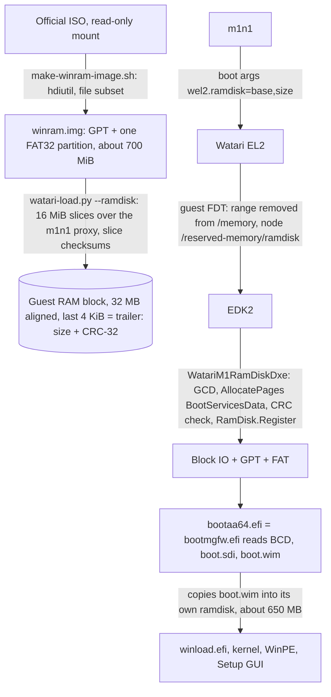

# watari-winram: Windows from a RAM disk on the M1

- Project: Watari Boot, subsystem "watari-winram" (Ralph task T20, Part 5) · Date: 2026-11-14 · Version: 0.1 · Status: **draft, not yet reviewed by an independent agent**
- Scope: how a Windows ARM64 boot image (WinPE / Windows Setup, from the official ISO) reaches the M1's RAM, how the layer and EDK2 expose it as a disk, how far Windows can get with no storage driver, and the step list T21-T24.
- Out of scope: installing Windows to a disk (needs storage, T14), USB input (T15), a persistent Windows, Secure Boot. The image never enters the repository (ADR-0005; it is Microsoft's data, kept on the data disk).

## Files

| File | Content |
|---|---|
| [DESIGN.md](DESIGN.md) | image layout and size, transfer, how the layer describes the image, how EDK2 exposes it and which memory type, Windows' boot chain, GOP, ACPI, what Windows needs from the layer, how far it can get |
| [RISKS.md](RISKS.md) | risks R-W1..R-W16 and open questions Q-W1..Q-W10 |
| [PLAN.md](PLAN.md) | steps for T21-T24 (files, functions, tests, acceptance) |
| [draft ADR](../../adr/draft-winram.md) | the decisions that need Marco |

Parents: [watari-edk2-m1](../watari-edk2-m1/README.md) (EDK2 on the layer, "E-10": the first Windows attempt is a RAM-disk boot), [`re/m3b-usb-display-windows.md`](../../../re/m3b-usb-display-windows.md) (GOP and USB), [`docs/procedures/m3a-day3-hardware.md`](../../procedures/m3a-day3-hardware.md) (the ladder this extends).

## The design in one page

## Decisions (evidence in DESIGN, approval in the ADR)

| ID | Decision | DESIGN |
|---|---|---|
| W-1 | **Image = a GPT disk with one FAT32 partition** holding a subset of the ISO: `efi\boot\bootaa64.efi`, `efi\microsoft\boot\{bcd,fonts,resources,...}`, `boot\boot.sdi`, `sources\boot.wim`; **no `install.wim`** (7.5 GB, above FAT32's 4 GB file limit anyway). Payload about 678 MB, image about 704 MiB. Built on the Mac by a script from a read-only mount of the ISO, never committed | 1 |
| W-2 | **Transfer: the loader's fourth block** over the m1n1 proxy in 16 MiB slices (each with m1n1's own checksum), then a CRC-32 trailer checked by EDK2. Time is **[hypothesis] 2-10 minutes**, measured first by a rate rung (W0) before anything else | 2 |
| W-3 | **The layer names the image with a boot argument `wel2.ramdisk=0x<base>,0x<size>` and a standard `/reserved-memory/ramdisk@<base>` node** (`compatible = "watari,ramdisk"`, `no-map`) in the guest FDT; the range is **removed from every `/memory` node**. Stage 2 keeps it as ordinary guest RAM | 3 |
| W-4 | **EDK2 `WatariM1RamDiskDxe`** (FDT driven, production-safe, does nothing without the node) claims the range as **`EfiBootServicesData`** (not Reserved: that makes `RamDiskDxe` publish an NFIT table, not Persistent), checks the CRC, registers a **volatile virtual disk** with `EFI_RAM_DISK_PROTOCOL` | 4 |
| W-5 | **GOP for Windows: the `--bgr8` build first** (8-bit BGR reported on the 10-bit panel: wrong colours, readable); the truthful `PixelBitMask` mode is tested on the **QEMU bench first** (Windows' behaviour does not depend on the panel), which settles Q-E1 without hardware | 6 |
| W-6 | **ACPI: unchanged** (acpigen `j293` MADT/GTDT/FADT/PPTT + the eight-processor DSDT; no DBG2/SPCR/NFIT/PCI). WinPE from RAM needs no device; the bench test (T23) is the first Windows boot with no PCI host bridge | 7 |
| W-7 | **Bench first.** WinPE from the RAM disk runs under the layer in QEMU TCG with the M1 firmware and the fake framebuffer (T22/T23) before a hardware day; the hardware day (T24) only repeats what the bench passed | 9 |

## Findings the task text did not expect

1. **The memory type decides whether an ACPI table appears.** EDK2's `RamDiskDxe` publishes an NFIT (NVDIMM table) for every RAM disk that lies in `EfiReservedMemoryType`, as soon as the ACPI table protocols exist [verified: E:MdeModulePkg/Universal/Disk/RamDiskDxe/RamDiskProtocol.c: the Reserved test in `RamDiskPublishNfit` lines 192-203, the call at the end of `RamDiskRegister` lines 188-190]. The M1 firmware has both protocols. A Reserved range would hand Windows an NFIT it has no reason to see; `EfiBootServicesData` avoids it and gives the memory back to Windows at `ExitBootServices`.
2. **Windows copies the image anyway.** In a RAM-disk boot the boot manager reads `boot.sdi` and `boot.wim` through the firmware's file system and builds its **own** RAM disk from them [verified: Microsoft Learn, WinPE walkthrough, `ramdisk=[...]\sources\boot.wim`; iPXE wimboot architecture note: "mounts the blank template SDI ramdisk and appends the WIM image"]. Our RAM disk is only the "boot medium"; peak use is about **2 x 650 MB**, and the first copy is reclaimable.
3. **Only one stack of the T11 design must change on the layer side** (a boot argument, an FDT node, a range cut), nothing in the vGIC, timer, PSCI or stage-2 attributes.
4. **The riskiest EDK2/Windows question (Q-E1, the 10-bit GOP) can be answered on the bench**, because the fake framebuffer of E9 exists in both pixel formats.
5. **The m1n1 proxy's `writemem` sends one checksum for the whole buffer** [verified: m1n1 v1.6.1 `proxyclient/m1n1/proxy.py`], so a 700 MB write in one call would fail only at its very end: the loader must slice.

## Status of the evidence

Read on 2026-11-14: the repository, the EDK2 tree on the data disk (`edk2-stable202608`), m1n1 v1.6.1 `proxy.py` and `proxyutils.py` (GitHub raw), Microsoft Learn (WinPE intro, UEFI requirements, the UEFI WinPE walkthrough), the iPXE wimboot architecture page, and the ISO's **file names and sizes** (read-only mount, detached afterwards). No Microsoft binary was opened or analysed; the BCD in the ISO was not read. uefi.org answered 403 to the automated fetch, so UEFI-spec statements are verified against the EDK2 headers and sources that implement them, and marked so. Nothing here was built or run.
