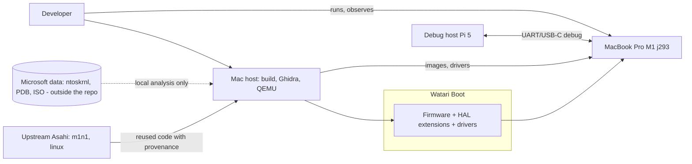
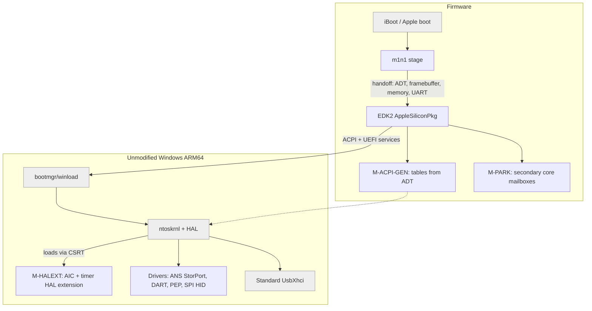
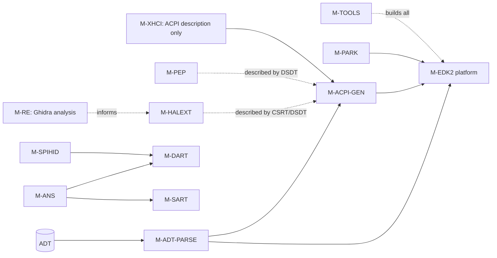
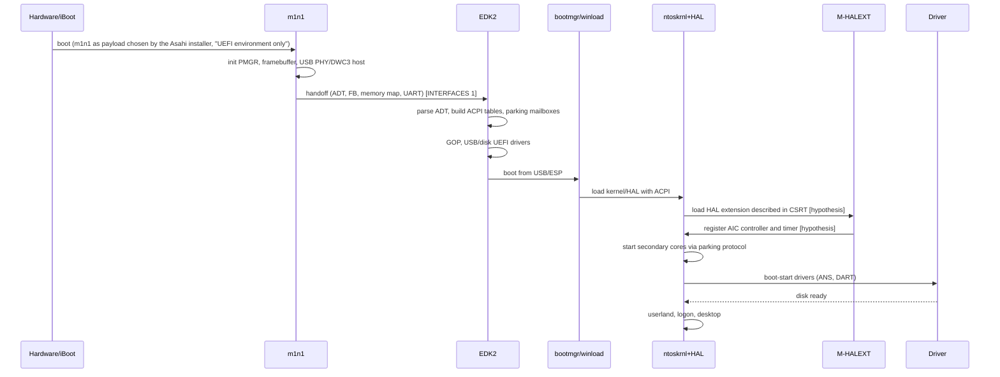
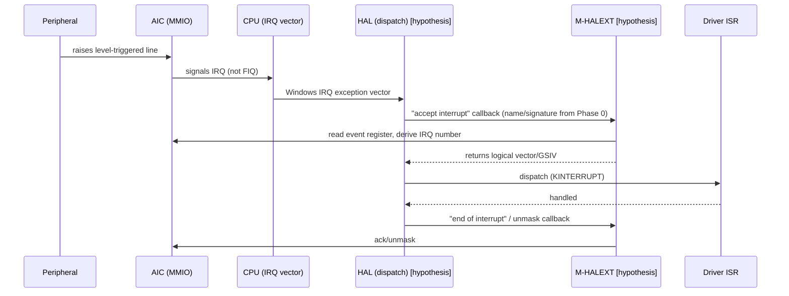

# ARCHITECTURE: Watari Boot

- Project: Watari Boot · Date: 2026-10-12 · Version: 0.1 · Status: draft
- Related documents: [PRD](PRD.md) · [INTERFACES](INTERFACES.md) · [TEST_STRATEGY](TEST_STRATEGY.md) · [RISKS](RISKS.md)
- Marking: `[verified: source]` / `[hypothesis]`. Everything that describes the internal behavior of Windows is `[hypothesis]` until Phase 0 is concluded.

## 1. Baseline facts used
- [verified: https://codebrowser.dev/linux/linux/arch/arm64/kernel/acpi_parking_protocol.c.html] The parking protocol uses a per-CPU mailbox with `cpu_id` (32 bit, expected 0xFFFFFFFF until released), `reserved` and `entry_point` (64 bit); the OS writes the entry point, then cpu_id, then sends a wake-up IPI.
- [verified: Linux source `drivers/irqchip/irq-apple-aic.c`, e.g. https://gbmc.googlesource.com/linux/+/refs/heads/master/drivers/irqchip/irq-apple-aic.c] The AIC has 896 level-triggered hardware IRQs with per-IRQ mask and affinity and two IPIs per CPU; FIQs are used for the ARM timer, Fast IPI (and performance counters) toward hard-wired clients.
- [verified: https://learn.microsoft.com/en-us/windows-hardware/test/hlk/testref/de119483-e85e-4f19-ba05-202a7219b43f] The concept of an HAL Extension DLL exists, tied to an ACPI device through a PNP ID (example ACPI\MSFT_1124) and to the HLK requirement System.Fundamentals.HAL.IfCSRTPresent; the extension is checked to be loaded and serviceable.
- [hypothesis] The CSRT format for HAL extensions, the interface (`HalExtension` exports) and the possibility of registering a non-GIC controller are to be confirmed in Phase 0.
- [hypothesis, from the plan] The M1 has no EL3/PSCI; the SoC is t8103, board j293; the SSD is ANS2, not on PCIe.

## 2. C4 view

### 2.1 Context

### 2.2 Container (system components)

### 2.3 Component (modules and dependencies)

The graph is acyclic: the dashed arrows are description/documentation dependencies, not link dependencies.

## 3. Modules
| Module | Single responsibility | Public interface | Depends on |
|---|---|---|---|
| M-RE | Produce verified knowledge about HAL/ntoskrnl (documents only) | Report in `re/` (INTERFACES, HYPOTHESIS section) | none |
| M-ADT-PARSE | Read the ADT delivered by m1n1 and produce a platform data model | `AdtGet*` (INTERFACES 2) | none |
| M-ACPI-GEN | Generate ACPI tables from the data model | `AcpiGenBuildAll()` | M-ADT-PARSE |
| M-PARK | Initialize the parking protocol mailboxes and the parking code | Mailbox layout (INTERFACES 4) | M-ADT-PARSE |
| M-EDK2 | UEFI platform: memory, GOP, console, bootmgr launch | UEFI + ACPI protocol | M-ADT-PARSE, M-ACPI-GEN, M-PARK |
| M-HALEXT | Provide Windows with the AIC as interrupt controller and the IRQ timer | HAL extension interface (HYPOTHESIS) | nothing at link time (dynamic load) |
| M-ANS | Expose the ANS2 SSD as a StorPort disk | StorPort miniport | M-DART, M-SART |
| M-SART | Program the SSD's SART regions | `SartMapRegion()` | none |
| M-DART | Manage the IOMMU (bypass or mappings) | `DartMap()/DartBypass()` | none |
| M-XHCI | Describe the xHCI controller in ACPI (no Windows code of our own) | DSDT node | M-ACPI-GEN |
| M-PEP | Power management and DVFS (PMGR registers) | PEP callbacks | none |
| M-SPIHID | Keyboard/trackpad over SPI as HID | KMDF HID minidriver | M-DART |
| M-GPU | Future WDDM driver (not defined in detail) | n/a | n/a |
| M-TOOLS | Reproducible build, images, QEMU scripts | CLI in `tools/` | none |

Maintainability note: modules that the plan describes as a combination (e.g. "AIC + timer") remain two distinct internal responsibilities (`aic_controller`, `irq_timer`) in the same binary because Windows loads a single HAL extension per ACPI device [hypothesis]; the separation is at the file and internal-interface level.

## 4. Boot flow from power-on to desktop

Details per phase: Phase 3 goes up to driver loading; Phase 4 enables the internal disk and USB; Phase 5 PEP and internal peripherals.

## 5. Flow of an interrupt AIC -> HAL extension -> ISR
All of Windows' internals are `[hypothesis]`.

Open points: [hypothesis] reading the event may happen in the HAL and not in the extension; Phase 0 determines who does what. [verified: irq-apple-aic.c] the AIC exposes an event register and mask/set/clear registers for IRQs and IPIs.

## 6. Boundaries and contracts
- m1n1 -> EDK2: data only (INTERFACES 1). EDK2 does not call back into m1n1 after the handoff.
- EDK2 -> Windows: standard UEFI + ACPI; no private protocol beyond CSRT/DSDT.
- Windows -> extensions/drivers: only documented WDK interfaces. [hypothesis] If Phase 0 shows that an undocumented interface is needed, the decision goes to the user (ADR-0001, plan B).
- Module -> ADT data model: no module reads the ADT directly except M-ADT-PARSE.

## 7. Explicit extension points
1. New SoC: add a data table in M-ADT-PARSE/M-ACPI-GEN (ADT compatible names -> ACPI blocks); no changes to existing modules. AIC2 adds an `aic_controller` back-end behind the same internal interface (Phase 6).
2. New device: a new DSDT node generated from a `DeviceDescriptor` registry entry + a new driver with its own ACPI HID.
3. New core role (P/E, new classes): PPTT/efficiency class data only.
4. Alternative interrupt source (e.g. MSI/AIC of new generations): new back-end in M-HALEXT.
5. Plan B hypervisor/shim: the M-EDK2 -> Windows interface stays unchanged (ACPI with a virtual GIC); only M-ACPI-GEN changes. [hypothesis] to be evaluated if plan B is activated.

## 8. Traceability
FR-1 M-RE · FR-2 M-ACPI-GEN/M-EDK2 · FR-3 M-PARK · FR-4 M-EDK2 · FR-5/FR-6 M-HALEXT · FR-7 M-EDK2+M-HALEXT+M-XHCI · FR-8 M-ANS/M-SART/M-DART · FR-9 M-XHCI · FR-10 M-DART · FR-11 M-PEP/M-ACPI-GEN · FR-12 M-SPIHID · FR-13 extension points (2) · FR-14 M-GPU · FR-15 M-ACPI-GEN/M-HALEXT · FR-16 installer procedure. NFR-2 M-TOOLS; NFR-3/4 sections 6-7.
